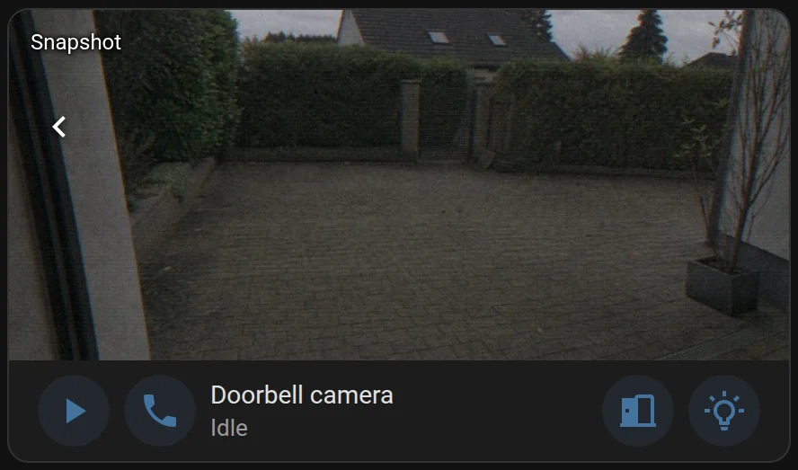
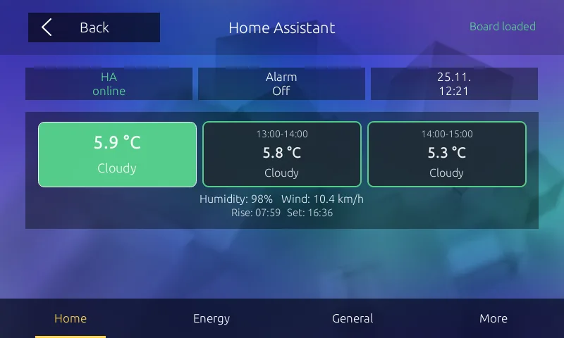
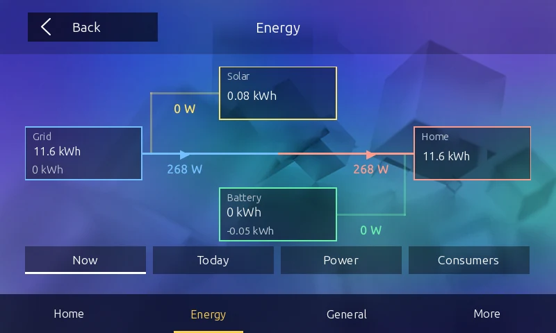
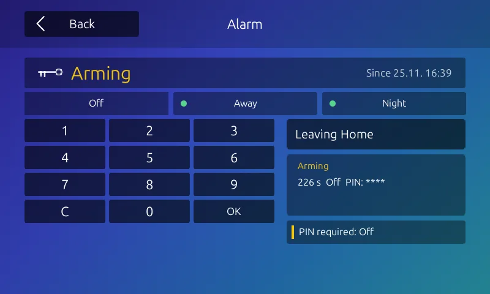
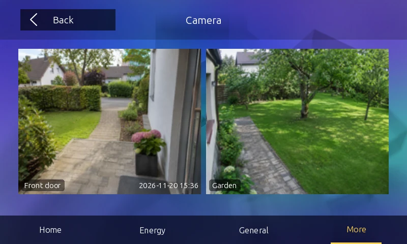

# BTicino Classe 300X for Home Assistant (Unofficial)

Local-first Home Assistant custom integration for the BTicino Classe 300X /
C300X video door station. A small agent on the station connects it to Home
Assistant over your local network.

  

[Quick Start](docs/quickstart.md) | [User guide](docs/user-guide.md) |
[Display pages](docs/display.md) | [Troubleshooting](docs/media-troubleshooting.md)

## Features

- **See and answer the door:** live video, Ring Call, talkback and audio-only
  Home Call in the bundled card ([details](#doorbell-video-ring-calls-and-talkback)).
- **Choose the camera picture:** size, bit rate and frame rate, including an
  optional 960x576 picture for the verified firmware 1.7.19 and 2.0.2 media
  files. **PCMU** gives clearer sound
  ([details](docs/user-guide.md#camera-quality-and-picture-size)).
- **Keep visitor images:** one image per ring or video session, saved in Home
  Assistant and browsable in the card together with recorded clips
  ([details](docs/user-guide.md#visitor-images-and-media-history)).
- **Let the station speak:** its loudspeaker is a media player for `tts.speak`;
  a door call always takes priority.
- **Control the station:** door unlock, stair light, ringer, forwarding,
  answering machine, messages, memos and extra activation buttons.
- **Use the station display:** Home Assistant pages for lights, covers,
  climate, media, locks, weather, energy, calendars and Alarmo in the station's
  blue interface ([Station Display Pages](docs/display.md)).
- **Notify and automate:** notices shown on the station display, spoken, or
  both (not a life-safety alarm), plus [blueprints](docs/user-guide.md#blueprints)
  for notifications, Ring capture and local transcription.
- **Guided recovery:** the **Media readiness** sensor and Repairs explain and
  fix setup problems.

## Requirements

- Home Assistant `2026.10.0` or newer.
- BTicino Classe 300X / C300X firmware `1.7.x`, `2.0.2` or `3.0.6`
  ([what differs on 3.0.6](docs/quickstart.md#firmware-306)).
- Root or SSH access on the station for the first agent installation.
- A trusted local network between Home Assistant and the station.

This project does not root a stock station and ships no firmware, APKs,
exploits, rooting instructions or vendor files
([firmware notes](docs/quickstart.md#requirements)). Use it at your own risk
and without warranty.

## Installation

- **Home Assistant 2026.11 or newer:** open the button above or
  **Settings > Marketplace** and install **BTicino C300X**.
- **Home Assistant 2026.10:** download **BTicino C300X** in HACS (no custom
  repository needed) and restart Home Assistant.

Then add **BTicino C300X** under **Settings > Devices & services** and follow
the [Quick Start](docs/quickstart.md): it installs the device agent, walks
through the options and adds the card. Later releases: [Update](docs/quickstart.md#update).

### Beta Versions

Betas are opt-in: enable **Pre-release** for this repository in Marketplace,
or beta versions in HACS. Stable installations are not switched to a beta
automatically. See [beta versions](docs/quickstart.md#beta-versions).

## Doorbell Video, Ring Calls and Talkback

Use one **C300X Doorbell Call Card** in **Doorstation + Home Call** mode.

| Task | How |
| --- | --- |
| Live video | Press **Stream**. Does not need **Forwarding** on Home Assistant. |
| Ring Call | Set **Forwarding** to **Home Assistant**. When someone rings, the card shows the picture; press **Answer**, later **Hang Up**. With **Smartphone**, calls go to the Door Entry app instead. |
| Home Call | Audio-only call from Home Assistant to the station display. |
| Talkback | Speak through the browser microphone. Needs HTTPS or Home Assistant Cloud and microphone permission. |
| Picture controls | Brightness, contrast and colour saturation during a Ring Call, and for on-demand video once the station reads them back live. Tested on 1.7.19; 2.0.2 and 3.0.6 are checked offline only. On TVP5150 boards (every 3.0.6 station) they may only work during a Ring Call until the station has written the contrast once after a start. Saved media stays unchanged. |

Talking in Home Assistant's own camera view is optional and off by default
(Home Assistant 2026.11+, **Two-way audio** in Labs and the option **Talk
through the Home Assistant camera view**).

If something does not work, check the
[Media readiness](docs/media-troubleshooting.md#media-readiness) sensor first.
Details: [Live picture and talkback](docs/user-guide.md#live-picture-and-talkback).

## Screenshots

<table>
  <tr>
    <td align="center"><strong>Doorbell card</strong> </td>
    <td align="center"><strong>Station display</strong> </td>
  </tr>
</table>
<table>
  <tr>
    <td align="center"><strong>Energy</strong> </td>
    <td align="center"><strong>Alarm (Alarmo)</strong> </td>
    <td align="center"><strong>Camera</strong> </td>
  </tr>
</table>

The card is a capture from Home Assistant; the station pages are renders of
the integration's own display pages with example values on a plain background
of our own, see [legal notes](docs/legal.md#no-firmware-or-apk-payloads).
The card shows an earlier visitor image. Entities and pages depend on the
enabled options.

## Documentation

1. [Quick Start](docs/quickstart.md): install, first tests, updates.
2. [Using the Integration](docs/user-guide.md): daily use and automations.
3. [Station Display Pages](docs/display.md): pages and tiles on the station.
4. [Reference](docs/feature-reference.md): options, entities, services, events.
5. [Troubleshooting](docs/media-troubleshooting.md): when something fails.
6. [Maintenance and Removal](docs/advanced-maintenance.md): agent, tokens,
   recovery, removal.

Also: [Security](SECURITY.md), [Privacy](PRIVACY.md), [Support](SUPPORT.md),
[Legal notes](docs/legal.md), [Changelog](CHANGELOG.md).

For developers: [Architecture](docs/dev/architecture.md),
[Native agent](docs/dev/native-agent.md), [Agent API](native_agent/API.md),
[Quality scale](docs/dev/quality-scale.md),
[Release validation](docs/dev/release-validation.md).

## Status and Legal

- Independent community project, not an official BTicino/Legrand or Home
  Assistant Core integration, and not affiliated with, endorsed, sponsored or
  certified by BTicino, Legrand, Home Assistant, Nabu Casa, HACS or the
  referenced community projects.
- IoT class `local_push`; HACS default repository (`zip_release`). Quality
  scale: per-rule [self-assessment](docs/dev/quality-scale.md), not an awarded
  tier.
- License: Apache-2.0. Developed with AI assistance, including Codex and Claude.
- The repository contains no vendor firmware, extracted firmware, APKs,
  third-party controller source trees, device backups, private captures or
  secrets. See [Legal notes](docs/legal.md).

### Support the Test Device

Every release is tested on one C300X with firmware `1.7.19`; other firmware can
only be checked against its files. A contribution towards a second unit, or a
used or defective Classe 300X / C300X (`344642` or `344643`), is welcome in a
[discussion](https://github.com/memphi2/ha-bticino-c300x/discussions/new?category=general).
It is voluntary; support and features stay open to everyone.

  

