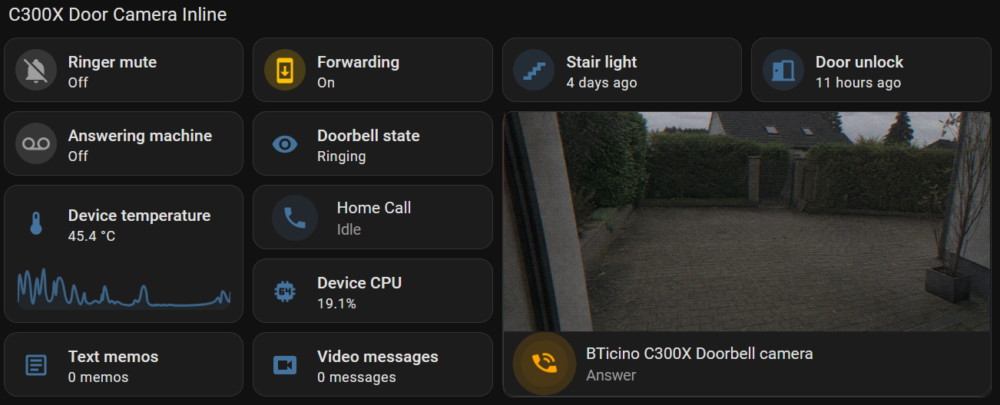

# BTicino Classe 300X for Home Assistant (Unofficial)

[](.github/workflows/validate.yml)
[](docs/quality-scale.md)
[](CHANGELOG.md)
[](https://contributors.home-assistant.io/marketplace/)
[](LICENSE)

Development version: **2.9.0b1 (beta for firmware 3.0.6, unreleased)**. Latest stable release: **2.8.0**.

Local-first Home Assistant custom integration for the BTicino Classe 300X /
C300X video door station.

It brings the C300X into Home Assistant as a local device: doorbell events,
camera view, Ring Call handling, Home Call, door unlock, stair light, ringer and
forwarding controls, messages and optional display pages.

<p align="center">
  
</p>

[Installation](#installation) | [Quickstart](docs/quickstart.md) |
[User guide](docs/user-guide.md) | [Troubleshooting](docs/media-troubleshooting.md)

<p align="center">
  <a href="https://ko-fi.com/oliver7557"></a>
</p>

## What You Get

- **See and answer the door.** Local live video and talkback through the bundled
  card, doorbell events, and Ring Call answer/hang-up when forwarding is set to
  Home Assistant. Audio-only Home Call reaches the C300X display.
- **Get a better camera picture.** Under **Camera quality** the stream can be
  sharper (up to 3000 kbit/s instead of 800), smoother (up to 24 frames per
  second instead of 15) and show the whole camera picture at 704x576 instead
  of the factory cut-out. For clearer sound, set the **Audio codec** to **PCMU**.
- **Let the C300X speak.** The device loudspeaker is a media player: use it
  with `tts.speak` and a local engine such as Piper, or have a notification
  shown on the display, spoken, or both. A door call always takes priority.
- **Control the door station.** Door unlock, stair light, ringer mute,
  forwarding and answering-machine controls, plus stored video messages,
  voice memos and text memos where supported by the agent.
- **Browse saved images and videos.** [Media history](docs/visitor-journal.md)
  is on by default in the doorstation card: previous/next browses HA snapshots
  and saved capture videos chronologically in the same window as live video.
  Live video and incoming rings take priority; browsing never starts, answers
  or stops a device call. Automatic [visitor images](docs/feature-reference.md#visitor-images)
  require **Save images** and need no open dashboard or image files on the C300X.
  Clips require a separate capture automation, such as the bundled Ring capture
  blueprint. History does not include the device's answering-machine recordings.
- **Use the C300X as a home-control display.** Keep the native blue interface
  with configurable controls for lights, covers, climate, media and locks,
  plus weather and Alarmo. Five built-in pages (Status, Energy, Agenda,
  Leave home and Situations) and up to seven custom pages have configurable positions. Energy
  includes live power, history and up to ten consumers configured in HA's
  Energy dashboard, ranked by current W. Agenda shows upcoming calendar events; Leave home checks
  selected contacts and lights, with explicitly confirmed actions. Situations
  lists what is open, on or pending among the entities you pick. Change pages
  with arrows or a favourites bar.
  See [Display setup](docs/quickstart.md#9-optional-native-display).
- **Connect notifications and automations.** The standard
  [Notify service](docs/feature-reference.md#standard-notify-service) offers
  info, warning and error notices with bounded display wake and sound, without
  interrupting protected screens or calls. It is not a life-safety alarm.
  Optional [blueprints](docs/blueprints.md) cover notifications, Ring Capture,
  local transcription and phrase-based decisions.
- **Diagnose and recover connections.** Media readiness diagnostics and guided
  Repairs explain setup problems. Credential checks
  distinguish rejected keys from unreachable devices and guide reauthentication,
  while existing entries can still start offline.

Talkback in the native HA camera view is separate from card talkback: it is
off by default and requires HA 2026.11+ Labs and the integration option.

## Requirements

- Home Assistant `2026.10.0` or newer.
- BTicino Classe 300X / C300X firmware `1.7.x` or `2.0.2`. Firmware `3.0.6` is
  supported experimentally, with the low-resolution camera stream; the Home
  Assistant pages on its display are in a beta, not yet tested on a device.
- Rooted or SSH-enabled C300X for the first device-agent installation.
- A trusted local network between Home Assistant and the C300X.

If your device is still stock, root or SSH-enable it first with a separate
workflow. This repository does not provide firmware images, firmware extraction
output, APKs, exploits, rooting instructions or vendor files. If another
workflow asks for a firmware target, use `1.7.19`; a device on `2.0.2` or
`3.0.6` needs a workflow made for that firmware. Everything is used at your own risk and
without warranty.

## Support the Test Device

Every release is tested on one C300X with firmware `1.7.19`; other firmware
versions can only be checked against their firmware files. A second test unit
would change that. A contribution towards it is welcome, as is a used or defective
Classe 300X / C300X (`344642` or `344643`): please start a
[discussion](https://github.com/memphi2/ha-bticino-c300x/discussions/new?category=general).
Every contribution is voluntary and very welcome. Support and new features
stay open to everyone either way.

## Installation

### Home Assistant Marketplace

[](https://my.home-assistant.io/redirect/marketplace_repository/?owner=memphi2&repository=ha-bticino-c300x&category=integration)

On Home Assistant `2026.11+`:

1. Open the button above, or go to **Settings > Marketplace**.
2. Find **BTicino C300X**, install it and confirm the community-integration notice.
3. Follow any restart request, then add **BTicino C300X** under
   **Settings > Devices & services**.

### HACS

On Home Assistant `2026.10`, find **BTicino C300X** in HACS, download it
and restart Home Assistant. Then add the integration under
**Settings > Devices & services**. No custom repository is needed.

Both installation methods use the same repository and release archive. Existing
configuration entries and bundled cards remain unchanged when moving to Marketplace.

## First Setup

Follow the [Quickstart](docs/quickstart.md) to install or update the device agent,
complete any required Repairs and add the bundled C300X card.

```text
Install integration -> add device -> install/update agent -> check Media readiness
-> add the C300X card
```

Start with live video, Home Call and Ring Call. Add display pages, blueprints and
other optional features once these work. Talkback requires a secure Home Assistant
frontend and browser microphone permission; see [media troubleshooting](docs/media-troubleshooting.md#talkback-or-microphone-does-not-work).

For updates, follow the [update instructions](docs/advanced-maintenance.md#updates).

## Screenshots

Screenshots show one representative setup. Exact entities and display pages
depend on enabled options and installed agent capabilities.

### Door Camera Inline Dashboard

<p align="center">
  
</p>

### C300X Display Pages

Control Home Assistant entities from the C300X's native blue interface.
Pages, tile sizes and names are configurable; controls follow each entity's
capabilities. [Set up pages and tiles](docs/quickstart.md#9-optional-native-display).
The [feature reference](docs/feature-reference.md#display-device-controls) shows
every page.

<table>
  <tr>
    <td align="center"><strong>Pages with the favourites bar</strong><br></td>
    <td align="center"><strong>Picture tiles</strong><br></td>
  </tr>
</table>

Captured on a C300X and translated into English; the camera pictures are example pictures, not real cameras.

## Documentation

| User documentation | Link |
| --- | --- |
| Install and configure | [Quickstart](docs/quickstart.md) |
| Task-focused user guide | [User guide](docs/user-guide.md) |
| Complete feature and entity/service reference | [Feature reference](docs/feature-reference.md) |
| Browse saved HA images and clips in the card | [Media history](docs/visitor-journal.md) |
| Media readiness states and fixes | [Media readiness](docs/media-readiness.md) |
| Answer, Talkback, Home Call or stream problems | [Media troubleshooting](docs/media-troubleshooting.md) |
| Ready-made automations | [Blueprints](docs/blueprints.md) |
| Updates, callbacks, SSH, firewall and display patches | [Advanced maintenance](docs/advanced-maintenance.md) |

| Maintainer documentation | Link |
| --- | --- |
| Architecture and data flow | [Architecture](docs/architecture.md) |
| Native agent runtime and packaging | [Native agent](docs/native-agent.md) |
| Native agent HTTP API contract | [Native Agent API](native_agent/API.md) |
| Device QML display pages | [Device QML UI](device_qml/README.md) |
| Quality scale tracking | [Quality scale](docs/quality-scale.md) |
| Hardware release checks | [Release validation](docs/release-validation.md) |
| Privacy, security, and legal notes | [Privacy](PRIVACY.md), [Security](SECURITY.md), [Legal notes](docs/legal.md) |
| Legal and provenance audit | [Current legal/provenance audit](docs/audits/current-legal-provenance.md) |
| Release history | [Changelog](CHANGELOG.md) |

## Project Status

- IoT class: `local_push`
- HACS: default repository, installed as a custom integration with `zip_release`
- Quality scale: per-rule [self-assessment](docs/quality-scale.md), not an awarded tier
- License: Apache-2.0
- Support scope: community project, not an official BTicino/Legrand or Home
  Assistant Core integration

## AI Assistance

- This project was developed with AI assistance, including Codex and Claude.

## Legal Notes

This repository is an independent community project. It is not affiliated with,
endorsed by, sponsored by, or certified by BTicino, Legrand, Home Assistant,
Nabu Casa, HACS or the referenced community projects.

This repository does not include vendor firmware, extracted firmware, APKs,
third-party controller source trees, local device backups, private captures or
secrets. See [docs/legal.md](docs/legal.md).
