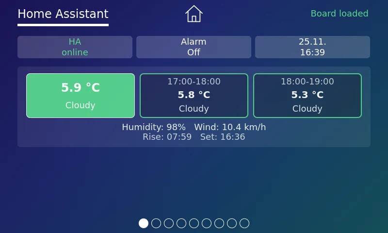
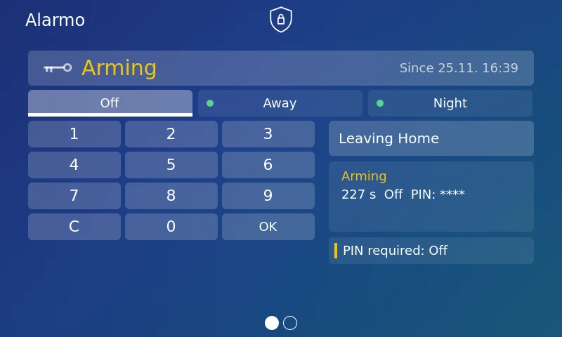

# Classe 100X (C100X 1.5.8)

The integration supports the BTicino Classe 100X on firmware 1.5.8 next to the
Classe 300X. The C100X is **in test** in
[issue #51](https://github.com/memphi2/ha-bticino-c300x/issues/51): its
features are built and checked against the original firmware, but not yet
confirmed on a C100X device. This page holds only what is specific to the
C100X; everything else is in the main documentation:

- what each model offers: [Models and Features](feature-reference.md#models-and-features);
- installation and first tests: [Quick Start](quickstart.md), with the
  [tester guide](c100x-test-release.md) for backup, test plan and rollback;
- display pages: [Classe 100X: Activation by Reboot](display.md#classe-100x-activation-by-reboot);
- problems: [Troubleshooting: Classe 100X](media-troubleshooting.md#classe-100x).

## Before You Start

- **SSH access.** The first installation needs an SSH-enabled C100X with a
  known, working privileged login. This project does not enable SSH on stock
  firmware and gives no rooting steps. The C100X factory login is checked
  against the root password of the original 1.5.8 image only, not on a device;
  a login you enter always takes priority. Home Assistant stores no SSH
  credentials; an installed agent uses its access and maintenance keys.
- **Vendor provisioning.** Add the station in the BTicino Door Entry app first.
  Its SIP users, domain and certificates come only from that registration; the
  integration adds its own media user to them and never creates them.
- **Stock firmware.** Use firmware 1.5.8 with only the changes needed for root
  or SSH access. Running alongside BTicino Companion, another controller, or
  custom SIP, media or display changes is not supported.
- **The package.** One package serves the C300X and the C100X. Keep a copy of
  the one you installed for recovery. A release from before the joint package
  is no substitute: a C100X refuses it.

## What Is Different on the C100X

| Area | On the C100X |
| --- | --- |
| Model detection | The agent detects the C100X from its display program and announces `_bticino-c100x-agent._tcp`; an announcement of one model never matches or moves an entry of the other. |
| Camera | Only the low stream; no **Camera resolution** select and no 960x576. Picture controls use the station's day ranges (brightness 30-220, contrast 80-255, saturation 80-255); at night and on off-grid menu steps the sliders show the nearest 10 % step. |
| Audio | The firmware codec stays Speex/8000: the station's audio runs at 16 kHz, the firmware's PCMU path accepts only 8 kHz, and the audio chip clocks every profile at 16 kHz. The agent therefore refuses a firmware PCMU switch, and Home Assistant offers no **Audio codec** select. HA and the browser still get PCMU through the agent ([audio analysis](dev/c100x-audio-analysis.md)). |
| Speaker and TTS | Not offered. The station's own sound paths have no safe owner or cancellation for a door call, so the agent blocks the C300X playback path on a C100X. |
| Answering machine | Not offered: the vendor library switches it off for this board, so nothing is recorded. The agent refuses the answering-machine, voice-memo and memo-delete requests; HA creates no such entities. |
| Text memos | Not offered: HA creates no memo entities, `write_text_memo` is refused with a translated message, and the display has no memo page. |
| Message LED | Not driven; the agent reports none, and HA refuses Notify `led`. |
| Display | A separate Qt 5 adapter activated by one reboot, confirmed in its first boot and otherwise rolled back; entered through the items **Home Assistant** and **Alarmo** of the station's main menu and operated like the station's own menus (Up/Down, Return, EXIT as the last entry). No Display patch, no home page buttons, no display reload ([details](dev/c100x-display-parity.md#activation-by-reboot)). |
| Ringer mute, touch tone, display notifications | Only after the display activation; notifications without a tone. **Ringer volume** works without it. |

 

More pictures of the display pages:
[Classe 100X: Activation by Reboot](display.md#classe-100x-activation-by-reboot).

## Package Protection

The package declares itself C100X-compatible in its device bundle. The
declaration is part of the bundle hash; it marks package compatibility, not
proven hardware features.

- Setup recognises a C100X and installs nothing on it until you confirm the
  experimental support in the setup dialog. A C300X is never asked.
- Home Assistant refuses to install or update a C100X from a package without
  the declaration, before any upload or write.
- The C100X agent's own updater refuses a package that is not marked
  C100X-compatible, even when an older Home Assistant sends it. A refused upload
  can leave staging files, never replaced runtime files.
- The SSH installer checks the C100X model, the package declaration and the
  agent's SHA256 before its first write.

These are compatibility guards, not signatures. They do not stop a manual
privileged overwrite or a deliberately relabelled package, and older C300X
updaters do not know them. Do not edit the manifest to force a package through.

## Routing and Removal

The media user patches the routing program `bt_answering_machine` from its
known stock 1.5.8 version and keeps the stock copy as a backup. Restoring needs
the known stock hash and the matching firmware: a backup with that hash, or an
interrupted patch whose known patch ranges rebuild it. Foreign or damaged
files, symlinks and missing targets stop it, and the recovery files stay for
investigation.

Removing the agent restores the original display files and the stock routing
program and verifies both before it deletes the agent or its backups. A failed
restore stops the removal without a reboot. Removal is not a factory reset or
an unroot. Removal and recovery are in test on a C100X.

## Evidence

The C100X work is checked offline against the original firmware: ABI checks of
the agent build, the routing patch on a firmware copy, the display transaction
on firmware copies under the firmware's own shell, and a compile of the
generated display files with the original Qt 5.10.1. One contributor ran an
earlier agent-only package on a modified station with Companion; that was not a
test of a stock station ([field report](dev/c100x-field-report.md)). None of
this replaces the device tests in issue #51. Developer details:
[Display parity](dev/c100x-display-parity.md),
[Audio analysis](dev/c100x-audio-analysis.md),
[Release validation](dev/release-validation.md#c100x-offline-checks).
