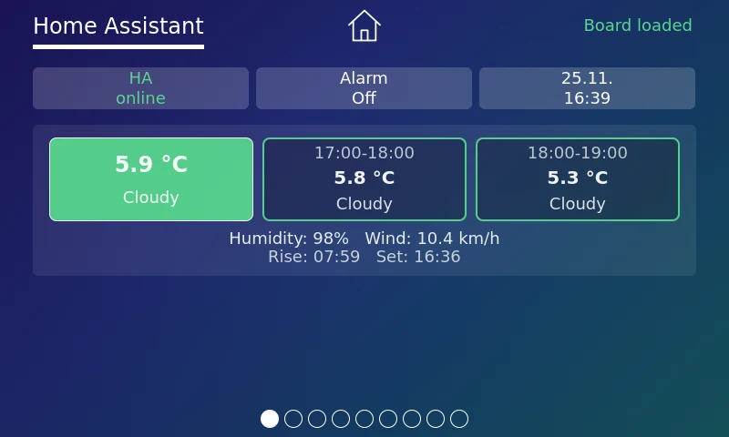
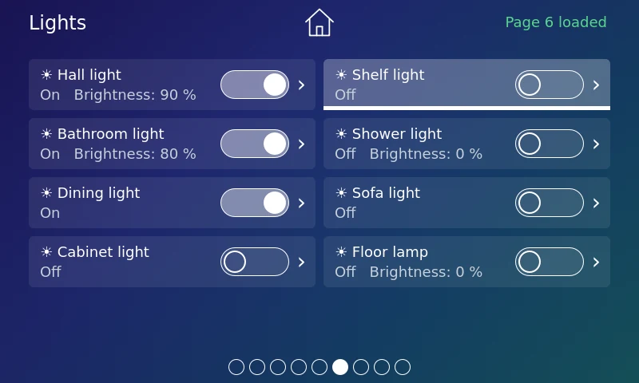
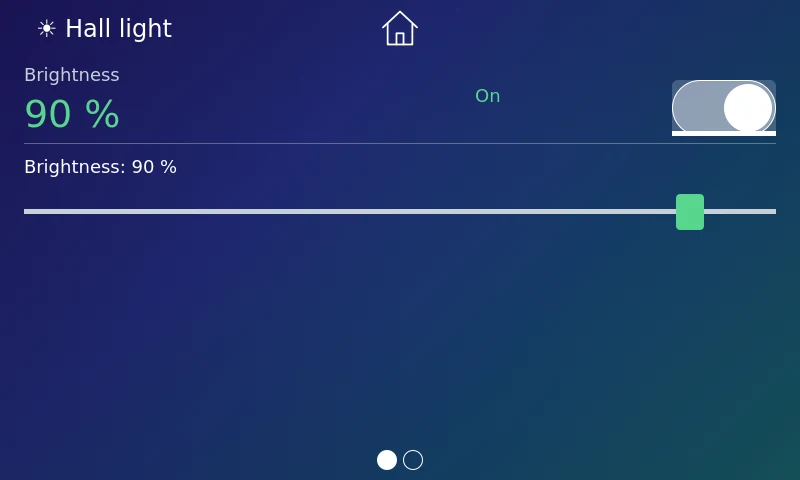
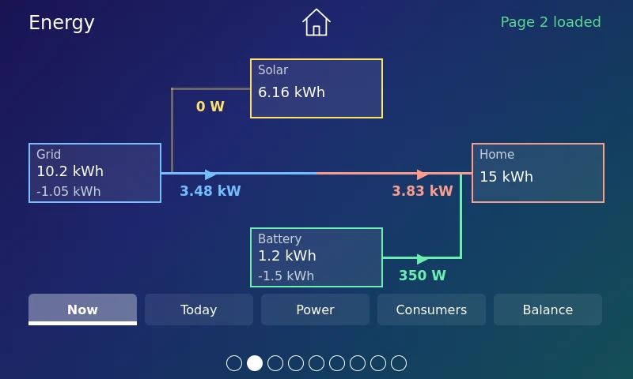
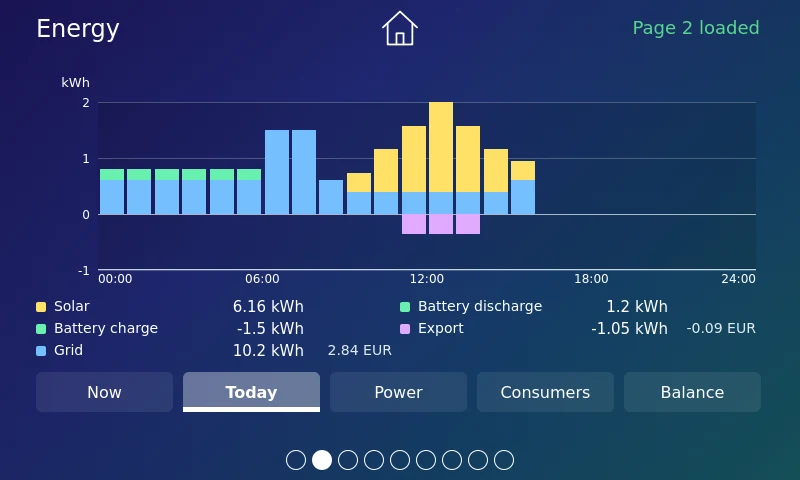
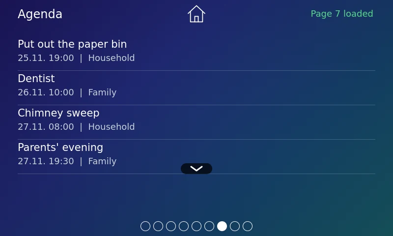
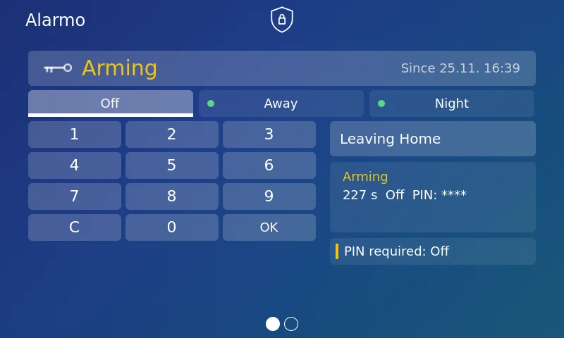

# Classe 100X: Station Display

This page explains how to switch on the Home Assistant pages on the Classe
100X display and how to use them with the station's keys.

Pages: [1. Setup](1-setup.md) | [2. Use](2-use.md) |
[4. Troubleshooting](4-troubleshooting.md) |
[5. Update and removal](5-update-and-removal.md)

<table>
  <tr>
    <td align="center"><strong>Home Assistant</strong> </td>
    <td align="center"><strong>Lights</strong> </td>
  </tr>
  <tr>
    <td align="center"><strong>Light detail</strong> </td>
    <td align="center"><strong>Energy: Now</strong> </td>
  </tr>
  <tr>
    <td align="center"><strong>Energy: Today</strong> </td>
    <td align="center"><strong>Agenda</strong> </td>
  </tr>
  <tr>
    <td align="center"><strong>Alarmo</strong> </td>
    <td></td>
  </tr>
</table>

The pictures are renders with example values; on the station the pages lie on
its wallpaper.

## Activate the Display Pages

The Classe 100X display cannot be restarted on its own, so the pages start
with one reboot of the station. Until then Home Assistant hides the display
settings, **Ringer mute** and **Touch tone**.

1. Finish the [first test](1-setup.md#first-test).
2. Press **Activate display pages** on the device page.
3. Wait. The station reboots once it has been idle for about two minutes. A
   call postpones the reboot and is never interrupted.
4. After the reboot the agent checks the new display. Once it is confirmed,
   Home Assistant turns on **Home Assistant pages on the display** and offers
   **Display pages** and **Display tiles** under **Configure > Display**.

If the new display does not start, the station goes back to its original
display at the next start and Repairs shows **C100X display pages were rolled
back** ([what to do](4-troubleshooting.md)).

## Set Up Pages and Tiles

Pages, tiles, the energy page, the agenda, leave home, situations and Alarmo
are set up as on the Classe 300X:
[Pages](../classe-300x/3-display.md#pages),
[Tiles](../classe-300x/3-display.md#tiles),
[Energy](../classe-300x/3-display.md#energy-page),
[Agenda, Leave home and Situations](../classe-300x/3-display.md#agenda-leave-home-and-situations).

Alarmo is set under **Configure > Display > Alarmo**.

## Use the Pages with the Keys

- The station's main menu gets two items right after the ringtone item:
  **Home Assistant** (the pages) and **Alarmo**. Each one appears only when it
  has something to open.
- **Up** and **Down** move from page to page; dots show where you are. The
  last entry is **EXIT**.
- **Return** enters a page. **Up** and **Down** then move between its
  controls; past the first or last one you leave the page again.
- To set a number such as a brightness: **Return**, **Up** or **Down**,
  **Return**.
- The call, hang-up and numbered keys keep their station functions.
- The station's **Settings** menu gets **Status messages** (on or off) before
  **EXIT**. It shows or hides routine confirmations on the pages.

Display notices wake the screen without a tone. Text memos are not shown.

## Restore the Original Display

Press **Restore original display**, or turn off **Home Assistant pages on the
display**. The station reboots once and shows its original display.
