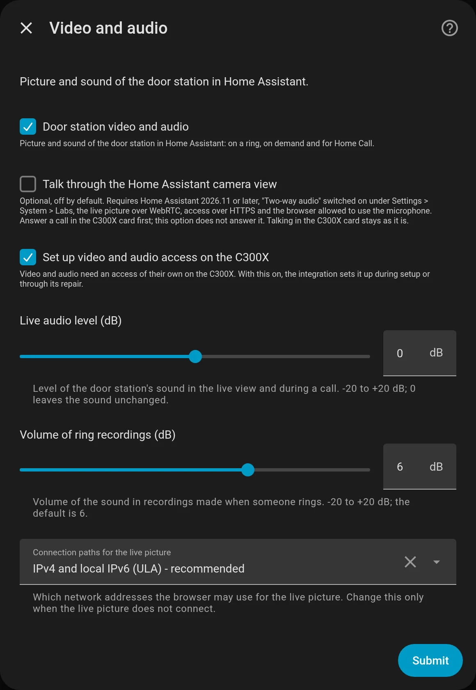

# Classe 300X: Setup

**Step 1 of 5:** **1. Setup** | [2. Use](2-use.md) | [3. Station display](3-display.md) |
[4. Troubleshooting](4-troubleshooting.md) | [5. Update and removal](5-update-and-removal.md)

This page takes a Classe 300X from SSH access to a working doorbell card in
Home Assistant.

## Requirements

- Home Assistant `2026.10.0` or newer.
- A Classe 300X (`344642` or `344643`) with firmware `1.7.x`, `2.0.2` or
  `3.0.6`.
- The station is set up in the BTicino Door Entry app.
- Home Assistant and the station are in the same trusted local network.
- SSH access on the station (next section).

## Enable SSH on the Station

The integration needs root access to the station over SSH. It cannot root a
stock station itself, and this project provides no firmware images, no tools and
no rooting instructions.

Enable nothing but SSH: no camera, MQTT or other extras. Flashing can brick
the station; you do it at your own risk and without warranty.

## Install the Integration

**Home Assistant 2026.11 or newer:**

1. Open the button above, or go to **Settings > Marketplace**.
2. Find **BTicino C300X/C100X** and install it.
3. Restart Home Assistant if it asks you to.

**Home Assistant 2026.10:**

1. Open **HACS** and search for **BTicino C300X/C100X**. If nothing is found,
   refresh the HACS catalog.
2. Download it and restart Home Assistant.

## Add the Station

1. Go to **Settings > Devices & services > Add integration** and choose
   **BTicino C300X/C100X**.
2. Fill in the form:

| Field | What to enter |
| --- | --- |
| **Address of the C300X/C100X** | The station's IP address. Give it a fixed address (DHCP reservation) in your router. |
| **Port** | `8091`. |
| **Address of Home Assistant for the C300X/C100X (optional)** | Leave empty. |

## Install the Device Agent

The device agent is a small program on the station. Setup installs it over
SSH.

Until the model is known, the forms say **C300X/C100X**. The field names
below leave the model out.

1. The dialog **Native agent not found** appears. Tick **Install native agent
   on the C300X/C100X** and submit.
2. Home Assistant logs in with the station's factory login. If the station
   refuses it, enter your own login:
   - **SSH user**: `root` or `root2`, never `bticino2`.
   - **SSH password**, or **SSH private key (optional)** with its **Key
     passphrase (optional)**. Paste the key as text. Firmware `1.7.x` and
     `2.0.2` take RSA or ECDSA keys, `3.0.6` also Ed25519. If your SSH access
     was set up with a key, use that key.
3. Wait until the installation is done. Home Assistant checks first that the
   host is a BTicino station and writes nothing to any other device. The SSH
   login is used once and not stored.

**An agent is already installed:** setup asks for its **Access key** and
**Maintenance key**. If you do not have them, tick **I do not have the keys:
reinstall the agent**. Home Assistant then installs the agent again over SSH
with new keys. Display pages and settings on the station stay, and the
station does not restart.

## Choose Options

Setup now walks through the settings. Later you find them under
**Configure** on the integration. Good choices for the start:

| Setting | Choose |
| --- | --- |
| **Door station video and audio** | On. |
| **Set up video and audio access on the C300X** | On. |
| **Door level** | Stock. |
| **Fine adjustment (dB)** | `0`. |
| **Connection paths for the live picture** | **IPv4 and local IPv6 (ULA) - recommended**. Change it only when the live picture does not connect ([choices](../reference.md#connection-paths-for-the-live-picture)). |
| **Talk through the Home Assistant camera view** | Off. Talking in the card does not need it. |
| **Visitor Snapshot** | Keep the defaults. |
| **Additional device activations** | Leave empty for now ([activations](2-use.md#door-stair-light-and-activations)). |
| **Home Assistant pages on the display** | On (the default); the next step picks the pages ([station display](3-display.md)). |
| **Alarm (Alarmo)** | Leave empty. |

## Apply the Core Media Hook

1. Open **Settings > Repairs**.
2. If **C300X core media hook is missing** is listed, open it and confirm
   **Apply C300X core media hook**.
3. On the device page, press **Reload device display**.

The hook tells Home Assistant when the station display ends a video session
and keeps **Ringer mute** in step with the station.

## Check Media Readiness

Open the **Media readiness** sensor on the device page.

| State | Do this |
| --- | --- |
| Ready | Continue. |
| Warning | Continue. A warning about forwarding only means that ring calls cannot be answered in Home Assistant yet. |
| Blocked or Unavailable | Open **Settings > Repairs** and run the offered fix. Then see [Troubleshooting](4-troubleshooting.md#media-readiness). |

## Add the Card

Repairs offers **Add the C300X Lovelace card**. Run it to get a C300X view
with the card in a dashboard.

Or add the card yourself:

1. Open a dashboard, switch it to edit mode and choose **Add card**.
2. Choose **BTicino Doorbell Call Card**.
3. Select the station's camera entity (**Doorbell camera**). Keep the mode
   **Doorstation + Home Call**.

## First Test

1. **Live video:** press **Stream** in the card.
2. **Home Call:** start and stop a Home Call in the card. The station display
   rings.
3. **Ring Call:** set the **Forwarding** select on the device page to
   **Home Assistant**. Ring at the door, then press **Answer** in the card.
4. **Door:** press **Door unlock** on the device page while someone is at the
   door.

Talking to the door needs Home Assistant over HTTPS (or Home Assistant Cloud)
and a browser that may use the microphone.

If a step fails, see [Troubleshooting](4-troubleshooting.md). To remove
everything later, see
[Remove the integration](5-update-and-removal.md#remove-the-integration).

## Firmware 3.0.6

Everything works as on `1.7.x` and `2.0.2`, with these differences:

- The camera sends only its low-resolution stream. There is no **Camera
  resolution** select and no 960x576 picture.
- **Audio codec** is already PCMU from the factory.
- Picture controls may only work during a Ring Call until the station has set
  the contrast once after a start.
- The display pages load when the station's display starts
  ([details](3-display.md#firmware-306)).
- There is no **IPv6 firewall patch** switch.

On a `3.0.6` station, Ring Call, the camera at its factory size, the door and
activations ran with earlier releases, and the display pages loaded at start.
The rest is checked offline only.

**Next: [2. Use](2-use.md)**
