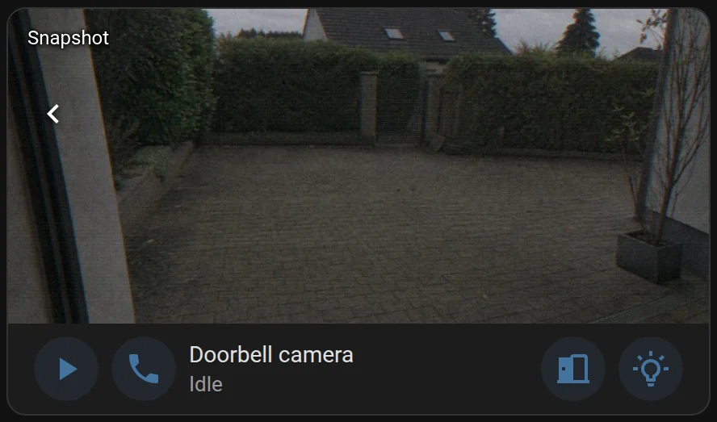
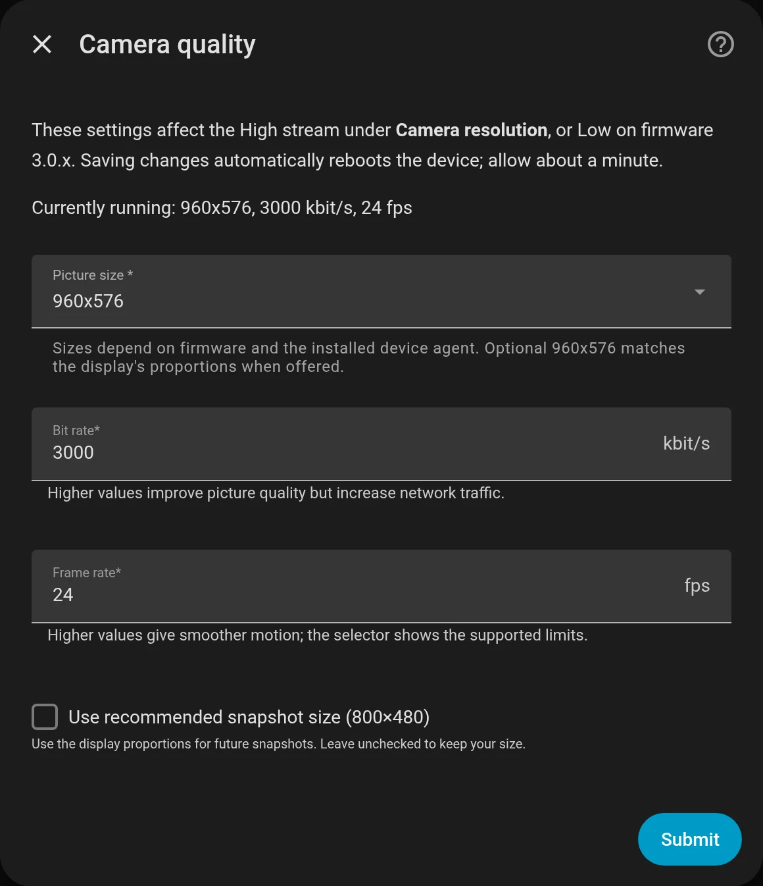

# Classe 300X: Use

**Step 2 of 5:** [1. Setup](1-setup.md) | **2. Use** | [3. Station display](3-display.md) |
[4. Troubleshooting](4-troubleshooting.md) | [5. Update and removal](5-update-and-removal.md) | [Reference](../reference.md)

This page explains daily use: the card, calls, the door, messages, sound,
picture, visitor images and notifications.

## Doorbell Card



The **BTicino Doorbell Call Card** shows live video, ring calls, Home Calls,
saved images and recordings. Keep its mode on **Doorstation + Home Call**.

- Click the picture for a large view. A running call continues.
- The card follows the current call and shows the calling outdoor unit's
  name.
- The door button opens the door of the outdoor unit that is calling, else
  of the default outdoor unit. At the start of a ring it stays disabled
  until the station has named the calling unit (about 0.3 s, at most 1 s).
  The light button switches the stair light.
- The arrows on the picture page through saved images and recordings.
- The sliders icon opens the [picture controls](#picture).
- In the Sections layout the card needs at least six rows.

Card options (in the card editor):

| Option | Default |
| --- | --- |
| **Show media readiness line** | On |
| **Show Open door button** | On |
| **Show staircase light button** | On |
| **Browse saved images and videos** | On |
| **Show picture controls for supported live video** | On |
| **Home Call ringback tone and volume** | On, 12 % |

## Video, Ring Calls and Home Calls

| What | How | Needs |
| --- | --- | --- |
| Live video | Press **Stream** in the card. It shows the unit of the current call, else the default outdoor unit. | **Door station video and audio** on. |
| Ring Call | Someone rings. Press **Answer**, later **Hang Up**. | Video on, and **Forwarding** on **Home Assistant**. |
| Home Call | Press **Call Home** in the card. The station display rings; audio only. | Video on. |

The **Forwarding** select on the device page decides where a ring goes:

| Choice | Result |
| --- | --- |
| **Smartphone** | The BTicino Door Entry app gets the call. Home Assistant cannot answer it. |
| **Home Assistant** | The card shows the ring with **Answer** and **Hang Up**. |
| **Blocked** | Nobody can answer. Home Assistant still gets the ring event. |

Several browsers can show a ring. After one answers, only that one keeps the
call controls. Automations answer with `bticino_c300x.answer_call` and end
the call with `bticino_c300x.hangup_call`
([Reference](../reference.md#actions)).

### Talking to the Door

The card uses the browser's microphone when you answer, start a stream or
start a Home Call. The microphone button mutes it.

- The browser must allow the microphone. That needs Home Assistant over
  HTTPS or Home Assistant Cloud. Over plain HTTP the card only listens.
- A phone notification cannot open the microphone. Open the card and answer
  there.

Talking in Home Assistant's own camera view is optional. It needs Home
Assistant 2026.11 or newer, **Two-way audio** under **Settings > System >
Labs**, HTTPS and the option **Talk through the Home Assistant camera view**.
It never answers a call: answer in the card first.

## Station and Outdoor Units

The station is one device. Every outdoor unit (entrance panel) is its own
device below it, also when there is only one. The station names its units
from its own configuration; a unit that is not configured appears with its
first ring. The device of a unit the station no longer reports can be
deleted on its device page.

Each outdoor unit has:

- a **Doorbell ring event** and a **Call** sensor (`idle`, `ringing`,
  `answered`, `viewing`) with the `call_id` of its call;
- a **Door unlock** button and a **Door** event, which fires whatever opened
  the door: the button, the station or the BTicino app;
- a **Door contact** sensor, only when the unit is wired with one; it appears
  with the first door message;
- a **Last visitor** image, and a camera: the **Doorbell camera** on the
  default unit, which shows the live picture of every unit, a **Camera** with
  still pictures on the others.

The station has the **Station ring** event, which fires at once with every
ring, the **Stair light** event and the **Station call state** sensor
([all entities](../reference.md#entities)).

To watch another unit, run `bticino_c300x.activate_doorbell_video` with that
unit as target; the **Doorbell camera** then shows it.

## Door, Stair Light and Activations

- **Door unlock** on an outdoor unit opens that unit's door.
- **Stair light** on the station switches the stair light.

The door locks of the outdoor units, the actuators and the stair light that
the station itself is set up with become buttons too. Extra locks or
actuators of your door system (for example a second door or a gate opener)
can be added as buttons of their own:

1. Open **Configure > Activations: locks, actuators, stair light**.
2. Choose **Add an activation**. Enter an **ID**, a **Name**, the **Type**
   (**Door lock**, **Actuator** or **Stair light**) and the **Address**
   (OpenWebNet `where` value). An actuator is what the station's display
   calls "Generic"; it is pressed and released like a door lock.
3. Choose **Finish and save**.

The settings list the station's own activations under **From the station**
and yours under **Manual**. A manual activation of the same type at the same
address replaces the station's.

**Stair light address:** **Automatic** switches the stair light at the
station's own address, as its display does. **Manual (P and N)** sets the
stair light from its P and N numbers (0-99 each). At most 16 activations are
possible.

## Ringer, Messages and Memos

- **Ringer volume**: `0` to `10`; `0` is silent.
- **Ringer mute**: mutes the ringtone, in step with the station's own
  setting.
- **Answering machine**: switches the station's answering machine on or off.
- **Video messages**, **Text memos**, **Voice memos**: count the station's
  messages and memos.
- **Delete latest video message**, **Delete latest text memo**, **Delete
  latest voice memo**: need the [Display patch](3-display.md).

Actions for automations: `play_latest_video_message`,
`play_latest_voice_memo` and `write_text_memo`
([Reference](../reference.md#actions)). The station saves no text memo during
a call.

## Picture

### Picture Controls

The sliders icon in the card changes **brightness**, **contrast** and
**colour saturation** of the live picture in 10 % steps. They change the
station's camera, not the saved images.

- During a Ring Call they always work. Opening them does not answer.
- With **Stream** the icon appears about two seconds after the picture.
- Changes last until the video ends.
- On boards with a TVP5150 video chip (every `3.0.6` station) they may only
  work during a Ring Call until the station has set the contrast once after a
  start.

They are tested on `1.7.19`; on `2.0.2` and `3.0.6` they are checked offline
only.

### Camera Quality

**Configure > Camera quality** sets picture size, bit rate and frame rate.
**Saving restarts the station** (about a minute). Choose a time without a
call, then open a new stream.



| Firmware | Picture sizes | Bit rate | Frame rate |
| --- | --- | --- | --- |
| `1.7.x`, `2.0.2` | 688x480 (factory), 704x576 (full height), 960x576 | 300-3000 kbit/s (factory 800) | 5-24 fps (factory 15) |
| `3.0.6` | 320x240 to 720x576 (factory 400x288) | 100-2000 kbit/s (factory 180) | 5-25 fps (factory 10) |

- Blurry or blocky: raise the bit rate. Grey blocks or stalls: lower it.
- Jerky: raise the frame rate.
- **960x576** fills the 5:3 shape of the station display. It is offered only
  for the exact media program of firmware `1.7.19` or `2.0.2`. The station
  keeps a backup of the original program; choosing another size restores it.
- On `3.0.6` only the factory size is tested on a station.
- When you change the size, tick **Use recommended snapshot size (800×480)**
  so visitor images keep the display's shape.

The **Camera resolution** select (not on `3.0.6`) switches between the
**High** stream (default) and the **Low** stream (400x288) for the next
stream.

## Sound

### Audio Codec

Set the **Audio codec** select to **PCMU** for clearer sound. The station
restarts once. A new installation on `1.7.x` and `2.0.2` sets PCMU itself,
and firmware `3.0.6` uses PCMU from the factory.

### Door Level and Fine Adjustment

Under **Configure > Video and audio**:

| Setting | Choices | Default |
| --- | --- | --- |
| **Door level** | Stock, +3, +6, +9, +12 dB | Stock |
| **Fine adjustment (dB)** | -10 to +10 dB | 0 |

Both set how loud the door station sounds in the live view, in answered
calls and in ring recordings. Recordings have the same level as the live
sound. Too quiet: raise **Door level** first. Too loud or harsh: lower it or
use a negative fine adjustment.

- **Door level** is set in the station's audio chip, so calls answered in the
  BTicino app get louder too. Set it to Stock, or remove the agent, to undo
  that. If the chip cannot be used, the agent adds the level in software.
- **Fine adjustment** is always added in software.
- The card plays the sound as it comes; it has no volume boost of its own.
- Home Call is not changed by these settings.

## Visitor Images

The **Save images** switch (on by default) saves one image on every ring and
every stream, even with no dashboard open. Find them in the card (arrows on
the picture) and under **Media > BTicino C300X/C100X Media**.

**Configure > Visitor Snapshot**:

| Setting | Default |
| --- | --- |
| **Image width (pixels)**, **Image height (pixels)** | 800 x 480 (the display's shape; 400 x 240 is a smaller image of the same shape) |
| **Image delay (seconds)** | 3 |
| **Keep images (days)** | 14 |
| **Write date and time into the image** | On |

At most 1,000 images or 128 MiB per station are kept; the oldest go first.
When an image fails, **Save images** shows the cause as **Last failure**
([codes](../reference.md#visitor-image-failures)).

## Recording a Ring

The card does not record. Use the **BTicino Ring capture** blueprint:

1. Set **Forwarding** to **Home Assistant**.
2. Open **Settings > Automations & scenes > Blueprints** and create an
   automation from **BTicino Ring capture**.
3. Select the **Doorbell ring event** of the outdoor unit to record, or the
   station's **Station ring** event to record every ring at once, and the
   length (5 seconds by default, 1-15).
4. **Include audio** is on by default and **answers the call** to record
   sound. Turn it off for video only.

MP4 files go to `/media/c300x/` and show up in the card's history. For a
recording without a ring, and all fields, see
[Recording](../reference.md#recording-clips).

## Speaker and Announcements

The **Speaker** media player is the station's loudspeaker. Use it with
`tts.speak` like any other speaker:

```yaml
action: tts.speak
target:
  entity_id: tts.piper
data:
  media_player_entity_id: media_player.bticino_c300x_speaker
  message: The washing machine is done.
```

- The player's volume applies to the next sound.
- One sound plays at a time, up to about 110 seconds.
- **A door call always wins.** A ring, a call or a camera request ends the
  sound at once. During and shortly after a ring no sound starts.
- A touch on the display can cut a sound short.

The attribute `last_result` says how the last sound ended
([values](../reference.md#speaker-results)). Tested on firmware `1.7.19`. On
`2.0.2` and `3.0.6` the agent uses each station's own sound files; playing is
not yet tested there.

## Notifications on the Station

With **Home Assistant pages on the display** on, each station gets a Notify
action, for example `notify.bticino_c300x`:

```yaml
action: notify.bticino_c300x
data:
  title: Front window
  message: The front window is still open.
  data:
    display: true
    tts: true
```

| Switch in `data` | Effect |
| --- | --- |
| `display` | Notice on the display with popup, screen wake and a tone. |
| `tts` | The speaker says the message. With `display` there is no tone. |
| `led` | The station's message LED, where the station has one. |

All fields: [Notify fields](../reference.md#notify-fields). Notices are
supplementary information, **not a fire alarm or other life-safety alerting
system**. Quiet notices that only sit on the Home Assistant page:
[Display notifications](3-display.md#display-notifications).

## Blueprints

Home Assistant copies these blueprints to **Settings > Automations & scenes >
Blueprints** at its start. If one is missing, restart Home Assistant once.

| Blueprint | Does |
| --- | --- |
| **BTicino Doorbell notification** | Runs your own action on a ring. Does not answer. |
| **BTicino Ring Call Android phone alert** | Rings an Android phone with **Answer**, **Hang Up** and **Open**. |
| **BTicino Ring Call iOS phone alert** | Rings an iPhone (critical sound) with **Answer**, **Hang Up** and **Open**. |
| **BTicino Ring capture** | Records a clip on a ring. |
| **BTicino Ring capture and Wyoming transcription** | Records and transcribes with a local Wyoming Whisper service. Always answers the call. |
| **BTicino strict phrase decision** | Checks a transcription for an exact phrase; can open the door of the outdoor unit that rang (off by default). |
| **BTicino Calendar display reminder** | Shows a notice on the station before a calendar event. |

The ring blueprints start from the **Doorbell ring event** of the outdoor
unit you select and act on that unit's call. For the fastest reaction select
the station's **Station ring** event instead: it fires at once with every
ring, the unit's event as soon as the station names the caller (about 0.3 s,
at most 1 s). The calendar reminder takes the station device. The strict
phrase decision takes the station, which opens the door of the unit that
called, or one outdoor unit.

The phone alerts need **Forwarding** on **Home Assistant** and the Home
Assistant Companion app on the phone. **Answer** opens the dashboard with the
call; talk there. The alert stops ringing when a **Door** event of one of
the station's outdoor units fires, whatever opened the door.

For your own automations, use the outdoor unit's **Doorbell ring event**,
the **Station ring**, the **Door** and **Stair light** events, or the events
in the [Reference](../reference.md#events).

**Next: [3. Station display](3-display.md)**
