# Classe 300X: Station Display

**Step 3 of 5:** [1. Setup](1-setup.md) | [2. Use](2-use.md) | **3. Station display** |
[4. Troubleshooting](4-troubleshooting.md) | [5. Update and removal](5-update-and-removal.md)

This page explains the Home Assistant pages on the station's own display and
how to set them up.

<table>
  <tr>
    <td align="center"><strong>Start page</strong><br>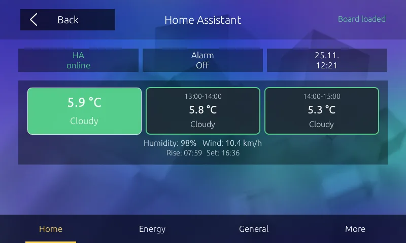</td>
    <td align="center"><strong>Lights</strong><br>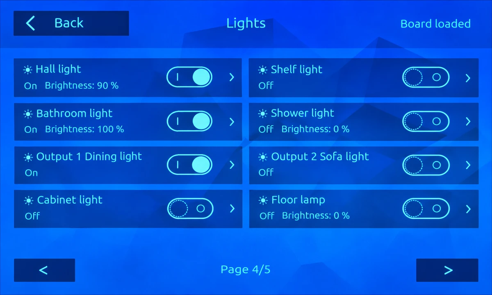</td>
  </tr>
</table>

The **Display patch** adds two buttons to the station's home page: **Alarm**
and **Home Assistant**. They open pages with tiles for your entities, an
energy page, an agenda and an Alarmo page. The pages follow the station's
language (German, English, French, Italian or Spanish; otherwise English).

## Enable the Display Pages

A new setup has the pages on. To turn them on later:

1. Open **Configure > Display > Display and Display patch**.
2. Turn on **Home Assistant pages on the display** and submit.
3. Wait up to a minute: the station's display restarts with the new buttons.

The **Display patch** switch on the device page does the same.

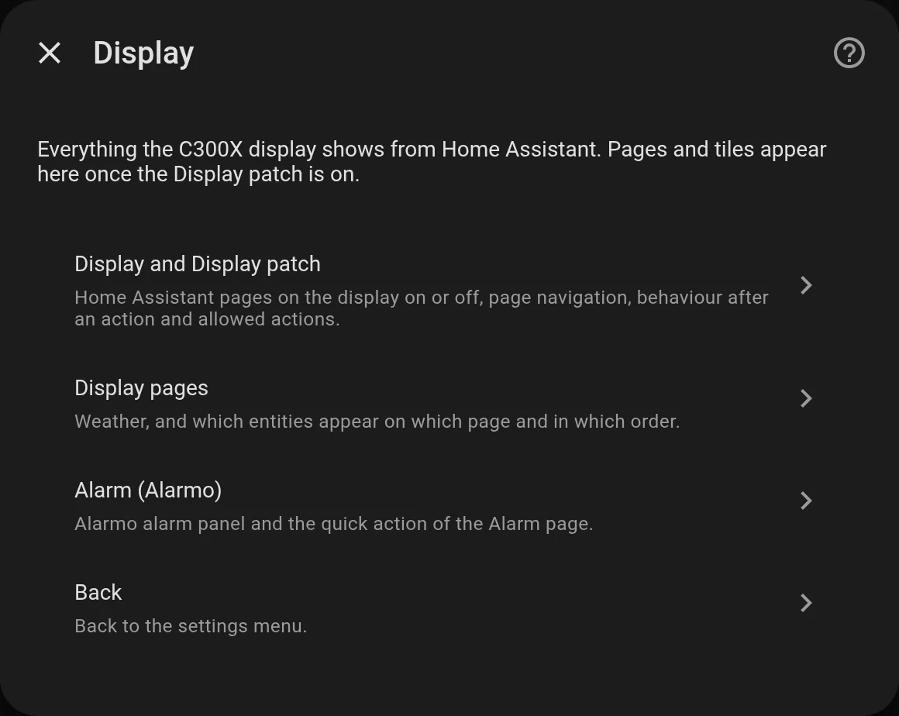

| Field | Meaning |
| --- | --- |
| **Home Assistant pages on the display** | On adds the pages. Off restores the original display and forgets the page and tile settings (the Alarmo settings stay). |
| **Keep the page open on screen standby** | Off (default): the pages go back to the home page when the screen sleeps. On: they stay open. |
| **Page navigation** | **Favourites bar** (default) or **Arrows (previous / next)**. |
| **Home page buttons** | Where **Alarm** and **Home Assistant** sit. **Stock view (when needed, also stacked)** (default): each button appears only when it has something to open, among the station's own buttons. **Fixed side by side**: both keep two fixed places after **Settings**. A change restarts the display once. |
| **Allowed actions (for experts)** | Actions that display tiles and notices may run, as JSON ([format](../reference.md#allowed-actions)). Leave empty if you use none. |

The Display patch also:

- adds an **Integration** tab to the station's **Settings** menu
  ([below](#integration-tab));
- shows a house symbol next to the power button; a yellow exclamation mark
  means the station cannot reach Home Assistant;
- makes taps more reliable: a tap that moves a little is no longer taken for a
  swipe (not on `3.0.6`).

Turning the pages off, or removing the agent, restores every original file.

## Pages

**Configure > Display > Display pages** lists the pages in display order.
Pick one to change it; **Add a page** adds one of your own (up to seven).

| Page | Shows |
| --- | --- |
| **Status page** | Connection, alarm and time, an optional **Weather** card and the entities you pick. On by default. |
| **Energy** | Home Assistant's energy data. Off by default. |
| **Agenda** | Upcoming calendar events. Off by default. |
| **Leave home** | Open doors and windows, lights on, and actions to run before leaving. Off by default. |
| **Situations** | Only the entities that need attention. Off by default. |
| Your own pages | A **Name** and the **Entities** you pick, in the order you pick them. |

- **Position** (1-12) sets where a page appears; the others move around it.
- An entity can be on one page only.
- A page of your own with no name and no entities is removed.

With **Favourites bar**, the bar at the bottom has one button per page; with
more than four pages the fourth is **More**, which lists the rest.

## Tiles

<table>
  <tr>
    <td align="center"><strong>Sensors and switches</strong><br>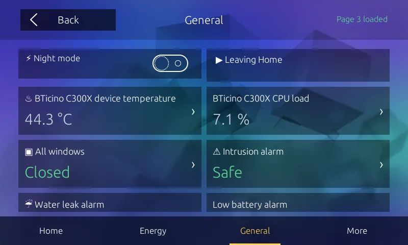</td>
    <td align="center"><strong>Light detail</strong><br>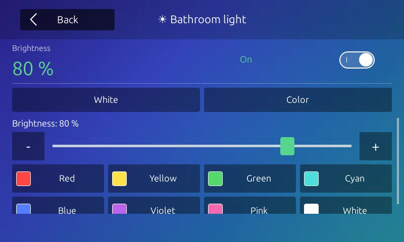</td>
  </tr>
  <tr>
    <td align="center"><strong>Media player</strong><br>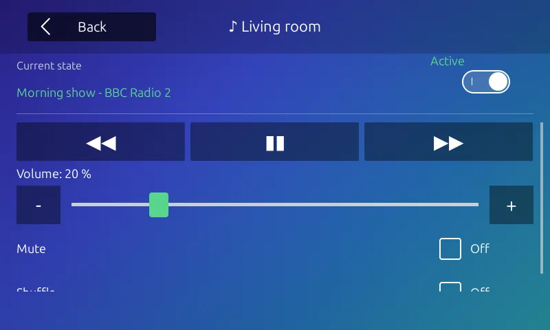</td>
    <td align="center"><strong>More pages</strong><br>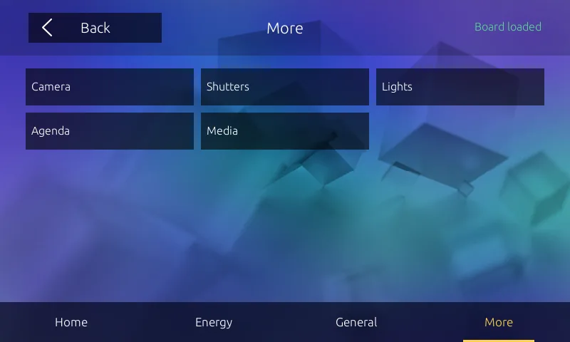</td>
  </tr>
</table>

**Configure > Display > Display tiles** has one section per tile:

| Field | Choices |
| --- | --- |
| **Width** | Automatic, Half or Full. |
| **Height** | Automatic, Half or Full. A full-height tile shows the entity's own buttons. |
| **Name** | Your own text; empty shows the Home Assistant name. |
| **Secondary line** | State, Entity ID, Last changed, Last updated or Nothing. |

A tile with a chevron opens a detail page. Lights, covers, climate, fans,
media players, locks, vacuums, valves, humidifiers, water heaters, numbers
and selects get controls there; sensors show their value. Unlocking or
opening a lock needs a second tap ("Sure?").

**Picture tiles:** a camera or image entity shows a still picture that
refreshes (a camera about every five minutes). Picture tiles need the
station to reach Home Assistant over `http://`, which is the default. With an
`https://` **Address of Home Assistant for the C300X** they are left out.

During a connection outage the tiles keep their last state, marked as stale,
and their buttons are off.

## Energy Page

<table>
  <tr>
    <td align="center"><strong>Now</strong><br>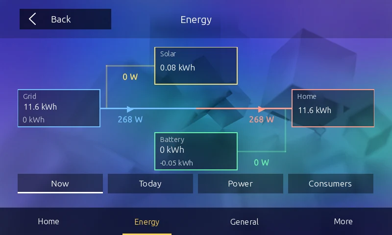</td>
    <td align="center"><strong>Power</strong><br>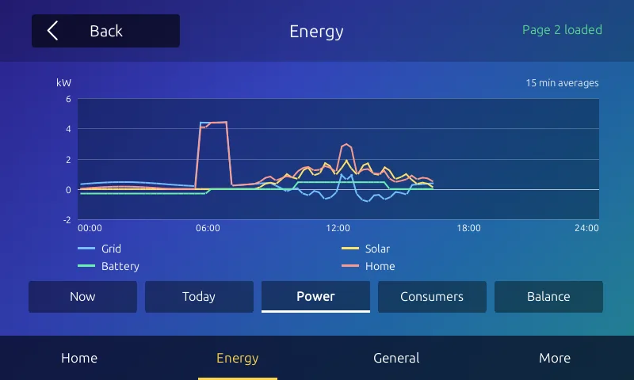</td>
    <td align="center"><strong>Consumers</strong><br>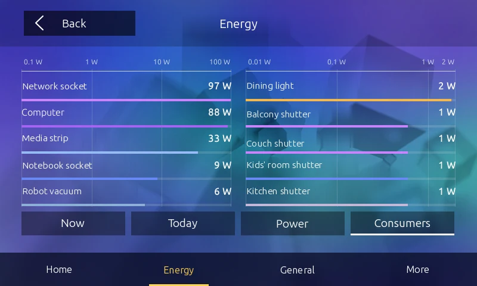</td>
  </tr>
</table>

The page uses Home Assistant's own energy setup (**Settings > Dashboards >
Energy**); nothing is entered twice. Turn on **Show the energy page** and
pick the views:

| View | Shows |
| --- | --- |
| **Now** | Solar, grid, battery and home with the current power. |
| **Today** | Energy per hour and today's costs. |
| **Power history** | Today's power curve. |
| **Consumers** | The ten devices using the most power now. |
| **Balance** | Own solar use, self-sufficiency and today's cost. |

For live watts, add power sensors in Home Assistant's energy settings. Gas and
water are not shown.

## Agenda, Leave Home and Situations

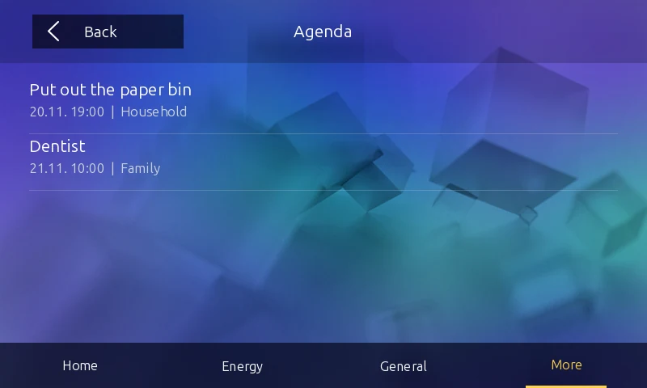

- **Agenda:** turn on **Show Agenda** and pick up to eight calendars. The page
  shows up to five events of the next seven days.
- **Leave home:** turn on **Show Leave home** and pick doors and windows,
  lights and up to eight **Actions**. An action runs only after a second tap
  on **Confirm**. **Show Alarmo readiness** adds a button to the Alarm page;
  it never arms the alarm by itself.
- **Situations:** turn on **Show Situations** and pick up to 24 entities. The
  page lists only open doors and windows, open garage doors, lights that are
  on and to-do lists with open items.

An entity that is unknown or unavailable is never counted as closed or off.

## Alarm Page (Alarmo)

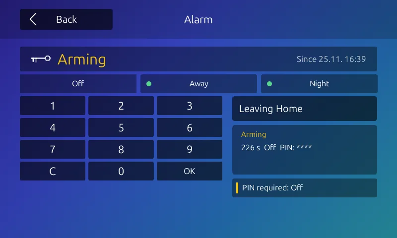

The **Alarm** button opens a page for an [Alarmo](https://github.com/nielsfaber/alarmo)
panel. Set it under **Configure > Display > Alarm (Alarmo)**:

| Field | Meaning |
| --- | --- |
| **Alarmo alarm panel** | The panel to show. Empty: no Alarm button. |
| **Quick action** | Optional button beside the alarm, for example the stair light. |

The page shows the state, the sensors that block arming and the countdowns. A
mode that needs a PIN opens the keypad.

## Display Notifications

An automation can put a quiet notice on the station's Home Assistant page. It
does not wake the screen or make a sound; tap it to read it.

```yaml
action: bticino_c300x.show_display_notification
data:
  notification_id: front_window
  title: Front window
  message: The front window is still open.
  priority: important
```

`bticino_c300x.dismiss_display_notification` with the same `notification_id`
removes it. Up to eight notices are kept. A restart of Home Assistant clears
them. All fields: [Reference](../reference.md#actions). For notices that wake
the screen or speak, use [Notifications](2-use.md#notifications-on-the-station).

## Integration Tab

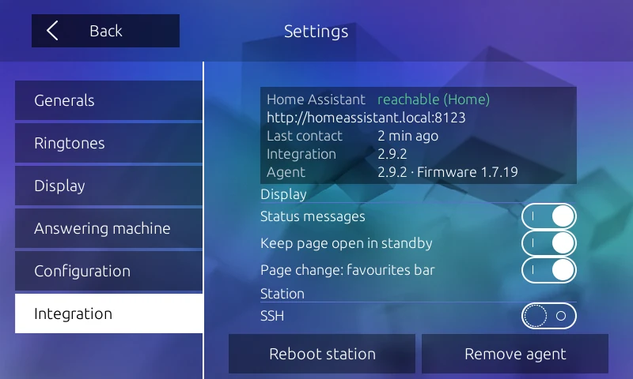

The Display patch adds **Integration** to the station's **Settings** menu. It
shows whether Home Assistant is reachable, the address the station uses, the
last contact and both versions.

| Control | Effect |
| --- | --- |
| **Status messages** | Shows or hides routine confirmations such as "Sending" on the pages. Errors always show. |
| **Keep page open in standby** | Same as the option **Keep the page open on screen standby**. |
| **Page change: favourites bar / arrows** | Same as the option **Page navigation**. |
| **SSH** | Switches the station's SSH access. |
| **Reboot station** | Restarts the station after **Yes**. |
| **Remove agent** | Removes the device agent after **Yes**. |

**Settings > Generals > Tone buttons** stays the station's own touch sound.
The **Touch tone** switch on the device page sets the same thing.

When Home Assistant is not reachable, the tab names the reason:

| Reason shown | Do this |
| --- | --- |
| **Home Assistant has not registered since the agent started.** | Wait a few minutes after a restart; check that the integration is loaded. |
| **The station pages are switched off in Home Assistant.** | Turn on **Home Assistant pages on the display**. |
| **Home Assistant does not answer.** | Check **Address of Home Assistant for the C300X** ([callback address](4-troubleshooting.md#events-or-display-pages-do-not-reach-home-assistant)). |

## Firmware 3.0.6

The display has the same buttons, pages and **Integration** tab. They load
each time the station's display starts. On a `3.0.6` station the pages loaded
at start with the buttons in place; the other pages are checked offline only.

- If the display fails to start with the pages, the agent starts it as
  shipped until the station restarts. The **Display patch** status then reads
  **applied, but the display started as shipped**. Turning the **Display
  patch** switch on, the core hook Repair or an agent update tries the pages
  again; saving the display settings does not.
- If the agent does not know the station's display, Repairs shows
  **C300X display pages are not available on this station** and the display
  stays as shipped.
- If the station keeps restarting after an install or update, follow
  [Troubleshooting](4-troubleshooting.md#the-station-keeps-restarting-firmware-306).

**Next: [4. Troubleshooting](4-troubleshooting.md)**
