# Station Display Pages

The Display patch adds Home Assistant pages to the C300X's own blue interface:
tiles for your entities, an energy page, an agenda, departure checks, an Alarmo
page and notices from automations. They are native station pages, not the
Lovelace card or an embedded Home Assistant dashboard. Display pages need
firmware 1.7.x or 2.0.2; on firmware 3.0.6 (experimental) the station's Qt 5
interface has no display files to patch, so the Display patch is skipped and
these pages are not available.

<p align="center">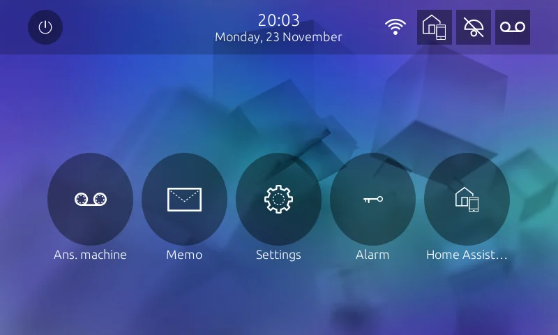</p>

Page and tile settings are stored in Home Assistant, and the display asks for
them, so changing them writes nothing to the station. Entity changes reach the
display through the existing event connection, without polling. Only entities
selected for the display can be operated from it, and Home Assistant checks
every command against the current selection and the entity's capabilities.

## Enable the Display Pages

1. Install or update the device agent
   ([Quick Start](quickstart.md#install-the-device-agent)).
2. Open **Configure > Display > Display and Display patch**, turn on
   **Home Assistant pages on the display** and submit. The integration reloads
   and applies the Display patch; the station's screen restarts, which can take
   up to about 60 seconds. The **Display patch** switch on the device page does
   the same and saves the option with it.
3. The **Display** menu now also offers **Display pages**
   ([Pages and Positions](#pages-and-positions)) and **Display tiles**
   ([Tiles](#tiles)). **Alarm (Alarmo)** is always there
   ([Alarm Page](#alarm-page-alarmo)).

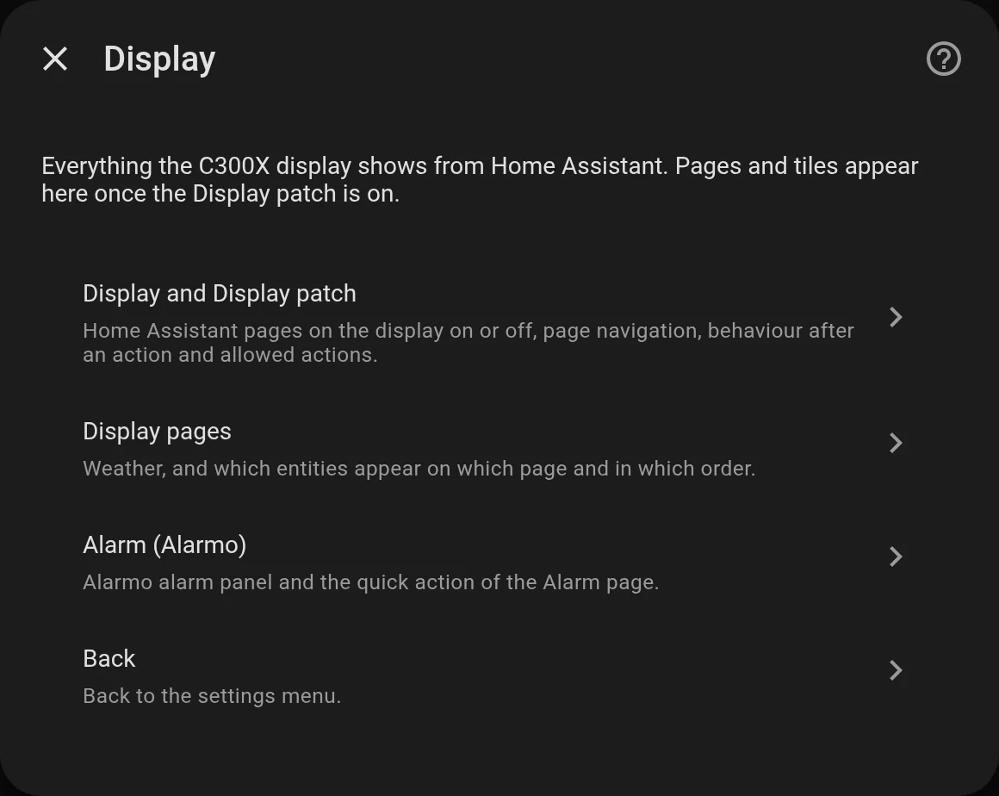

A new setup and a reconfigure walk through the same areas in turn. Pages are
offered while the Display patch is on, tiles once a page has an entity or the
Alarm page has a quick action. Turning the option off restores the original
display and discards the weather, page, tile and action settings; the Alarmo
settings stay.

| Field in **Display and Display patch** | Meaning |
| --- | --- |
| **Home Assistant pages on the display** | On applies the Display patch, off restores the original display. |
| **Show home page buttons only when needed** | On (default): the Alarm button appears while an alarm panel is configured, the Home Assistant button while a page has content. Off: both are always shown. A change applies the patch again and restarts the screen once. |
| **Keep the page open on screen standby** | Off (default): the Home Assistant and Alarm pages return to the station's home page when the screen goes to standby. On: they stay open. |
| **Page navigation** | **Favourites bar** (default) or **Arrows (previous / next)**; see [Page navigation](#page-navigation). |
| **Allowed actions (for experts)** | Actions the display and its notices may run. Leave empty if you use none. |

The allowed actions are a JSON object, one entry per action ID (letters,
digits, `_ . : -`) with `domain`, `service` and optional `target`, `data` and
`name`. Leave home and display notices can only offer actions from this list.

```json
{
  "entry_light": {
    "domain": "light",
    "service": "toggle",
    "data": {"entity_id": "light.entry"}
  }
}
```

### What the Display patch changes on the station

- Two buttons on the home page open the Alarm and Home Assistant pages. Their
  places stay reserved, so the other buttons never move; a short connection
  failure keeps the last confirmed visibility.
- A **Home Assistant** tab in the Settings menu
  ([Station Settings Tab](#station-settings-tab)).
- The swipe threshold of the touch screen rises from 4 to 16 pixels, so a tap
  that moves a little is no longer taken for a swipe.
- Every original file it changes is backed up first. Turning the patch off or
  [removing the agent](advanced-maintenance.md#remove-agent) restores them.
  Installing the agent alone, without the Display patch, leaves the Settings
  menu untouched.

After an integration update, the agent-update Repair installs the matching
agent and display files together.

## Pages and Positions

**Configure > Display > Display pages** lists the pages in display order, for
example **Page 2: Living room**. Pick one to open its form; submitting returns
to the list. **Add a page** appears while a page of your own is still free.

| Page | Default position | Default |
| --- | --- | --- |
| Status page | 1 | On |
| [Energy](#energy-page) | 2 | Off |
| [Agenda](#agenda) | 10 | Off |
| [Leave home](#leave-home) | 11 | Off |
| [Situations](#situations) | 12 | Off |
| Up to seven pages of your own | After the existing pages | - |

| Field | Meaning |
| --- | --- |
| **Name** | Heading of the page on the display, in place of Home Assistant. Up to 60 characters; each name once, in any capitalisation. A page with entities needs one. The status page has none. |
| **Position** | Place among all pages, 1 to 12. |
| **Entities** | The page's tiles, in the order picked; drag to reorder. An entity is on one page only: picking one that another page shows moves it, with its tile settings, to this page. |

How positions work:

- In the settings, a page takes the position it asks for and the other pages
  are numbered around it. Left empty, a page keeps its place and a new page
  goes to the end. Decimals are rounded.
- On equal positions Energy comes first, then Agenda, Leave home, Situations
  and the regular pages in their own order.
- A page the display does not show (switched off, or without entities) has no
  number and follows the shown pages. Switching an optional page off keeps its
  position and selections.
- Two things the form cannot count can shift the numbers on the display: a
  page used only by allowed actions, and an Energy page that is on while Home
  Assistant has no energy data.
- A page of your own without name and entities is removed.

In the setup and the reconfigure all pages are sections of one form, headed
with their page number. Free sections come last, titled **Page +**; fill one in
to add a page. There, an empty position returns an existing page to its
section's number.

### Status Page

The status page keeps the heading Home Assistant and shows the HA, alarm and
time badges, an optional weather card at the top (**Weather** field) and its
entities. With arrow navigation it also has a button for every other visible
page. **Show the status page** (on by default) switches the whole page,
independently of weather and entities; off keeps its settings. If no page is
visible at all, display notices still get a neutral page. The name `C300X` is
reserved for the status page.

### Page Navigation

<table>
  <tr>
    <td align="center"><strong>Favourites bar</strong><br>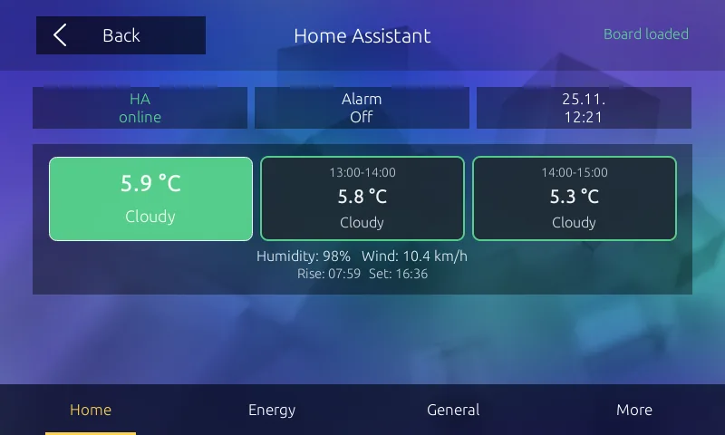</td>
    <td align="center"><strong>More: the other pages</strong><br>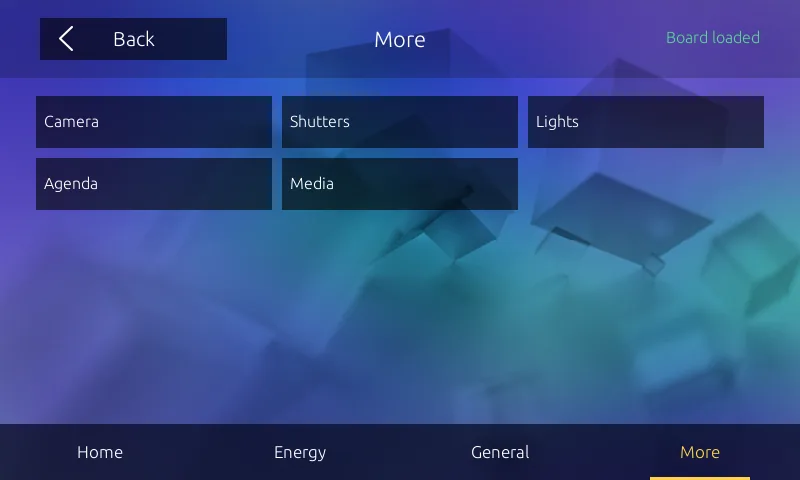</td>
  </tr>
</table>

| Choice | On the display |
| --- | --- |
| **Favourites bar** | A bar along the bottom edge with one button per page; the current page is marked in yellow. The status page is labelled **Home**, other pages show their name on up to two lines. |
| **Arrows (previous / next)** | `<`, the page number and `>` below the tiles. |

The bar has four places in page order. With more than four pages the fourth
is **More**: it opens a list of the other pages and stays marked while one of
them is shown. The station's back button closes the open list first. Changing
pages uses the data already loaded and requests nothing new.

## Tiles

<table>
  <tr>
    <td align="center"><strong>Sensor and switch tiles</strong><br>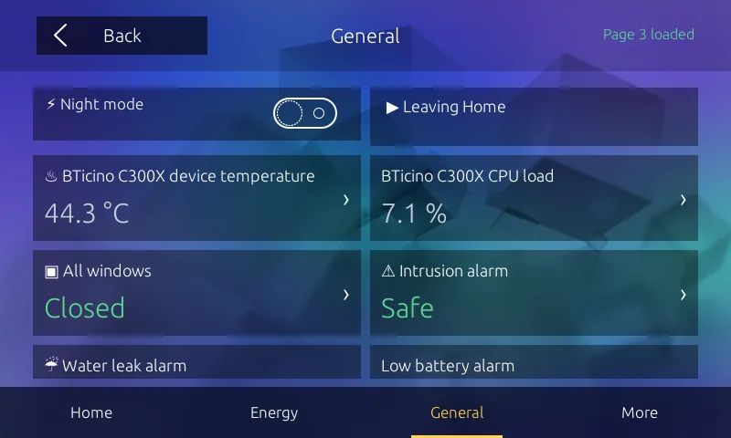</td>
    <td align="center"><strong>Light overview</strong><br>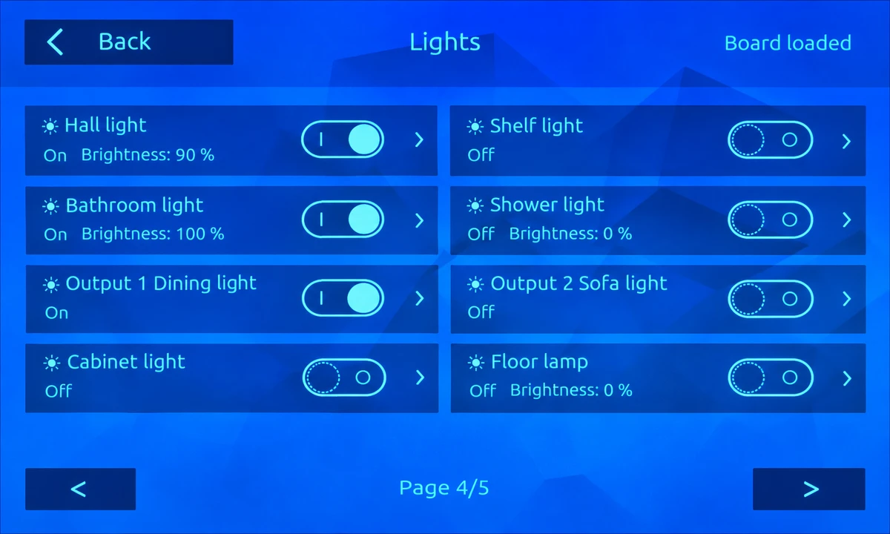</td>
  </tr>
  <tr>
    <td align="center"><strong>Brightness and color</strong><br>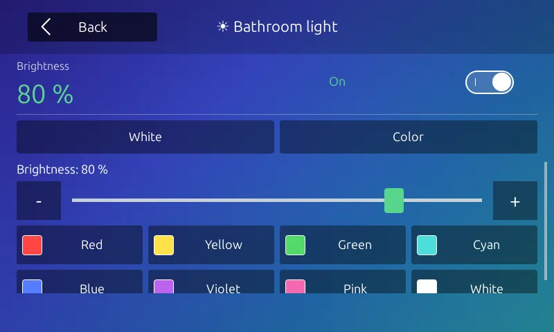</td>
    <td align="center"><strong>Media player</strong><br>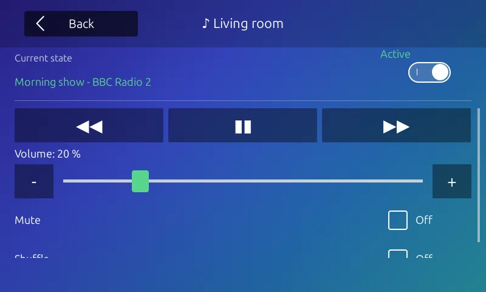</td>
  </tr>
</table>

**Configure > Display > Display tiles** has one section per tile, in display
order: page by page, then the page's entities. A section is titled like
**Living room › Ceiling light**; with more than two tiles the sections start
collapsed.

| Field | Meaning |
| --- | --- |
| **Width** | Automatic, Half or Full. |
| **Height** | Automatic, Half (compact) or Full (sensor-sized). A full-height tile carries the entity's own buttons. |
| **Name** | Your own text; left empty, the Home Assistant name is shown. |
| **Secondary line** | State, Entity ID, Last changed, Last updated or Nothing. |

Automatic keeps the usual size of the type, at half width: sensors full
height, switches a slimmer tile, everything else half height. A missing or
unavailable entity keeps its settings and shows as unavailable.

### Controls by Entity Type

A tile with a chevron opens a detail page: tap anywhere on it. Back returns to
the same page and scroll position. Controls appear only where the entity
reports the feature.

| Entity | Tile | Detail page |
| --- | --- | --- |
| Light | On/off switch, brightness | Brightness, eight colour swatches, warm, neutral and cool white within the light's Kelvin range, a Kelvin slider and effects. White and colour get separate tabs where both are supported. |
| Cover | Position, opening or closing | Up, stop and down stay visible at the top; position and tilt separately. A missing position is not shown as closed. |
| Climate | Measured temperature, heating or cooling activity | Target temperature or range and HVAC mode; presets, fan mode and swing on a settings tab. |
| Fan | On/off switch, speed | Speed, oscillation, presets and direction. |
| Media player | On/off switch; artist and title, or the state, as its State line | Previous, play/pause and next, volume, mute, source, sound mode, shuffle and repeat (off, all, one). |
| Lock | Locked, unlocked, locking, unlocking or jammed | Lock, unlock and open the latch. Unlock and open ask for a second tap on the same button, which then reads "Sure?". |
| Vacuum | What the robot is doing | Start, pause, stop, return to base, locate and suction. |
| Valve | Position, or the state | Open, stop, close and a position slider. |
| Humidifier | Switch, room humidity | Target humidity and modes. |
| Water heater | Water temperature | Target temperature and operation mode. |
| Number, select and their input helpers | Value | Home Assistant's units, bounds and steps; the entity's own options. |
| Switch, input boolean, automation, siren | Switch | - |
| Button, input button, scene, script | Button | - |
| Sensor, binary sensor | Large reading with its unit and precision | Read-only; battery, humidity and illuminance where reported. |
| Person, device tracker | Home, away or the zone | - |
| Camera, image | Picture | See [Picture tiles](#picture-tiles). |

| Entity | Buttons on a full-height tile |
| --- | --- |
| Cover | Up, stop, down |
| Climate | Target temperature minus/plus by the entity's step |
| Light | On/off, brightness minus/plus in 10 % steps |
| Fan | On/off, speed minus/plus by about 10 % |
| Number | Minus/plus by the entity's step |
| Select | Previous/next option, wrapping at either end |
| Media player | On/off, previous, play/pause, next |

Minus and plus are dimmed while there is no value to step from, for example a
light that is off; tapping them then opens the detail page. A press while the
previous command is still under way is ignored.

More tile behaviour:

- A small symbol before the name shows the type or device class, for example
  a sun for a light or a note for a media player.
- Timestamp and date sensors show a short local form such as `14.11. 10:30`.
  Text cut to fit ends in three dots.
- Sliders send one command when released, not while moving.
- Numbers and select options follow Home Assistant's language: a decimal
  comma in German, French and Italian, a point in English and all other
  languages.
- A lock's second-tap question moves to another button when that is tapped
  and stays until the page is left or the screen goes off. Locking needs no
  second tap.
- Long choice lists (a select's options, a player's sources) offer their first
  options, at most 50. If the content is still too large for the display, the
  longest lists are shortened further; if even that is not enough, the display
  shows Home Assistant as unavailable and Home Assistant logs a warning.
  Select fewer entities.

Command feedback shows sending, accepted, and confirmed once Home Assistant
reports the matching state. This is not a physical check for entities that
report their state optimistically. A command Home Assistant never reflects is
marked unconfirmed after 15 seconds; a track skip stays accepted. Feedback
clears a minute after the last change. Errors stay at the control and an
uncertain result is not retried. During a connection outage the last state
stays visible, marked as stale, with all actions disabled.

### Picture Tiles

<p align="center">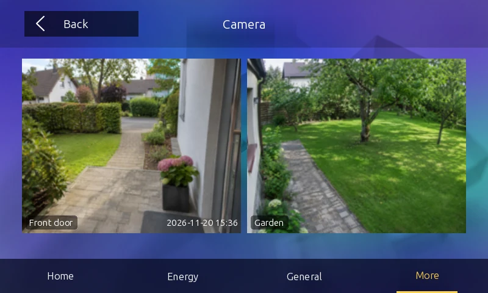</p>

A camera or image entity becomes a picture tile. By default it spans the page
and takes the picture's proportions, up to 320 px high; a taller picture is
shown whole and narrower. With **Width** Half two pictures stand side by side.
With **Height** Half (138 px) or Full (286 px) the picture is cut around its
centre to fill the tile. Home Assistant scales the picture to the tile before
the display loads it; a smaller picture is enlarged up to twice its size.

It is a still, not a stream: an image entity reloads when it has a new
picture, a camera about every five minutes. The entity name is written in the
bottom left corner; a tap does nothing. An unavailable entity has no tile
until it is back, and a picture that cannot be read shows only the name until
the next one.

The display loads the picture from Home Assistant at an address signed with
the entry's secret. It serves only camera and image entities on the display
pages and needs no login, so anyone who can reach Home Assistant and has seen
the address can load that scaled picture. It does not expire; it stops working
when the entity leaves the display pages or the display pages are switched off. Picture tiles
need a plain `http://` callback address, because the display cannot open
`https://`; with an HTTPS callback address they are left out. They are not
offered for the Alarm page.

## Energy Page

<table>
  <tr>
    <td align="center"><strong>Now</strong><br>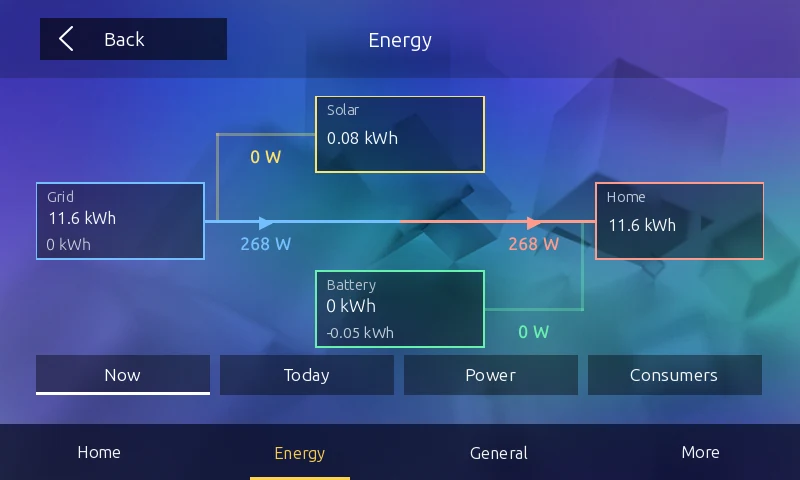</td>
    <td align="center"><strong>Power</strong><br>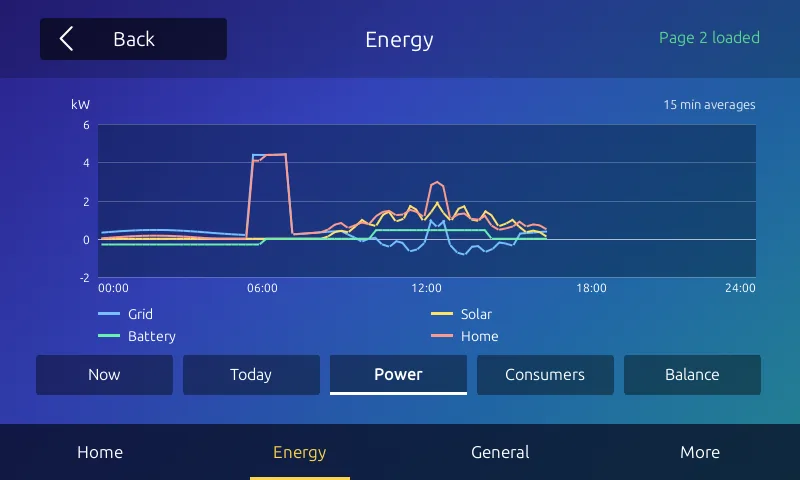</td>
    <td align="center"><strong>Consumers</strong><br>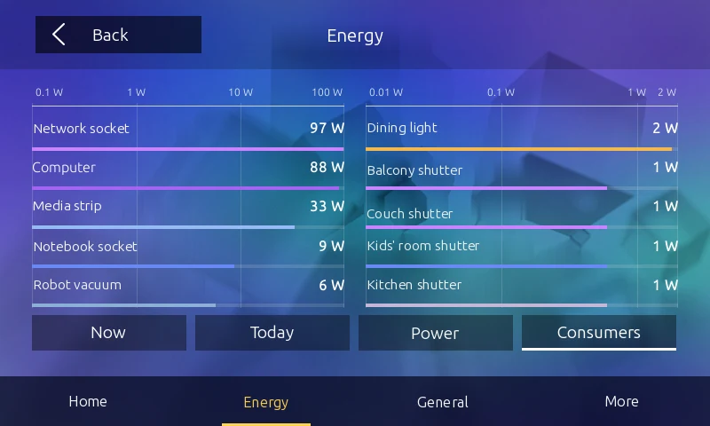</td>
  </tr>
</table>

The Energy page shows Home Assistant's own Energy setup (**Settings >
Dashboards > Energy**): meters, names, prices and power sensors come from
there and are not configured twice. Turn it on with **Show the energy page**
and pick its views. With more than one view, buttons at the bottom switch
between them; all views off hides the page and keeps its settings.

| View | Shows |
| --- | --- |
| **Now** | Solar, grid, battery and home with today's energy, and the current W/kW beneath the flow arrows. A source without a power sensor counts as 0 W; an unavailable sensor stays unknown. A power sensor shared by several meters counts once. |
| **Today** | Hourly bars: grid import, solar and battery discharge above zero, grid export below. A table of up to eight rows with costs; further meters are grouped as **Other meters**. |
| **Power** (form: **Power history**) | Today's power for grid, solar, battery and home as 15-minute means of recorded statistics, on one W/kW scale. Export and battery charging go below zero; missing statistics leave gaps. |
| **Consumers** | The ten individual devices with the highest current power, in two columns of five. |
| **Balance** | Share of solar used at home, self-sufficiency, net energy from the grid and today's cost. |

- Tap the Today or Power chart to see the exact values of one interval.
  Nothing is filled in between recorded values.
- **Consumers** uses the power sensors set for individual devices in Home
  Assistant's Energy settings, with their names. Unavailable, invalid or
  negative readings are left out and a hint marks the list as incomplete; a
  measured 0 W shows an empty bar. Each column scales its bars on its own, so
  compare the W values across columns.
- A kind of source not set up in Home Assistant is left out. Without any
  electricity source the page is hidden, unless **Consumers** is on. Gas and
  water are not shown.
- Colours: blue grid, yellow solar, green battery, violet export, coral home.
- An energy meter in kWh has no current W value: add power sensors in Home
  Assistant's Energy settings for the live readings.
- Home Assistant computes the charts from its recorder statistics and changes
  none of them. Now and Consumers update at most every ten seconds; switched-off
  views request nothing. No charts are stored on the station.
- The page's texts follow Home Assistant's language in German, English, French
  and Italian; other languages show English.

## Agenda

<p align="center">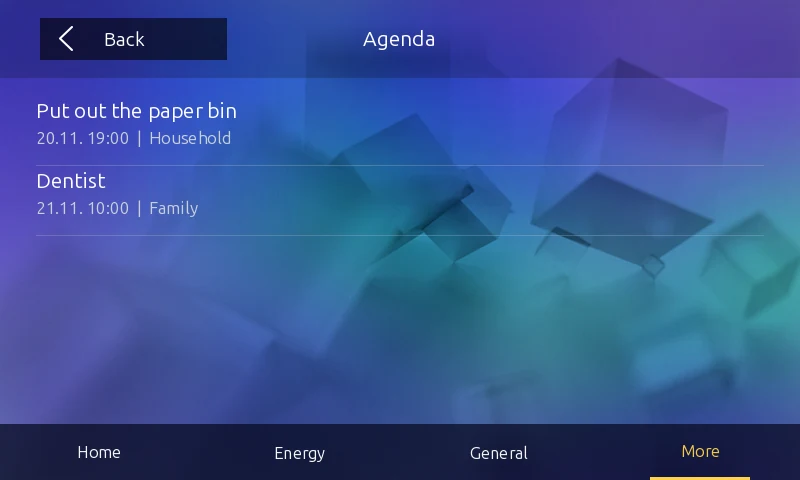</p>

Turn on **Show Agenda** and select up to eight Home Assistant calendars. The
page shows up to five ongoing or upcoming events within the next seven days,
all-day events included. A loading message appears on the first read, and a
slow calendar does not hold up the other pages. A failed calendar read is
shown as such, not as an empty agenda. Turning the page off or selecting no
calendars stops its reads.

Showing an event does not trigger anything. For a reminder before an event,
use the calendar reminder blueprint ([Blueprints](user-guide.md#blueprints)).

## Leave Home

Turn on **Show Leave home** and select what to check before leaving: up to 24
door and window contacts (**Windows and doors**), up to 24 lights and up to
eight **Actions** from the allowed actions. Nothing else in Home Assistant is
inspected. An unavailable contact stays unknown, never counted as closed.

Opening or refreshing the page never runs an action. The first tap on an
action asks for **Confirm** within eight seconds and can be cancelled. Leaving
the page, changed page data, a running command or a lost connection clears the
pending confirmation.

**Show Alarmo readiness** adds the alarm configured for the display. It opens
the Alarm page with its usual readiness checks and PIN; it never arms the alarm
by itself. A disarmed panel shows its readiness, an armed or arming one its
state.

## Situations

Turn on **Show Situations** and pick the entities to watch, up to 24 in total.
The page lists only those that need attention, one row each with the state on
the right:

| Field | Shown when |
| --- | --- |
| **Windows and doors** | A contact with device class door, window, opening or garage door is open. |
| **Garage doors** | A cover with device class garage is open, opening or closing. |
| **Lights** | The light is on. |
| **Task lists** | The to-do list has pending items; the row shows their number. |

An unknown or unavailable entity stays on the list in yellow and never counts
as closed or off; an entity of another kind shows as unsupported. With nothing
to show the page says so in one line. The page is read-only: it runs no
action, does not wake the display and never changes the page by itself.

## Alarm Page (Alarmo)

<p align="center">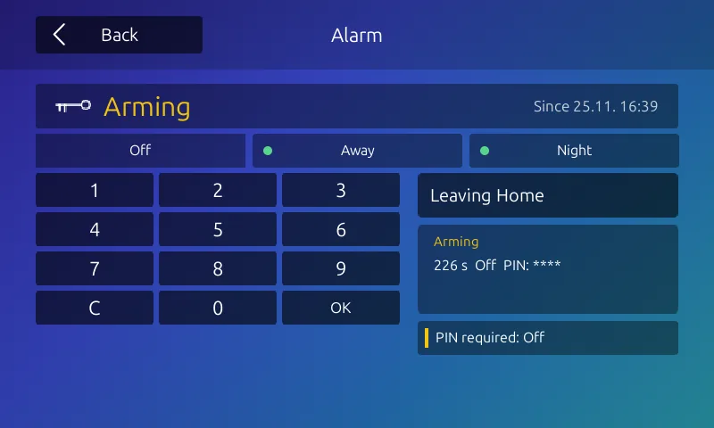</p>

The Alarm page is a subpage in the station's original blue design, opened by
the Alarm button on the home page. It is not one of the numbered pages. Set it
under **Configure > Display > Alarm (Alarmo)**, or in the **Alarm (Alarmo)**
step of the setup and the reconfigure:

| Field | Meaning |
| --- | --- |
| **Alarmo alarm panel** | The panel the page shows and controls. Empty: no Alarm button. |
| **Quick action** | Optional entity beside the alarm, for example the stair-light button. Empty hides it; nothing is inserted by default. Buttons, switches, lights, fans, humidifiers, automations, sirens, scenes, scripts and their helpers can be picked; media players cannot. |

The page shows the reported alarm state, readiness, blocking contacts and the
entry and exit countdowns. A mode runs directly when it needs no PIN;
otherwise the keypad opens. An entry delay opens the disarm keypad when a PIN
is required. A pending command blocks further taps, and missing data is never
shown as a ready alarm. The quick action uses its entity's name, or the name
set in its own **Alarm page ›** section of **Display tiles**.

## Display Notifications

Automations can put a compact notice on the station's Home Assistant page;
tap it for details. It does not open by itself, wake the display, cover the
Alarmo PIN entry or interrupt a Ring Call. For notices that wake the screen,
sound a tone or speak, use the Notify service in
[Notifications](user-guide.md#notifications).

```yaml
action: bticino_c300x.show_display_notification
data:
  notification_id: front_window
  title: Front window
  message: The front window is still open.
  icon: warning
  priority: important
  expires_in: 3600
```

| Field | Values |
| --- | --- |
| `notification_id` | Required. 1 to 64 lowercase letters, digits, `_` or `-`. The same ID replaces a notice. |
| `title` | Required, up to 80 characters. |
| `message` | Required, up to 500 characters. |
| `icon` | `info` (default), `warning` or `calendar`. |
| `priority` | `normal` (default), `important` or `urgent`. |
| `expires_in` | Seconds, 1 to 604800 (7 days); default 3600. |
| `actions` | Up to two `{action_id: ..., label: ...}` entries from the allowed actions. |
| `entry_id` | Needed with more than one C300X entry. |

`bticino_c300x.dismiss_display_notification` with the same `notification_id`
removes a notice.

- Up to eight notices (16 KiB in total) are kept, highest priority first. When
  full, the oldest notice of the lowest priority is replaced; a lower-priority
  notice cannot push out a higher one.
- Notices live in Home Assistant's memory only. Restarting Home Assistant or
  reloading the integration clears them, so automations should resend
  conditions that still apply. Nothing is written to the station or the
  recorder.
- An action never runs because a notice arrives, only when tapped. **Mark
  read** only dismisses the notice; it neither fixes the condition nor runs an
  action. Commands for a notice that has since changed are rejected.
- The bundled **C300X Calendar display reminder** blueprint shows a notice
  before a calendar event ([Blueprints](user-guide.md#blueprints)). For a
  reliable test, create the event more than 15 minutes ahead, as the
  [Home Assistant calendar documentation](https://www.home-assistant.io/integrations/calendar/#automation)
  notes.

## Station Settings Tab

The Display patch adds a **Home Assistant** tab to the station's **Settings**
menu, below **Configuration**. These controls work without Home Assistant;
only maintenance operations the agent has enabled are offered.

<table>
  <tr>
    <td align="center"><strong>Home Assistant tab</strong><br>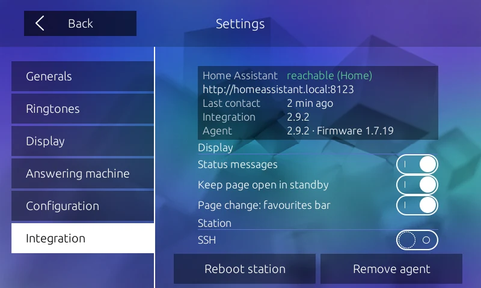</td>
    <td align="center"><strong>Generals: Tone buttons</strong><br>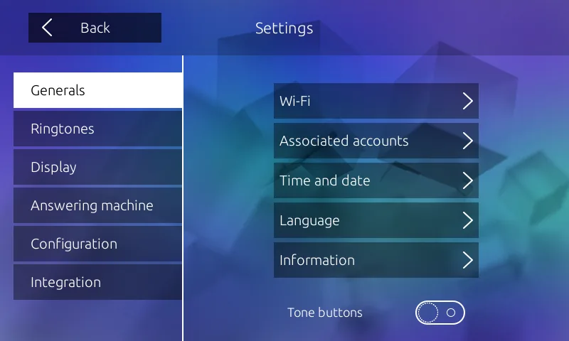</td>
  </tr>
</table>

| Control | Effect |
| --- | --- |
| **HA feedback** | Shows (default) or hides coloured action confirmations and routine messages such as "Page loaded" in the upper right of the Home Assistant page. Text at a control, errors, pending actions, connection warnings and real alarm or entity states always stay visible. |
| **SSH** | Switches the station's SSH access. |
| **Reboot station** | Restarts the station. |
| **Remove agent** | Removes the device agent; see [Remove Agent](advanced-maintenance.md#remove-agent). |

Reboot and removal need a second, explicit confirmation within ten seconds;
leaving the tab or the screen going off cancels it. **HA feedback** is a
station preference, not an integration option, and survives restarts. If the
agent cannot read or save it, the switch shows **Setting unavailable**; reopen
the tab before trying again.

**Settings > Generals > Tone buttons** stays the station's own touch-sound
control. With the Display patch active, the device page in Home Assistant
offers the same setting as the **Touch tone** switch under **Configuration**.
It follows changes made on the station, is unavailable while the agent has no
connection to the station's interface, and Home Assistant never sets it on
start. A confirmed
change fires a **Touch tone changed** device event; see
[Events](feature-reference.md#events).

Turning the Display patch off restores the original Settings menu. A Settings
page in an unknown layout, or a missing backup of an already patched page,
stops the patch instead of replacing the original with a guess.
