# Feature Reference

This page is the compact reference for users and maintainers. It describes what
the integration exposes, where to configure it, and which parts write to the
C300X only after an explicit user action.

## Operating Model

The integration is local-first:

- Home Assistant talks to the native C300X agent through the local `/api/v1`
  HTTP API.
- The native agent pushes events back to Home Assistant webhooks.
- Camera, Ring Call, Home Call and talkback use Home Assistant's WebRTC
  provider/go2rtc path.
- Core device state is event-driven; Home Assistant should not need polling for
  normal doorbell, call, ringer, forwarding, memo or message changes.
- Optional maintenance actions can write device-side config, but they are
  explicit setup, options or Repair actions.

## Setup and Options

**Configure** opens a menu of settings areas. Each area is a form of its own
and saves when it is submitted; the other areas keep their settings. After
saving, the menu is shown again, so several areas can be changed in one go;
**Done** closes it. To leave an area without a change, submit it as it is. A new
setup and a reconfigure walk through the same areas one after the other:
connection, video and audio, Visitor Snapshot (only with video on),
activations, Alarm (Alarmo), display and Display patch and, with the patch
on, the pages and the tiles. Display
pages and display tiles are offered while the Display patch is on, the tiles
only once there is an entity on a page or an Alarmo quick action. Every field
has a help text.

Normal credential entry is checked before saving: rejected agent keys and
rejected supplied maintenance keys have separate errors from an unreachable
agent. Correct the keys through Home Assistant's reauthentication flow when
prompted; the existing entry and unrelated settings are retained. A rejected
maintenance key locks only maintenance actions such as restart, update and
repair: calls, video, door and events continue, and the prompt then requires a
maintenance key. A rejected agent key takes the entry offline until it is
corrected. Blank key
fields for an existing connection retain the saved key. An existing entry can
still start while its device is offline and reconnect later. This does not
bypass credential validation for a new entry or a changed connection, and the
one-time SSH installation remains a separate explicit step.

| Area | Purpose | Writes to device |
| --- | --- | --- |
| Connection | Agent host, port, API token, maintenance token, optional callback base URL. | Token setup during explicit install. Changing callback HTTP/HTTPS mode updates agent config and schedules an agent-only restart. |
| Video and audio | Door station video and audio, video and audio access on the C300X, live audio level, volume of ring recordings, connection paths for the live picture, talking through the HA camera view. | Media-user setup writes only when setup/Repair is run. Audio gain is runtime-only and is sent only when non-default or different. |
| Visitor Snapshot | Image width and height (688x480), delay (3 s), retention (14 days), date and time in the image (on). Offered only with video on. | No. |
| Camera quality | Picture size (688x480 from the factory, or the whole 720x576 picture), bit rate (300–3000 kbit/s, 800 from the factory) and frame rate (5–24 fps, 15 from the factory; at 25 the device sends only about 8) of the high-resolution camera stream; on firmware 3.0.x of the low-resolution stream, the only one it sends, which the Door Entry app gets as well (sizes 352x288 to 720x576, 400x288 from the factory; 100–2000 kbit/s, 180 from the factory; 5–25 fps, 10 from the factory; sizes other than 400x288 not yet tested on a 3.0.x device). The size also applies to the camera picture on the device display and to answering-machine recordings. The form shows the values saved on the device and the ones it runs with. Offered with video on. | Yes: saving a change writes both values in one step and restarts the device once, like the audio codec switch. The values stay on the device, not in Home Assistant. |
| Activations: locks, lights, stair light | Optional extra C300X activation buttons. | Only after saving, and only when the desired activation config differs. |
| Alarm (Alarmo) | Alarmo alarm panel and quick action of the Alarm page. | No. Stored in Home Assistant; the display asks for it. |
| Display and Display patch | Optional Display patch, home page buttons, behaviour after an action and action allowlist. | Yes, only when the Display patch is applied/restored. |
| Display pages and tiles | Weather, entities per page, size, name and secondary line of each tile. | No. Stored in Home Assistant; the display asks for them. |

Maintenance controls (SSH, noAuth, mDNS discovery, firewall patches, GUI
reload, reboot, agent update/remove) are device entities, not a settings area;
they write to the device only when the entity, button or Repair is used.

**Connection paths for the live picture** is available in setup and under
**Video and audio** in options. Its default is **IPv4 and local IPv6 (ULA) -
recommended** (`prefer_ipv4_ula`). The
[ICE policy reference](media-troubleshooting.md#connection-paths-for-the-live-picture)
explains all four choices, the address filters and preserved relay/mDNS paths.
No address or token is entered in this selector.

To uninstall, use the [HA removal guide](advanced-maintenance.md#remove-home-assistant-integration).
Deleting an HA entry, uninstalling the downloaded package and removing the device
agent have different effects on settings, media and backups.

## Main User Features

| Feature | User surface | Notes |
| --- | --- | --- |
| Doorbell ring event | Event entity, automations, blueprints, card state. | Receives real C300X ring events from the native agent. |
| On-demand camera | Camera entity, C300X Doorbell Call Card, `activate_doorbell_video` / `stop_doorbell_video`. | Uses local RTSP through Home Assistant's WebRTC provider/go2rtc and does not require Home Assistant Ring Call forwarding. |
| Ring Call preview | C300X Doorbell Call Card. | Multiple browser previews are supported; only the active answered browser should show Answer/Hang Up. |
| Ring Call answer/hangup | C300X card, mobile blueprints, `answer_doorbell_call`, `hangup_doorbell_call`. | Requires Forwarding set to Home Assistant and media readiness without blocking failures. |
| Talkback | Browser microphone through the card, or optionally the native HA camera player on HA 2026.11+. | Native HA control is off by default. Enable **Talk through the Home Assistant camera view** under **Configure > Video and audio** and Two-way audio in HA Labs. Requires WebRTC, HTTPS and microphone permission. Card talkback is unchanged. |
| Home Call | C300X card, Home Call websocket path, `start_home_call`, `stop_home_call`. | Audio-only call from Home Assistant to the C300X display. |
| Media history | Previous/next in the doorstation card's media window. | On by default; HA snapshots and indexed HA capture videos only. Live video and incoming rings take priority. No built-in answering-machine recordings. |
| Door unlock | Button entity, service, optional dashboard action. | Sends one configured unlock command through the native agent. |
| Stair light | Button entity, service, optional generated activation. | Manual mode uses P/N parts to generate the stair-light activation address. |
| Device activations | Button entities, `run_device_activation`. | Supports `lock`, `light`, `stair_light`, `scenario`, and `generic` activation types. |
| Forwarding | Select entity. | Shown as Smartphone, Home Assistant and Blocked, translated like any other entity. Automations use the option values `enabled`, `homeassistant` and `blocked`. Ring Call answer needs Home Assistant. |
| Ringer mute and volume | Switch and number entity. | Volume uses the C300X display scale `0..10`; `0` is muted. |
| Answering machine | Switch and video-message sensor/services. | Message delete requires the Display patch. |
| Text and voice memos | Sensors and memo services. | Text memo write and latest memo playback are service driven. Delete requires the Display patch. |
| Display pages | Optional C300X display dashboard. | Native QML pages, not Lovelace embedding; no Home Assistant token is stored on the device display side. |
| Ring Capture and local analysis | Services and blueprints. | Writes local MP4/WAV/JPEG/JSON below allowed Home Assistant paths; local Wyoming transcription is optional. |
| Media readiness and Repairs | Diagnostic sensor and Repair flows. | Media prerequisites can be repaired; the selected Ring Call forwarding target is reported but never changed by a Repair. |

### Card Buttons

The card editor lets you show or hide **Open door** and **Staircase light**
independently. Both are shown by default. In YAML, set `show_door_unlock: false`
or `show_stair_light: false` to hide the corresponding button. This only changes
that card; the Home Assistant entities and services remain available.

### Card Media History

**Browse saved images and videos** is on by default (`show_media_history: true`). The
doorstation card combines saved HA snapshots and saved HA capture videos in
one chronological sequence, newest first, in the same window as live video.
Use the arrows on the picture; there is no separate visitor list. A click on
the picture opens the card as a large window with the same controls; full
screen is available there. Saved videos offer play/pause, a seek timeline and
volume/mute, with their recording timestamp at the lower right. Snapshots keep
their configured date/time stamp without a second card overlay.

Live video and incoming rings take precedence. Archive navigation and playback
never start, answer or stop device calls, request a microphone or capture new
media. Existing Home Call, door/light, card name, status and enable options
remain available. History is not shown in dedicated Home Call mode.

Set `show_media_history: false` to hide history on one card independently of
`show_media_readiness`, `show_door_unlock` and `show_stair_light`. This does not
stop image saving or recording automations, change retention or delete files.
History does not record clips: use the bundled Ring capture blueprint or an
explicit capture service automation. Built-in C300X answering-machine videos
remain separate. See [Media history](visitor-journal.md) for setup, storage,
multi-device indexing and access rules.

### Visitor Images

The **Save images** switch belongs to the C300X device and is on by default.
It controls automatic images for doorbell rings and HA video streams, regardless
of whether a Home Assistant dashboard is open. No browser capture is used.
**Configure > Visitor Snapshot** holds the image width and height (default
**688×480**), the image delay (default **3 seconds**), retention (default **14
days**) and whether the capture date and time are written into the image
(default on, lower right corner). The area is offered only while video is
enabled; setup and reconfiguration show it as a step of its own after the video
and audio page. A call or stream that ends before capture may not produce an
image.

The image comes from the device display, not from the video stream. The
display is 800×480 and shows the camera picture stretched to its own width; the
device encodes the stream itself as 688×480. The default therefore gives the
image the size and shape of the stream. The agent delivers the image in exactly
the configured size (width 64–800, height 64–480) and Home Assistant does not
rescale it. Setting 800×480 returns the display pixel for pixel. A size above
the display's is not offered, because it would add no detail.

The agent reads the existing video background only while the firmware media
process is using it. It does not start or answer a call, change forwarding,
run FFmpeg, or create image, temporary or status files on the C300X. Encoding
as JPEG and all persistent storage happen in Home Assistant; the image is
encoded once and its size is left as the agent delivered it. Reading a frame
still has a bounded CPU, RAM and network cost; this is not zero-load capture.
Visitor images need the bundled agent.

Images are stored beside Ring Captures under the configured HA media root:
`c300x/snapshots/<device-directory>/`. Each C300X has its own directory and
archive in **Media > BTicino C300X Media**. The storage location is not `www` and the
integration's image endpoint requires camera read permission. HA's standard
local-media browser also exposes this directory using HA media access rules,
independently of camera entity permissions. Restrict media access if needed;
disabling the camera entity does not hide the archive from that browser. The latest
retained image is used by the camera entity and the card. The card adds no
timestamp overlay; the optional date and time are part of the saved image.
The preview is a saved image, not live video. Snapshot and live video share
the same display area, so switching between them does not resize the card.
Until the first successful capture, no preview is shown.

Turning **Save images** off stops new automatic images and hides snapshots in
the card, including media history, without reloading the integration. It does
not disable clip capture or saved-video history. Existing images remain in Media
until they expire. Cleanup also runs while the switch is off. Storage is
limited to **1,000 images or 128 MiB per device**, whichever is reached first;
the oldest images are removed first. Retention limits are enforced while HA
is running and again after startup.

The card's [Media history](visitor-journal.md) browses these retained images
alongside indexed HA capture recordings, not just images associated with rings.
It is on by default and never starts additional recording or live video.

## Alarmo Display

<p align="center">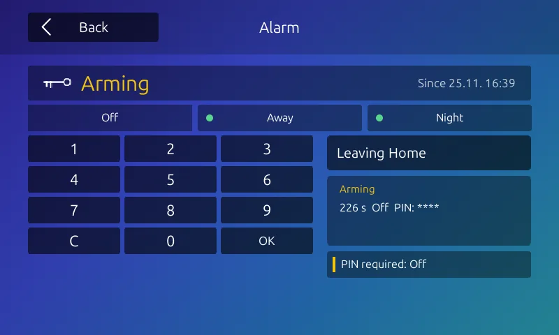</p>

The optional native Alarmo page stays a subpage in the original blue C300X
design. The configured return-after-standby setting still applies. It shows
reported alarm state, readiness, blocking contacts and entry/exit countdowns.
Tap a mode to execute directly when no PIN is required; otherwise the keypad
appears. Entry delay opens the disarm keypad when required. A pending command
blocks repeated taps; unavailable data is not displayed as a ready alarm.

The Alarmo alarm panel and the **Quick action**, the optional quick action or
status entity, are set in the **Alarm (Alarmo)** step right after the
activations, in the setup, the reconfigure and the settings menu. They are kept
with the Display patch off, since the alarm commands do not need it. Leave it empty to hide this area. To retain a stair-light
shortcut, select the integration's stair-light button explicitly. No stair-light
action is inserted automatically. The picker offers buttons, switches, lights,
fans, humidifiers, automations, sirens, scenes, scripts and their supported
toggle/button helpers. Existing read-only selections are retained, but cannot
be newly selected as a quick action. Media players are not supported here.
The selected entity's name is used, including an existing display-name override.

Update the bundled agent and apply the Display patch to install the page. No
background polling or device-file history is added. Reconnect attempts run
only after a failed event connection while the page is active.

## Display Home Page Buttons

<p align="center">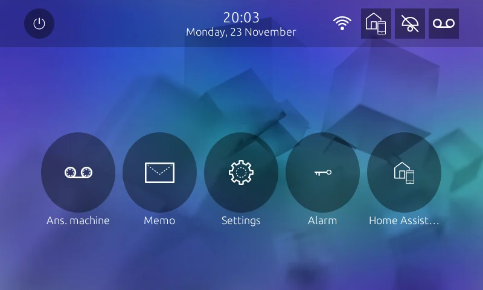</p>

With the Display patch, the Alarm button appears when an alarm panel is configured;
the Home Assistant button appears when a display page has configured content.
Their positions stay reserved, so a change in availability does not rearrange
the other home-page buttons. A temporary connection failure keeps the last
confirmed visibility instead of hiding both buttons.

## Display Device Controls

<table>
  <tr>
    <td align="center"><strong>Sensor and switch tiles</strong><br>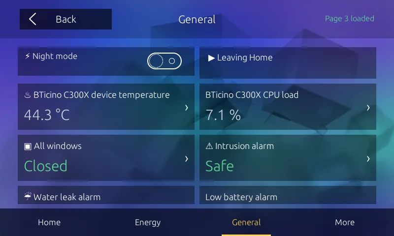</td>
    <td align="center"><strong>Light overview</strong><br>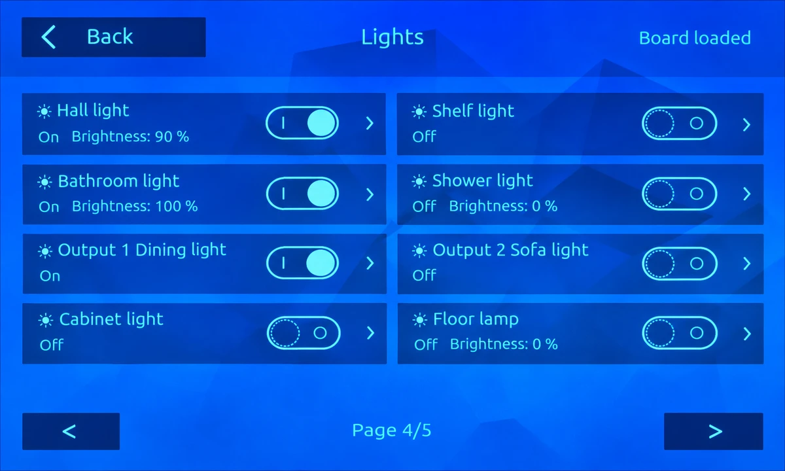</td>
  </tr>
  <tr>
    <td align="center"><strong>Brightness and color</strong><br>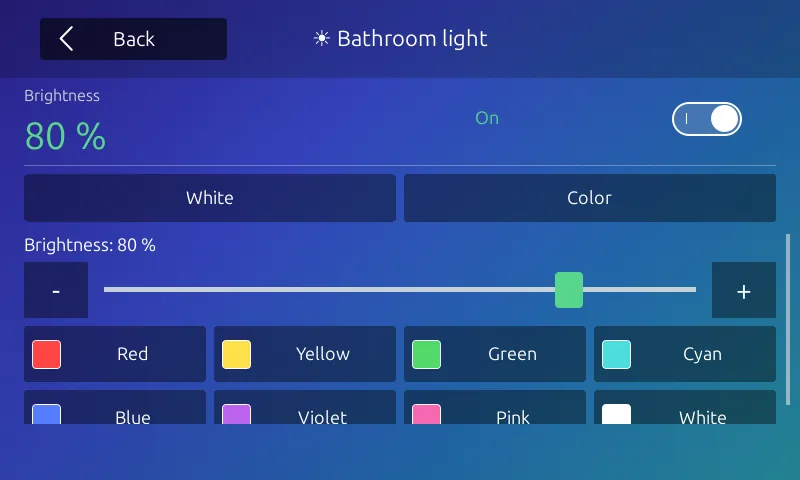</td>
    <td align="center"><strong>Media player</strong><br>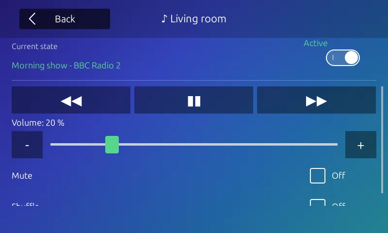</td>
  </tr>
</table>

Select entities under **Display pages**. Supported controls include lights,
covers, climate, fans, media players, locks, vacuums, valves, humidifiers and
water heaters, plus switches, automations, sirens, buttons, scenes, scripts,
numbers, selects and their input helpers. Sensors, binary sensors, people and
device trackers provide read-only tiles in the same two-column overview.
A chevron marks every tile that has a submenu: tap anywhere on such a tile to
open its supported controls, or tap a sensor tile for its read-only details.
Lights, fans and media players keep an on/off switch on the tile itself where
the entity supports one. Covers and climate entities have none, because neither
has a single on/off action: a full-height tile carries their buttons, and a
compact one leaves them to the submenu. Back returns to the same overview page
and scroll position; a state refresh that arrives while the list is moving is
applied once it settles.

Each tile's size is set per entity in the display tiles form. **Width** is
half or full. **Height** is half, the compact 64 px tile, or full, a 94 px tile
like a sensor's. A full-height tile carries the entity's own buttons, so the
common action needs no submenu:

| Entity | Buttons on a full-height tile |
| --- | --- |
| Cover | up, stop, down (those it supports) |
| Climate | target temperature minus/plus, by the entity's step |
| Light | on/off switch, brightness minus/plus in 10 % steps |
| Fan | on/off switch, speed minus/plus by about 10 %, at least one of the fan's speeds |
| Number | minus/plus, by the entity's step |
| Select | previous/next option, wrapping at either end |
| Media player | on/off switch, previous, play/pause, next (those it supports) |

A fan's tile shows its speed next to on/off, as a light's shows its brightness.
Minus/plus are dimmed while there is no value to step from, such as the
brightness of a light that is off or a thermostat without a target; tapping them
then opens the submenu. A press while the previous command is still on its way
is ignored. The tile background still opens the submenu, and every other control
stays there. **Automatic** keeps the size of the type, at half width: sensors
full height, switches their slimmer 58 px tile, which **Half** raises to 64 px,
and all other entities the 64 px half height. A dashboard configured before
these settings existed therefore looks the same until a size is chosen.

- Lights show brightness, eight color swatches and warm/neutral/cool white
  presets where supported. White presets stay within the light's Kelvin range;
  the Kelvin slider remains available for fine adjustment. Selecting a color
  sends one command, including both hue and saturation. Lights supporting both
  white temperature and color have separate tabs; brightness stays available
  in either tab, with the power button in the fixed summary.
- Covers show their reported position visually, plus opening/closing state.
  Supported up/stop/down buttons stay visible above the scrolling controls.
  Position and tilt are adjusted separately; missing position is not shown as
  closed.
- Climate entities separate measured temperature and reported heating/cooling
  activity from the selected HVAC mode. Target temperature, lower/upper target
  range, presets, fan mode and vertical/horizontal swing appear where supported.
  Target and HVAC mode are on the main tab; presets, fan and swing settings
  move to a separate settings tab when supported.
- Fans expose speed, oscillation, presets and direction according to their
  capabilities. Preset names come from the entity itself.
- Media players show what is playing, or their state when nothing is. On a
  tile this is the state line, so another secondary-line choice replaces it.
  The submenu has previous, play/pause and next side by side in one row of
  equal buttons (a pair of triangles, a triangle or two bars), then a volume
  slider, mute, source and sound mode, each only where the player reports the
  feature. The same symbols are on the tile's buttons. The on/off switch
  and play/pause appear only when the player reports the step its current state
  needs, and send that explicit service: turn on or off, play or pause. A
  media player cannot be chosen as the alarm page's quick entity. The line
  names the artist before the title, and a player that reports them also gets
  a shuffle switch and a repeat choice (off, all, one).
- Lights that report effects get an effect choice below their other controls.
- A tile carries a small symbol before its name for its type or device class,
  for example a sun for a light, an up-down arrow for a cover or a note for a
  media player. The symbols are characters of the fonts on the device (DejaVu
  Sans); no image file is added to it. Types and classes without a fitting
  symbol, such as a plain sensor, have none.
- Sensors with the device class timestamp or date show a short local time such
  as `14.11. 10:30` or `14.11.2026`, not the ISO text. A text that had to be
  cut ends in three dots.
- Locks are tiles that read locked, unlocked, locking, unlocking or jammed and
  open a detail page. It offers what changes something (lock when it is not
  locked, unlock when it is not unlocked) and, for a lock that can, opening
  the latch, in one row of equal buttons. Unlocking and opening ask for a
  second tap on the same button, which then reads "Sure?"; locking does not.
  A tap on another button takes over the question. The question stays until
  the page is left or the screen goes off. The display sends the explicit lock, unlock or open
  service for a lock that was selected on a page, never for another entity.
- Vacuums are tiles that read what the robot does (cleaning, docked,
  returning, paused, idle, error) and open a detail page with start, pause,
  stop, return to base and locate in one row, each only where the robot reports
  the feature and where it makes sense in its state, and the suction choice
  below. The display sends the explicit vacuum service of the button.
- Valves are tiles that read their position, or their state when they report
  none, and open a detail page with open, stop and close in one row and, for a
  valve that can, a position slider. The display sends the explicit valve
  service, and a position only from 0 to 100.
- Humidifiers are switch tiles that read the humidity in the room. Their detail
  page has the target humidity, within the range the humidifier reports, and the
  modes of a humidifier that has them.
- Water heaters are tiles that read the water temperature. Their detail page has
  the target temperature and the operation mode, each where the heater reports
  the feature.
- Automations and sirens are switch tiles. Persons and device trackers are
  read-only tiles that say home, away or the name of the zone.
- Sensor and binary-sensor tiles use larger readings and read-only details.
  Numeric sensors retain their unit and reported display precision. Details may
  show the entity's numeric battery level, humidity and illuminance attributes;
  unrelated attributes and history are not requested or forwarded.
- Number entities use HA units, bounds and step sizes; select entities show their
  actual options. Sliders send one command on release, not during movement.
- Numbers on every display page use the decimal sign of Home Assistant's
  language: a point in English, a comma in German, French and Italian; other
  languages use the English form. Select options on tiles appear in that
  language too.
- A choice, such as a select's options or a player's sources, offers its
  first options: at most 50, and only as many as fit into 2 kB of the answer
  to the display, where a character outside ASCII counts six bytes and an
  emoji twelve. An option taking more than 1 kB there is left out. If the
  dashboard would still be too large for the display to read, the longest
  choice lists are shortened further, one after another, until it fits; short
  lists such as a thermostat's modes are cut last. A dashboard too large even then, for example
  because of very many entities, shows Home Assistant as unavailable, and
  Home Assistant logs a warning.

State changes for selected entities use the existing event bridge, including
when no Alarmo entity is configured. There is no regular device-state polling.
Bursts are combined into a notification. Selected-entity changes that do not
alter the displayed values, availability or controls do not notify the device.
Alarmo and weather keep their existing event handling. Unchanged GUI items are
reused, preserving the overview position and active input.

Device requests to Home Assistant are serialised on the device. The agent
forwards them one at a time and refuses a second one while the first is open,
so the pages queue instead of colliding: waking from standby does not show a
transport error when the home page refreshes its buttons at the same moment a
page is opened. Pages asking for the same state at the same time are answered
from one request; commands always keep their own.

Command feedback distinguishes sending, accepted commands and matching state
reported by HA. HA state confirmation is not independent physical verification
for optimistic entities. An accepted command that HA never reflects is reported
as unconfirmed after 15 seconds; a track skip, which changes no state HA
reports, stays accepted. Feedback for an entity disappears a minute
after the last thing happened to it, so a tile returns to showing its plain
reading. Errors remain at the affected control; an uncertain transport result is
not automatically retried. During a connection outage the
last snapshot stays visible, explicitly marked as stale, with actions disabled.
Dashboard responses use compact UTF-8 within the device's fixed response budget.
If the combined configured content still cannot fit, HA logs the size and
returns `dashboard_too_large`; the display stays offline/stale rather than
showing an incomplete set of checks or fabricated history. Reduce the selected
display content before retrying. Check states, actions and history values are
not silently dropped to fit.
Unavailable controls are disabled and commands are validated again in HA against
the current selection and entity capabilities. Timeout and reconnect handling
only runs while the page is active. Display changes require the matching bundled
agent files and reapplying the Display patch after an update. Device rendering
and physical Ring Call interruption are not yet confirmed on hardware. No
additional polling, refresh timers or device-file writes are introduced by these
detail views.

### Picture tiles

<p align="center">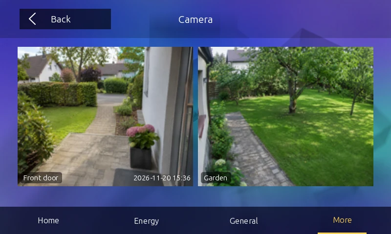</p>

A camera or image entity becomes a picture tile on the page you place it on.
By default the tile spans the page and follows its picture: the picture is as
wide as the tile, and the tile is as high as the picture's proportions make it.
Under **Tiles** the width can be set to half, so two pictures stand side by
side. A tile is at most 320 px high, which is what a page shows at once; a
picture that would be higher is shown whole and narrower than the tile. With
the height set to half (138 px) or full (286 px) the tile has that height and
the picture is cut around its centre to fill it. Home Assistant brings the
picture to the tile's size before the display loads it, so a full camera frame
never reaches the device. A picture smaller than the tile is enlarged up to
twice its size. The picture is a still, not a stream: an image entity is reloaded when
it has a new picture, a camera about every five minutes. The entity's name is
written in the bottom left corner of the picture. A tap does nothing.

The display loads the picture straight from Home Assistant, at the address the
device already uses for it. That address is signed with the entry's secret and
serves only camera and image entities that are on the display pages; it needs
no login, so anyone who can reach Home Assistant and has seen the address can
load that scaled picture. The address does not expire; it stops working when
the entity leaves the display pages or the display feature is switched off.
A camera or image
entity that is unavailable has no tile until it is back. If a picture cannot
be read once, the tile shows only the name until the next picture.

Picture tiles need a plain `http://` address of Home Assistant for the device:
the display cannot open `https://` addresses. With an HTTPS callback address
the tiles are left out. Picture tiles are not offered for the Alarm page.

## Display Settings

On the C300X itself, open **Settings → General**. The original **Tone buttons**
switch controls touch sounds. Directly below it, **HA feedback** turns colored
HA action confirmations and routine messages in the HA page's upper-right
header, such as "Page loaded", on or off (on by default). Text at the affected
control, errors, pending actions, connection warnings and actual alarm or entity
states remain visible.
This is a local device preference, not another HA integration option.

With the Display patch active, the C300X device page in Home Assistant also
offers **Touch tone** under **Configuration**. It controls the same original
device setting and follows changes made on the C300X. HA waits for the GUI's
confirmed value; without the GUI connection the switch is unavailable. The
agent uses a sleeping local connection, not periodic device reads, and does
not write a second copy of this setting to its configuration.
Confirmed touch-tone value changes appear in **Device event** as **Touch tone
changed**, with the stable event type `display_touch_tone_changed` for automations.
The initial reading, loss of the GUI connection and recovery with the same
value only refresh the switch. Starting HA does not set the touch tone.

With the matching 2.7.0 agent bundle, the same distinction applies to ringer
mute, ringer volume and forwarding: initial values and availability updates
synchronize their entities without firing change events. Message and memo
collections retain their last valid content identity across an access failure;
unchanged recovery is a state refresh, while actual content changes still
produce events. A changed value first observed after an outage describes the
new state, not who changed it. Repeated physical actions, doorbell rings and
call transitions remain separate events, even when their data is identical.

Changing the feedback setting saves it in the agent configuration, so it survives
GUI and agent restarts. Reading it and choosing the already saved value do not
write files; there is no periodic preference polling. If the agent cannot read
or save it, the switch is disabled with **Setting unavailable**; reopen General
to read the actual setting before trying again.

Only the optional Display patch that installs the additional HA/Alarmo pages
changes General settings. Installing or updating the agent's core media/ringer
hook alone leaves the page untouched. Turning the Display patch off restores
General settings while keeping the core media/ringer hook.

The Display patch backs up the original General settings page before changing
it, keeps the original tone control and restores the page on removal. Unknown
page layouts or a missing backup of an already patched page abort the operation
instead of replacing the original with a guessed version.

Everything about the display is under **Configure > Display**. Switch the
Display patch on under **Display and Display patch**; the Display menu then
offers **Display pages** and **Display tiles**. Choose the weather and the entities with the normal
HA selectors; Alarmo is set under **Alarm (Alarmo)** in the same menu;
control types come from their actual capabilities, not a manually chosen
widget.

**Display pages** is a list of the pages in display order: five built-in pages
(Status, Energy, Agenda, Leave home and Situations) and up to seven custom
pages. Pick a page to open a form with its fields only; saving returns to the
list. Entries show the page's number and name, for example
**Page 2: Living room**. A page the display does not show (switched off, or
without entities) has no number and follows the shown pages; **Add a page**
follows while a custom page is free. In a page's form a new position puts
the page there and numbers the others around it, and an entity that another page shows moves to
the opened page with its tile settings. The setup and the reconfigure dialog show the same pages in one
form, one section each, with free sections titled **Page +**. Alarmo is not
one of the pages: its Alarm page opens from the home page button and has an
area of its own in the Display menu.

| Field | Meaning |
| --- | --- |
| **Name** | Heading of the page on the display, in place of Home Assistant. The status page has none. |
| **Position** | Order of all pages, 1 to 12. In the settings a page takes the place it asks for and the other pages are numbered around it; left empty, a page stays where it is and a new page goes to the end. In the setup form, left empty, an existing page returns to its section's number. Equal positions put Energy, Agenda, Leave home, then Situations before regular pages; regular pages keep their section order. |
| **Entities** | Tiles of the page, in the order they are picked; drag them to reorder. |

The status-page section carries the weather card at its top,
set in its **Weather** field, followed by direct buttons for the other visible
pages and then its entities. The buttons also appear without a weather entity;
they use the already loaded dashboard and do not request fresh data. The heading
stays Home Assistant. **Show the status page** switches the entire page on or
off, independently of its optional weather card and entities. When enabled
(the default), it also appears with only its HA, alarm and time badges.
Disabling it keeps its settings. Messages still get a neutral page if no
other page is visible. Its internal name is `C300X`, which another page cannot use. Like
any other page it can be moved with its position. A section without a name and
entities stays unused; a page with entities needs a name. Each page name (in
any capitalization) and each entity can be used once. Page names are limited to
60 characters; a longer one is cut, and a position is rounded to a whole
number. Pages that only configured actions use follow the configured pages.
The sections are listed in the order of the display and their headings show
the page number, counted over the pages the display shows. A page it does not
show (switched off, or without entities) has no number and follows the shown
pages. Free sections come last and are titled "Page +"; fill one in to add a
page. Without a position the new page follows the existing ones. Sections of used pages are open, and so is the first free one.
The headings count what this form sets up. Two things it does not know can
shift the numbers on the display: a page that only configured actions use, and
an Energy page that is switched on while Home Assistant has no energy data.
The optional pages can be placed among regular pages, not just after them.
Their default positions are Energy 2, Agenda 10, Leave home 11 and Situations 12. Disabling an
optional page preserves its position and selections for later use.

#### Page navigation

<table>
  <tr>
    <td align="center"><strong>Favourites bar</strong><br>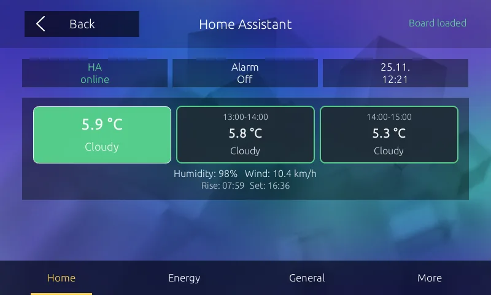</td>
    <td align="center"><strong>More: the other pages</strong><br>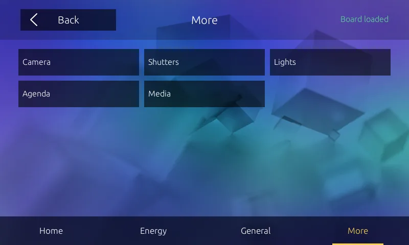</td>
  </tr>
</table>

**Page navigation** in the display settings chooses how the display changes
pages. It is one setting for all pages.

| Choice | On the display |
| --- | --- |
| **Favourites bar** | A bar along the bottom edge with one button per page. The current page is marked in yellow. This is the default. |
| **Arrows (previous / next)** | The row with `<`, the page number and `>` under the tiles. |

The bar has four places and follows the page positions. With up to four pages
every page has its button. With more pages the first three have one and the
fourth is **More**: it opens the list of the other pages, and **More** stays
marked while one of those is shown. The device's back button closes the open
list first. The status page is labelled **Home**; every other page shows its
name, on up to two lines.

With the bar the status page has no direct page buttons of its own, and the
tiles keep the height they have above the arrows. Changing the page uses the
dashboard that is already loaded and requests no data.

### Agenda

<p align="center">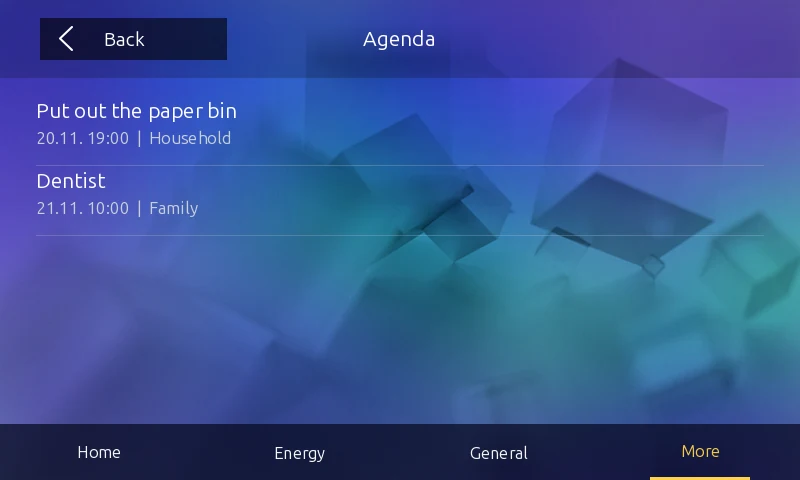</p>

Enable **Agenda** in **Display pages** and select up to eight HA calendars.
It shows up to five ongoing or upcoming events within the next seven days,
including all-day events. Calendar titles and event summaries stay in HA and
the display's memory, with no new files on the C300X.

The default position is 10, configurable from 1 to 12. HA fetches events in the
background and caches bounded results for five minutes, invalidating them on
calendar changes. A translated loading message appears during the first read;
a slow calendar does not hold up the dashboard or its controls. A calendar read
failure is shown explicitly, not as an empty diary. Disabling the page or
selecting no calendars stops its reads and clears its cache; unloading the
entry cancels pending work. No separate device polling or device-file writes
are added.

The [calendar reminder blueprint](blueprints.md) is separate: it sends a
notification before an event. Merely showing an event in Agenda does not trigger
a reminder or an action.

### Leave Home

Enable **Leave home** in **Display pages**, then explicitly select the door/window
contacts, lights and existing configured display actions to include (up to 24
contacts, 24 lights and eight actions). It does not
automatically inspect every entity in HA. Unavailable contacts remain unknown,
not safely closed. Opening or refreshing this page never executes an action.

Its position defaults to 11 and can be set from 1 to 12. Selected actions require
a second tap on **Confirm** within eight seconds and can be cancelled. Leaving
the page, changed page data, a busy command or a lost connection clears pending
confirmation; offline controls cannot execute commands. The first tap never
executes an action. Only the existing configured action allowlist is used. The
optional Alarmo section opens the existing Alarm page with its usual readiness
checks and PIN rules; it does not arm the alarm automatically. Disarmed panels
show readiness where supported; armed or arming panels show their actual state.

### Situations

Enable **Situations** in **Display pages** and pick the entities to watch. The
page lists only those that need attention, one row each with the state on the
right:

| Field | Shown when |
| --- | --- |
| **Windows and doors** | A contact with device class door, window, opening or garage door is open. |
| **Garage doors** | A cover with device class garage is open, opening or closing. |
| **Lights** | The light is on. |
| **Task lists** | The to-do list has pending items; the row shows their number. |

Up to 24 entities in total across the four fields. An unknown or unavailable
entity stays on the page, in yellow, and is never counted as closed or off. An
entity of another kind is shown as unsupported. With nothing to show the page
says so in one line.

The page is read-only: it runs no action, does not wake the display and does
not change the page by itself. It uses the dashboard updates that are sent
anyway and watches only the selected entities. It is off by default; its
position defaults to 12 and can be set from 1 to 12.

### Energy Page

<table>
  <tr>
    <td align="center"><strong>Now</strong><br>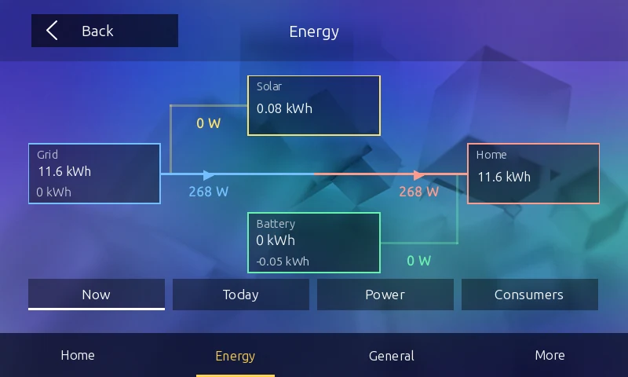</td>
    <td align="center"><strong>Power</strong><br>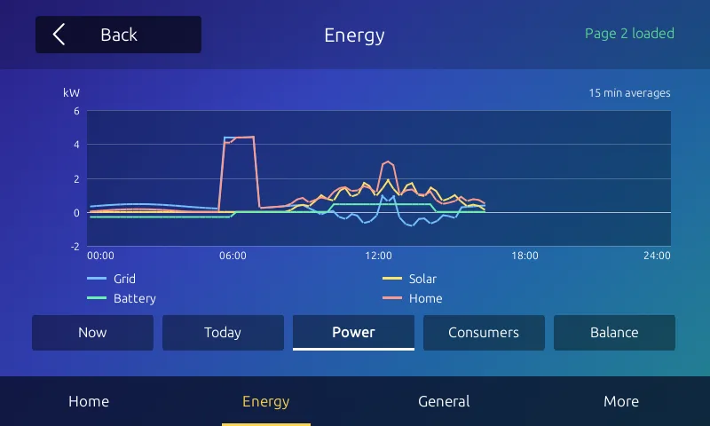</td>
    <td align="center"><strong>Consumers</strong><br>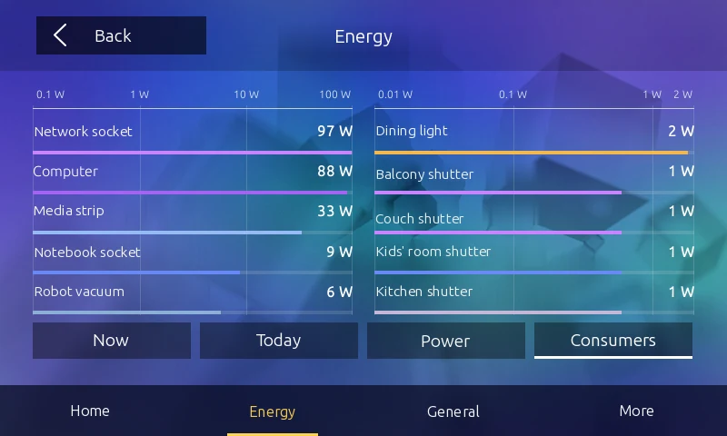</td>
  </tr>
</table>

The **Energy** section switches on an optional page that
shows Home Assistant's own Energy setup (**Settings → Dashboards → Energy**).
Nothing is configured twice: meters, their names, prices and power sensors come
from there.

| Field | Meaning |
| --- | --- |
| **Show the energy page** | Off by default. |
| **Position** | 1 to 12, 2 by default. At the same position Energy comes before Agenda, Leave home, Situations and regular pages. |
| **Show Now / Today / Power / Consumers / Balance** | Each subpage has its own switch. With more than one enabled, buttons at the bottom switch between them. Switching all five off hides the Energy page and stops its updates without deleting its settings. |

| View | Shows |
| --- | --- |
| **Now** | One box each for solar, grid, battery and home with today's energy. Current W/kW values appear beneath the flow arrows. Sources without a configured power sensor contribute 0 W; configured sensors are summed normally. A configured sensor that becomes unavailable remains unknown rather than 0 W. Meters may share one power sensor; its reading is counted once. |
| **Today** | Hourly bars with a labelled energy axis: grid import, solar and battery discharge stack above zero; grid export extends below zero without cancelling the positive stack. Tapping an hour also shows the negative export value. The table has up to eight rows with costs. Grid meters have distinct colored segments matching the table; further meters are grouped as **Other meters** in both places. Values and costs occupy separate columns. |
| **Power** | Today's power curves for grid, solar, battery and home from the power sensors configured in HA's Energy dashboard. The chart uses 15-minute means of recorded power statistics, a common W/kW scale and a visible zero line. Sources without a configured power sensor contribute zero without suppressing other curves. Export and battery charging appear below zero. Missing statistics from configured sensors leave gaps; no future or otherwise unrecorded samples are invented. |
| **Consumers** | The ten configured electrical devices with the highest current power in W, in two columns of five, sorted descending. |
| **Balance** | Share of solar energy used at home, self-sufficiency, net energy from the grid and today's cost. |

**Consumers** uses the current power sensors explicitly configured for individual
electrical devices in HA's Energy settings, with their configured names. It
does not infer power from energy meters or guess sensor IDs. Missing power
mappings and unavailable, invalid or negative readings are omitted; a measured
0 W remains visible with an empty bar. Missing mapped readings produce an
incomplete-data indication, and no usable readings produce an explicit empty
state. Nested configured devices remain individual readings, not a computed
household total. Each column scales its bars independently so smaller loads
remain legible; compare the numeric W values across columns. Colors are stable
per power sensor and drawn from an HA-like palette, not copied from an assigned
HA device color. Displayed values are rounded to whole watts, including readings
converted from kW. Ranking and bar lengths retain the unrounded measurements.

**Upgrade from 2.4.1:** Distribution has been removed. Enable **Consumers**
explicitly once if wanted; it is not a replacement selection applied
automatically. Other selected views are preserved. A selection containing only
the removed view becomes empty, leaving Energy configured but hidden, with no
view updates. Install the matching 2.5.0 agent and display bundle.

A kind of source that is not set up in Home Assistant is left out, with its
box, rows and bars. Without electricity sources the page is normally hidden;
explicitly selecting Consumers keeps it available for device readings or its
empty state, even without grid, solar or battery sources. Gas and water meters
are not part of the page.

Source colors are consistent across views: blue for grid, yellow for solar,
green for battery, violet for export and coral for home. An energy meter in
kWh does not provide an instantaneous W/kW measurement: select the appropriate
power sensors in HA's Energy settings to show those readings.

Home Assistant computes the charts from its recorder statistics; the display
only draws the result. The daily figures and power history are cached for five
minutes, with shared reads and retry backoff after database errors. The power
curve requires recorded mean statistics for the configured power sensors; it
does not start any new measurements. Only enabled views request or cache their
data. Disabling a view discards data used only by that view; shared daily values
remain only while another enabled view needs them. All caches live in HA's
memory, not in additional files. These switches do not change or delete Home
Assistant's existing recorder history.
Tap the Today or Power chart to inspect the selected recorded interval and its
exact supplied values. Compact history retains the values and missing intervals;
the display does not invent intermediate measurements.
The **Now** and **Consumers** views publish changed live power at most every ten
seconds. Consumers alone does not read or cache recorder history or daily
statistics. Disabling a view removes subscriptions used only by that view.
No charts are stored on the C300X and no extra device polling is added.
The display file of the page is loaded only
while the page is open. Texts follow the language of Home Assistant in German,
English, French and Italian; other languages show English.

An entry saved before the pages dialog opens it with its existing pages: the
status page first, then the others in the order their names first appeared.
Entities without a page name keep their untitled page when saved unchanged.
Adding another entity to that page requires a name. The tiles form labels it
**Page without title**.

The display tiles form has one section per tile, in the order the display
shows them: page by page, and within a page in the order of its entities. A
section is titled with the page and the entity's Home Assistant name, for
example **Living room › Ceiling light**; two tiles with the same title get the
entity id added. With more than two tiles the sections start collapsed.

| Field | Meaning |
| --- | --- |
| **Width**, **Height** | Half or full; Automatic keeps the usual size of the entity type. |
| **Name** | A text of your own. Left empty, the Home Assistant name is shown. A tile saved earlier to show its entity ID shows the ID here; overwrite or empty it. |
| **Secondary line** | State, entity id, last changed, last updated, or nothing. |

Missing or unavailable entities retain their configuration and show unavailable
rather than changing the saved layout.

The optional quick action of the Alarm page, set in the **Alarm (Alarmo)** step, gets a
section of its own at the end, titled **Alarm page › name**, with name and secondary line, even if it is not
selected for an overview page; saving the pages keeps these settings. Selecting
it does not add it to the overview. Leave the quick action empty to hide it; no
stair-light default is inserted. Connection/maintenance settings remain separate. Calendar and notification
logic stays in HA automations. This is a normal configuration dialog, not a visual
editor, and opening the dialog does not operate a device.

## Display Notifications

Automations can use `bticino_c300x.show_display_notification` to show a compact
notice on the native Home Assistant page. Tap it for details. It does not open
automatically, cover Alarmo PIN entry, interrupt Ring Calls or wake the display.

```yaml
action: bticino_c300x.show_display_notification
data:
  notification_id: front_window
  title: Front window
  message: The front window is still open.
  icon: warning
  priority: important
  expires_in: 3600
```

Use the same ID to replace a message and `bticino_c300x.dismiss_display_notification`
with that ID to remove it. IDs allow lowercase letters, digits, `_` and `-` (64
characters maximum). Titles allow 80 characters, text 500, expiry 1 second to
7 days. Symbols are `info`, `warning` and `calendar`; priorities are `normal`,
`important` and `urgent`. Specify `entry_id` with multiple C300X integrations.

Up to eight messages (16 KiB of encoded data) are retained in HA memory, highest
priority first. When full,
the oldest message at the lowest priority is replaced; a lower-priority incoming
message cannot evict a higher-priority one. Restarting HA or reloading the
integration clears the list. Automations should resend still-relevant conditions.
No message history or notification files are written to the C300X or Recorder.

Optional `actions` accepts at most two `{action_id: ..., label: ...}` entries from
the existing display action allowlist. An action never runs merely because a
notification arrives. **Mark read** only dismisses the message; it does not resolve
the physical condition or run an action. Updated messages reject stale commands.

The bundled **C300X Calendar display reminder** blueprint selects an existing HA
calendar, target C300X, lead time, reminder text and expiry. It uses a calendar
event trigger rather than polling the device or adding a calendar provider.
For a reliable test, create the event more than 15 minutes in advance, as noted
in the [Home Assistant calendar documentation](https://www.home-assistant.io/integrations/calendar/#automation).

### Standard Notify Service

With the display integration enabled, each entry registers a named Notify action.
The default first entry uses `notify.bticino_c300x`. Choose the action for your device in
HA's action editor. It accepts the standard `message`, optional `title`
(default **Home Assistant**) and nested `data` fields; the target is fixed to
that entry, so do not supply `target`.

```yaml
action: notify.bticino_c300x
data:
  title: Front window
  message: The front window is still open.
  data:
    notification_id: front_window
    severity: warning
    wake_duration: 30
    sound_duration: 30
    expires_in: 3600
```

Use the exact action ID shown in HA's action editor if your entry has a different
name or you have multiple C300X devices. For example, an entry named **Front door**
uses `notify.bticino_c300x_front_door`; a name collision adds a short unique
suffix. HA remembers the chosen action ID across reloads and restarts. Renaming
an entry updates its displayed label, not its action ID. Permanently removing
the entry releases its name reservation.

If HA cannot read or confirm the saved name reservations, the integration does
not register a replacement action under another device's name. Resolve the HA
storage problem or restore the reservations from a working HA backup before
retrying setup.

| Severity | Default wake duration | Default sound duration |
| --- | --- | --- |
| `info` (default) | 30 seconds | 30 seconds |
| `warning` | 30 seconds | 30 seconds |
| `error` | 30 seconds | 30 seconds |

Each duration accepts whole seconds from 0 to 300; zero disables that effect.
`notification_id` is optional and reuses the existing notice ID rules. Title,
message and `expires_in` use the same limits as above, with a default expiry of
one hour. There are no arbitrary URLs, audio files or executable actions in
this service's data. This is supplementary information, **not a fire alarm or
other life-safety alerting system**.

Popup, wake and the bounded stock short-beep signal are permitted only on the
stock Home or HA page when the GUI is ready and no call is active or ringing.
Alarmo, PIN entry, settings and other protected pages block these effects.
With the matching agent and Display patch, a live GUI explicitly reports this
protection: the action completes without a delivery error, keeps the HA notice,
and logs that popup, wake and sound were suppressed. This is not confirmation
that an alert was shown or heard. A missing or disconnected GUI remains an error.
User interaction, standby, a call or leaving an allowed context stops them;
they are not queued for the next wake or replayed on return. Higher-severity
alerts may replace lower-severity alerts, not vice versa.

The integration stores the notice in HA memory, then sends exactly one POST to
the agent. No waiting GUI connection means an error, not a native queue or
automatic retry. The stored notice may still be read later on the HA page,
without delayed wake or sound. Protection is tied to the live GUI connection,
not a persistent flag; the connection adds no periodic status polling or device
file writes. An accepted response confirms a write to the
waiting GUI connection only; it does not prove GUI rendering, physical wake
or audible output. A lost response does not prove non-delivery.

This feature requires the matching **2.5.0 agent and display bundle**, including
the reapplied Display patch. Test your notifications on the actual device before
relying on an automation; a successful action is not proof of audible or visible
delivery.

## Entity Reference

<table>
  <tr>
    <td align="center" valign="top"><strong>Controls</strong><br>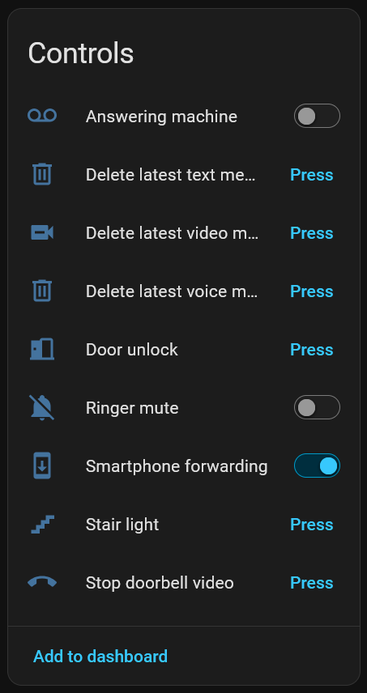</td>
    <td align="center" valign="top"><strong>Sensors / Events</strong><br>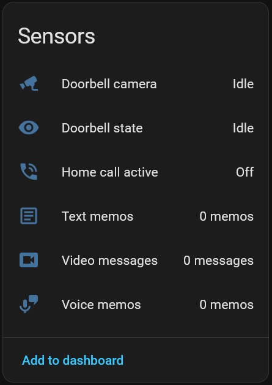<br>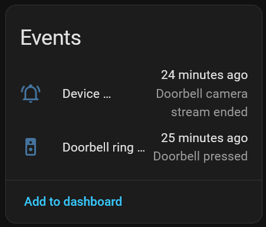</td>
    <td align="center" valign="top"><strong>Configuration</strong><br>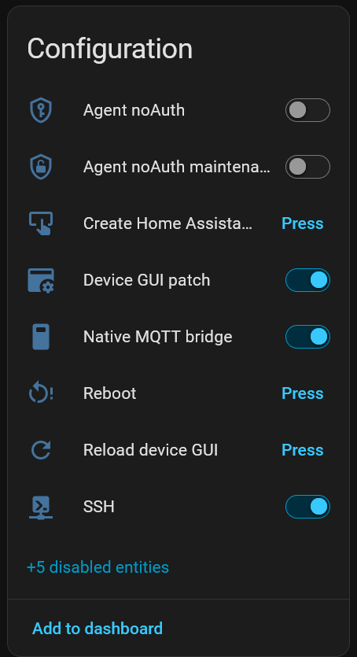</td>
    <td align="center" valign="top"><strong>Diagnostics</strong><br>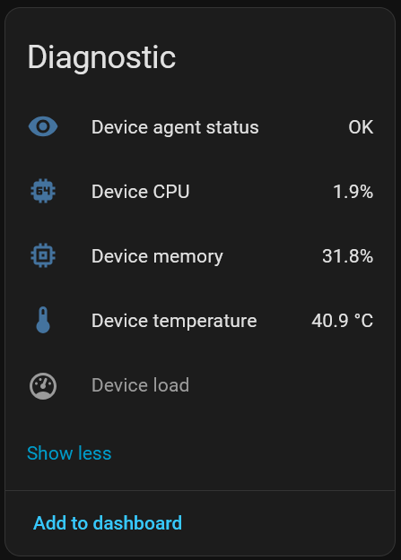</td>
  </tr>
</table>

Entities are capability-gated. If the installed agent does not advertise a
feature, the matching entity is not created.

| Platform | Entity | Purpose |
| --- | --- | --- |
| `camera` | Doorbell camera | On-demand/Ring Call/Home Call media entry point. |
| `event` | Doorbell ring event | Ring-only event entity. |
| `event` | Device event | Canonical native-agent events such as doorbell, call, ringer, forwarding, stair light, activation, memo and message changes. |
| `sensor` | Media readiness | Aggregated media setup state and actionable failures. |
| `sensor` | Device agent status | Agent connection and health summary. |
| `sensor` | Device agent diagnostics | Self-test and watcher diagnostics. |
| `sensor` | Doorbell state | Current doorbell/media state derived from native events. |
| `sensor` | Device CPU/load/memory/temperature | Optional low-frequency native-agent metrics. |
| `sensor` | Video messages, text memos, voice memos | Local device message/memo counters and latest metadata. |
| `binary_sensor` | Home call active | Whether Home Call is currently active. |
| `select` | Forwarding | Forwarding mode: `enabled` (Smartphone), `homeassistant` or `blocked`. |
| `switch` | Ringer mute | Device ringer mute state. |
| `number` | Ringer volume | C300X `0..10` ringtone volume scale. |
| `switch` | Answering machine | Device answering-machine enabled state. |
| `switch` | Save images | Automatic visitor images on or off (on by default). |
| `switch` | Touch tone | The display's touch-sound setting. |
| `select` | Camera resolution | High (688×480) or low (400×288) camera stream, from the next stream on; high by default. Not offered on firmware 3.0.x, which is fixed to low. |
| `select` | Audio codec | Device audio codec `speex` (stock) or `pcmu`; changes the device configuration explicitly. |
| `switch` | Home Assistant media user | Creates/repairs the local C300X media user when used. |
| `switch` | SSH, noAuth, noAuth maintenance, mDNS discovery | Explicit maintenance controls. |
| `switch` | Display patch, API firewall patch, IPv6 firewall patch | Explicit device-side patch controls. |
| `switch` | Native MQTT bridge, legacy MQTT bridge | Local MQTT migration/compatibility controls. |
| `button` | Door unlock, stair light, device activations | One-shot device actions. |
| `button` | Stop doorbell video | Stops an active agent-owned on-demand media session. |
| `button` | Reboot, restart agent, reload display, remove device agent | Explicit maintenance actions. |
| `button` | Delete latest video/text/voice memo | Delete actions that require matching capability and patch state. |

The agent status attribute `agent_restart_count` counts observed changes of the
agent process instance since this integration entry was loaded. It does not
count device reboots, and agents without instance metadata cannot contribute to
it. A lower uptime alone is not treated as
restart evidence.

Detailed agent diagnostics remain available live, but volatile debug attributes
(loop counters, descriptor counts and observation timestamps) are excluded from
Recorder history. Health states, CPU measurements, write counters and watchdog
triggers retain their normal history behavior. Diagnostic entities remain
disabled by default.

The diagnostics attribute `media_watchdog_last_percent` records the CPU value
of the last actual watchdog trigger, not every healthy observation. Use the
Device CPU sensor for current CPU measurements.

## Service Reference

Services called by a HA user respect that user's control permissions. Device
commands require access to the matching enabled entity; configured actions keep
the caller's identity. Maintenance, explicit stair-light address overrides,
capture/analysis, notification management and stored-message services are
admin-only. Trusted context-free automations remain supported. See
[service permissions](../SECURITY.md#home-assistant-service-permissions).

| Service | Purpose |
| --- | --- |
| `bticino_c300x.show_display_notification` | Shows or replaces a notice on the native Home Assistant display page. |
| `bticino_c300x.dismiss_display_notification` | Removes a display notice by its ID. |
| `bticino_c300x.run_action` | Runs one allowlisted display/dashboard action by action id. |
| `bticino_c300x.run_device_activation` | Runs one configured C300X activation by activation id. |
| `bticino_c300x.alarm_command` | Sends an alarm command to the configured alarm control panel entity. |
| `bticino_c300x.stair_light` | Activates the configured or supplied stair-light address. |
| `bticino_c300x.unlock_door` | Unlocks a configured door lock. |
| `bticino_c300x.activate_doorbell_video` | Starts or renews on-demand doorstation media. |
| `bticino_c300x.stop_doorbell_video` | Stops an active agent-owned on-demand media session. |
| `bticino_c300x.answer_doorbell_call` | Answers the active Ring Call. |
| `bticino_c300x.hangup_doorbell_call` | Hangs up the active Ring Call. |
| `bticino_c300x.capture_doorbell_call` | Records a 1–15 second MP4 from a Ring Call (`ring`, default) or idle live view (`on_demand`), with optional audio and local capture artifacts. |
| `bticino_c300x.run_ring_wyoming_analysis` | Transcribes an existing Ring Capture WAV through a local Wyoming Whisper service. |
| `bticino_c300x.evaluate_ring_analysis` | Evaluates a local transcription JSON and optionally unlocks only on strict phrase match. |
| `bticino_c300x.start_home_call` | Starts an audio-only Home Call to the C300X display. |
| `bticino_c300x.stop_home_call` | Stops an active Home Call. |
| `bticino_c300x.reboot` | Schedules a device reboot through the maintenance API. |
| `bticino_c300x.reload_gui` | Reloads the C300X graphical interface. |
| `bticino_c300x.play_latest_video_message` | Plays the latest stored video message on a media player. |
| `bticino_c300x.play_latest_voice_memo` | Plays the latest voice memo on a media player. |
| `bticino_c300x.write_text_memo` | Creates one local text memo on the C300X. |
| `bticino_c300x.delete_latest_video_message` | Deletes the latest video message when supported. |
| `bticino_c300x.delete_latest_text_memo` | Deletes the latest text memo when supported. |
| `bticino_c300x.delete_latest_voice_memo` | Deletes the latest voice memo when supported. |

### Capture Modes

Stored answering-machine videos, voice memos and Ring Capture MP4 files are
shared media: any authenticated HA user can play them through the integration's
media endpoints, regardless of camera entity permissions. This does not grant
permission to record, delete messages or control the device. The snapshot-image
endpoint checks camera permission, but files in HA's local-media directory are
also accessible through HA's own media browser. See [Privacy](../PRIVACY.md).

`capture_doorbell_call` defaults to `capture_mode: ring`. Existing Ring Capture
automations and blueprints keep their behavior: audio or an announcement answers
the active Ring Call before recording. To record without ringing the doorbell,
explicitly select `capture_mode: on_demand`. This starts an idle doorstation live
view and records video with optional audio; it does not answer a Ring Call.

Ring capture does not take over an already answered call. A capture with audio
or an announcement is refused while a client watches the ring preview: an
answered call cannot be shared, so the call is left ringing instead of being
answered and dropped. A video-only capture shares the preview. Unloading the
integration or observing a replacement call cancels the capture. Automatic
hangup is skipped when the captured call cannot be identified reliably. The
device API has no atomic call-specific hangup, so a call change between the last
status check and the hangup request cannot be excluded entirely.

For automatic recording on rings, use the bundled **C300X Ring capture**
blueprint rather than treating **Browse saved images and videos** as a recording switch.
Select the C300X device; the blueprint matches its ring events and requires
readiness `ready` or `warning`. Its duration defaults to 5 seconds (range 1-15)
and **Include audio** defaults to on, so it answers the active Ring Call.
Video-only capture does not answer. The blueprint's capture file directory
selects the WAV/JPEG/metadata workspace, not the MP4 output path. See
[Recording videos](visitor-journal.md#recording-videos) for the setup steps.

Example action for a script or automation; replace `YOUR_C300X_ENTRY_ID` with the
integration entry id:

```yaml
- action: bticino_c300x.capture_doorbell_call
  data:
    entry_id: YOUR_C300X_ENTRY_ID
    capture_mode: on_demand
    duration_seconds: 5
    include_audio: true
  response_variable: capture
```

Set `include_audio: false` for video only. Both modes accept durations from
`1` to `15` seconds. MP4 files default to `/media/c300x/`; WAV audio, JPEG frames
and JSON metadata use the existing capture workspace under `/config/c300x/`
unless configured otherwise. The metadata field `capture_mode` records the
requested mode; native media ownership is not continuously verified. The optional
`response_variable` provides the exact per-recording paths, such as
`{{ capture.output_path }}` and `{{ capture.metadata_path }}`; use these in
follow-up actions instead of the mutable `latest` pointers.

Successful new captures in either mode are indexed in that device's card
history when `output_path` is left unset. The shared MP4 directory is not
scanned to guess device ownership or import arbitrary historic recordings;
custom output paths are not indexed. History visibility and its retention
window do not delete MP4s. Manage those files separately from snapshot and
capture-workspace cleanup. See [Storage and access](visitor-journal.md#storage-and-access).

On-demand capture checks for idle media before opening its recording client and
rejects a reported busy or unclear state. The native API does not reserve the
media owner across this check and RTSP setup. A physical call that begins during
setup can change the stream, so the recording may fail or include Ring video.
On-demand capture does not answer or hang up a Ring Call. Completion, failure or
cancellation closes its own recording client. `announcement_path` is supported
only in `ring` mode and is rejected before starting an on-demand capture.

## Device Activations

Device activations are configured from setup, options, or reconfigure. They are
not raw JSON input for normal users.

Modes:

- **Automatic** keeps the generated stair-light activation out of the payload and
  uses activation items as configured by the user or reported by the agent.
- **Manual** reserves the `stair_light` id and generates one stair-light item
  from P/N address parts. This leaves up to 15 additional user-managed items.

Limits:

- Maximum total activation items sent to the native agent: `16`.
- Activation IDs: letters, numbers, `_` and `-`, up to 32 characters.
- Activation address: OpenWebNet `where` value, up to 31 characters.
- Activation names: up to 63 characters.

## Media and Audio

Live browser media uses Home Assistant's WebRTC provider/go2rtc. The native
agent exposes RTSP sources for:

- ring preview video,
- answered Ring Call audio/video with talkback backchannel,
- on-demand doorstation audio/video,
- Home Call audio.

These sources support interleaved RTP over RTSP/TCP. UDP transport is not
supported; external clients must select TCP.

Audio gain options:

- **Live audio level (dB)** affects on-demand and Ring Call downstream
  audio. Default is `0 dB`.
- **Volume of ring recordings (dB)** affects the audio in Ring Capture MP4 files.
  Default is `6 dB`. At `0 dB` the level of the device audio is left unchanged:
  neither the gain nor the limiter that guards it is applied. The separate
  16 kHz mono WAV used for transcription is not affected by this setting.
- The allowed range is `-20 dB` to `+20 dB`.
- At `0 dB`, live audio stays on the neutral path and the integration avoids
  unnecessary gain updates.

## Expert Notes

- The native-agent API contract is documented in
  [Native Agent API](../native_agent/API.md).
- Runtime packaging and release-agent reuse rules are documented in
  [Native agent](native-agent.md).
- Release hardware checks are documented in
  [Release validation](release-validation.md).
- Security exceptions for local-only SSH bootstrap and MQTT transport are
  documented in [Security](../SECURITY.md).
