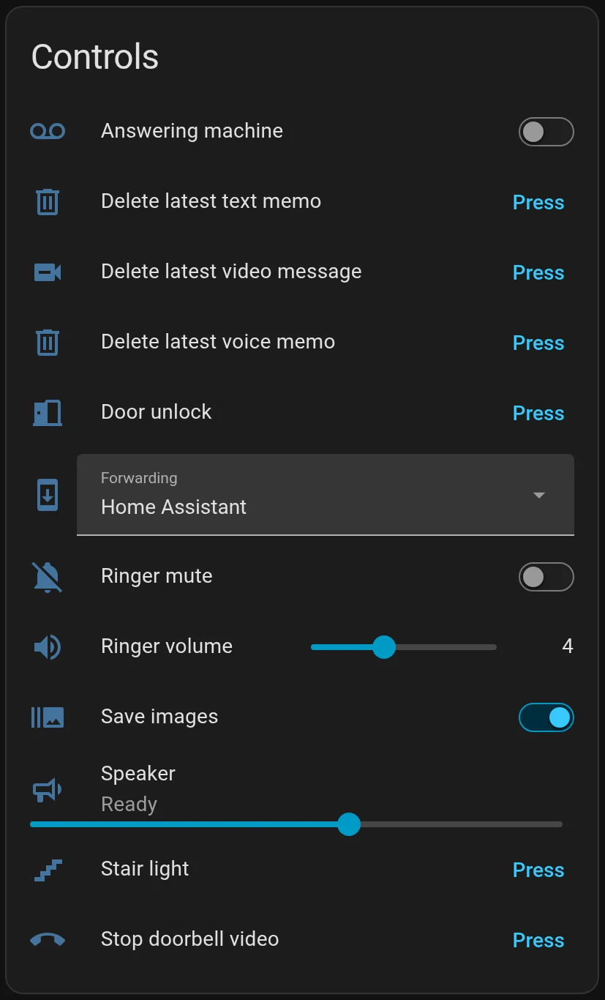
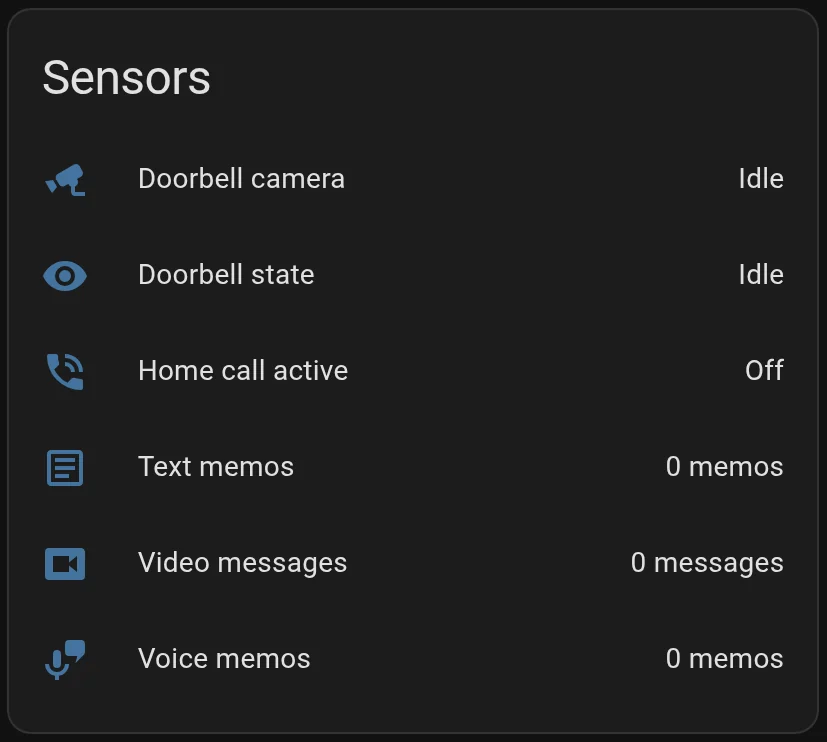
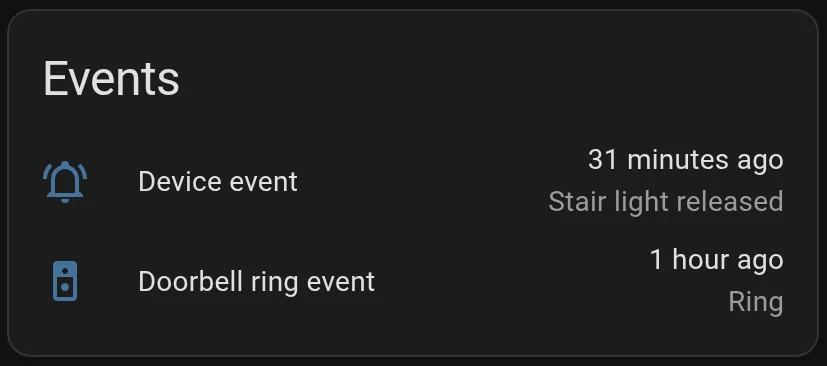
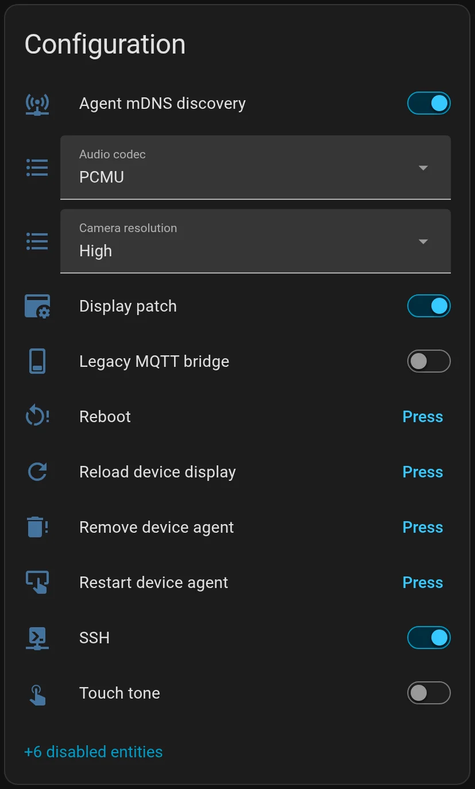
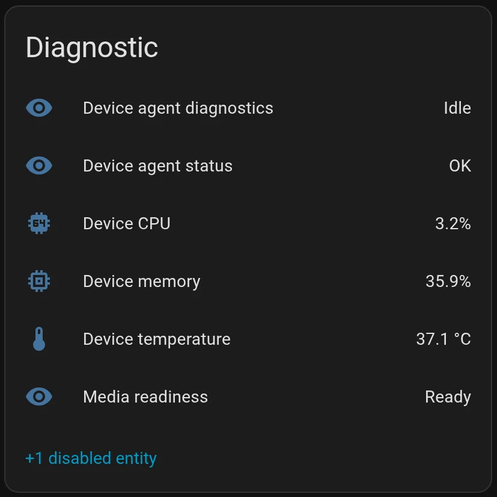

# Reference

Lookup tables for settings, entities, actions and events. How to use the
features is in [Using the Integration](user-guide.md), the station display in
[Station Display Pages](display.md), and how the parts work together in
[Architecture](dev/architecture.md).

## Models and Features

One integration, one device agent and one card serve two BTicino door
stations:

- **Classe 300X (C300X)** on firmware `1.7.x`, `2.0.2` or `3.0.6`; firmware
  `3.0.6` has only the low-resolution camera stream
  ([what differs](quickstart.md#firmware-306)).
- **Classe 100X (C100X)** on firmware `1.5.8`, **in test** in
  [issue #51](https://github.com/memphi2/ha-bticino-c300x/issues/51). It
  installs from the C100X test package, which runs on a C100X only; a C300X
  keeps the regular release. Model notes: [Classe 100X](c100x-experimental.md).

The agent detects the model on the station and reports it with the features it
offers. A feature the model does not offer creates no entity, option or
action, and the agent refuses its requests.

**Yes**: offered. **In test**: offered on the C100X, not yet confirmed on a
C100X device (issue #51). **No**: not offered on that model.

| Feature | C300X | C100X 1.5.8 |
| --- | --- | --- |
| Agent installation over SSH | Yes; factory root login or your SSH login | In test; needs an SSH-enabled station, see [Install the Device Agent](quickstart.md#install-the-device-agent) |
| Discovery on the network (mDNS) | Yes, `_bticino-c300x-agent._tcp` | In test, `_bticino-c100x-agent._tcp` |
| Door unlock, stair light, device activations | Yes | In test |
| Live video, Ring Call, talkback | Yes | In test |
| Home Call | Yes | In test |
| Forwarding select | Yes | In test |
| Picture controls | Ring Call; on-demand video on 1.7.19, 2.0.2 and 3.0.6 (TVP5150 boards), tested on 1.7.19 | In test; the station's day ranges |
| Camera quality (size, bit rate, frame rate) | Yes; 3.0.6 only the low stream | In test; low stream only |
| Camera resolution select, 960x576 | 1.7.x and 2.0.2; 960x576 on 1.7.19 and 2.0.2 only | No: the station sends only the low stream |
| Visitor images, Ring capture | Yes | In test |
| Audio codec select (PCMU) | Yes; 3.0.6 already runs PCMU | No: the station's audio runs at 16 kHz; HA still gets PCMU through the agent |
| Ringer volume | Yes | In test |
| Ringer mute | Yes, through the core GUI hook | In test; after the [display activation](display.md#classe-100x-activation-by-reboot) |
| Answering machine, video messages, voice memos | Yes | No: the station's firmware switches the answering machine off |
| Text memos: read, create | Yes | In test |
| Delete latest memo or message | With the Display patch | No |
| Speaker, `tts.speak`, spoken notifications | Yes; tested on 1.7.19 | No |
| Display pages | Display patch | In test; [activation by reboot](display.md#classe-100x-activation-by-reboot), operated with the station's keys |
| Display notifications (Notify `display`) | With the display pages | In test; after the activation, without a tone |
| Touch tone switch | With the Display patch | In test; after the activation |
| Message LED (Notify `led`) | Where the agent reports it | No |
| Home page buttons layout | With the Display patch | No |
| Reload device display | Yes | No: the display program cannot be restarted |
| Agent update through the Repair | Yes | In test; only the C100X package updates a C100X |
| Remove device agent | Yes | In test; restores the original display and routing first |

## Options

**Configure** opens a menu of settings areas. Each area saves when you submit
it and returns to the menu; the other areas keep their settings. **Done**
closes the menu. An area submitted unchanged changes and reloads nothing. A new
setup and **Reconfigure** walk through the same areas in turn. Every field has
a help text.

| Area | Fields (default) | Writes to the device |
| --- | --- | --- |
| Connection to the C300X | Address of the C300X; Port (`8091`); Access key; Maintenance key; Address of Home Assistant for the C300X (optional callback URL). | Keys only during the explicit installation. Switching the callback between `http` and `https` updates the agent configuration and restarts the agent once no call or stream is running. |
| Video and audio | Door station video and audio (on); Set up video and audio access on the C300X (on); Live audio level (`0 dB`); Volume of ring recordings (`6 dB`); Connection paths for the live picture (`prefer_ipv4_ula`); Talk through the Home Assistant camera view (off). | The media access only during setup or its Repair. Audio levels are runtime values, sent only when they differ from the default or change. |
| Visitor Snapshot (video on) | Image width 64-800 px (`800`); height 64-480 px (`480`); delay 1-300 s (`3`); keep 1-365 days (`14`); date and time in the image (on). | No. |
| Camera quality (video on, when the agent offers it) | Picture size; bit rate; frame rate; **Use recommended snapshot size (800×480)**. Values per firmware and model: [Camera Quality and Picture Size](user-guide.md#camera-quality-and-picture-size). | Yes: stored on the device and applied with a normal device reboot. |
| Activations: locks, lights, stair light | Stair light address Automatic or Manual (P `01`, N `00`); add, edit or remove activations. Rules: [Device Activations](user-guide.md#device-activations). | Only after saving, and only when the activation list differs. |
| Speech (the agent can play sound and the display pages are on; not on the C100X) | Text-to-speech engine; Language. | No. Read when a notification is spoken. |
| Display > Display and Display patch | Home Assistant pages on the display; Allowed actions (JSON); Keep the page open on screen standby; Page navigation; Home page buttons: **Stock view** (default; the Alarm and Home Assistant buttons appear only when they have something to open, among the original buttons) or **Fixed side by side**. | Yes: the Display patch is applied or restored. Changing the home page buttons applies it again and restarts the display once. On a C100X the form has no home page buttons, and turning the pages off restores the original display with one reboot ([activation by reboot](display.md#classe-100x-activation-by-reboot)). |
| Display > Display pages, Display tiles | Weather, entities per page and their order; size, name and secondary line of each tile. Offered while the display pages are on; tiles once a page has an entity or Alarmo has a quick action. | No. Stored in Home Assistant; the display asks for them. |
| Display > Alarm (Alarmo) | Alarmo alarm panel; Quick action. Kept when the Display patch is off. | No. |

The display areas are described in [Station Display Pages](display.md).
Maintenance controls (SSH, noAuth, mDNS discovery, firewall patches, display
reload, reboot, agent update and removal) are device entities and Repairs, not
settings areas; they write to the device only when used. See
[Maintenance and Removal](advanced-maintenance.md).

**Connection paths for the live picture** decides which network addresses the
browser may use for the live picture. The default is **IPv4 and local IPv6 (ULA) - recommended**
(`prefer_ipv4_ula`). All four choices, their address filters and the relay and
mDNS paths they keep are explained in
[Connection Paths for the Live Picture](media-troubleshooting.md#connection-paths-for-the-live-picture).
No address or token is entered in this selector.

### Keys

- New keys, and keys of a changed connection, are checked before saving; a
  rejected key gives a different error than an unreachable station. An empty
  key field keeps the saved key.
- A rejected access key takes the entry offline until it is corrected through
  Home Assistant's reauthentication prompt; the other settings are kept.
- A rejected maintenance key locks only maintenance actions such as restart,
  update and repair. Calls, video, door and events keep working.

More: [Tokens and Access](advanced-maintenance.md#tokens-and-access).

### Removal

Deleting the entry, uninstalling the package and removing the device agent are
separate steps with different effects on settings, media and backups. Follow
[Remove Home Assistant Integration](advanced-maintenance.md#remove-home-assistant-integration).

## Entities

<table>
  <tr>
    <td align="center" valign="top"><strong>Controls</strong><br></td>
    <td align="center" valign="top"><strong>Sensors / Events</strong><br><br></td>
    <td align="center" valign="top"><strong>Configuration</strong><br></td>
    <td align="center" valign="top"><strong>Diagnostics</strong><br></td>
  </tr>
</table>

Entities depend on what the installed agent reports: a feature it does not
offer creates no entity.

| Platform | Entity | Notes |
| --- | --- | --- |
| `camera` | Doorbell camera | Live picture, Ring Call and Home Call media; shows the latest visitor image when idle. |
| `media_player` | Speaker | Station loudspeaker for TTS and sounds; a door call ends a sound at once. See [Speaker Announcements and TTS](user-guide.md#speaker-announcements-and-tts). Not on the C100X. |
| `event` | Doorbell ring event | Standard doorbell event; see [Events](#events). |
| `event` | Device event | Diagnostic; all other station events; see [Events](#events). |
| `sensor` | Media readiness | See [Media Readiness](media-troubleshooting.md#media-readiness). |
| `sensor` | Device agent status | Connection and health of the agent. |
| `sensor` | Device agent diagnostics | Self-test and watcher details. Disabled by default. |
| `sensor` | Doorbell state | Doorbell and media state from the station's events. |
| `sensor` | Device CPU, Device temperature | Enabled by default when supported. |
| `sensor` | Device load, Device memory | Disabled by default. |
| `sensor` | Video messages, Text memos, Voice memos | Counters and latest metadata of the station's own messages and memos. Not on the C100X. |
| `binary_sensor` | Home call active | On while a Home Call runs. |
| `select` | Forwarding | Smartphone, Home Assistant or Blocked; automations use `enabled`, `homeassistant`, `blocked`. Answering a Ring Call in HA needs Home Assistant. |
| `select` | Camera resolution | High (688x480 from the factory) or low (400x288) stream from the next stream on; high by default. Not on firmware 3.0.x or the C100X. |
| `select` | Audio codec | `speex` or `pcmu`; a change writes the device configuration and restarts it once. `pcmu` is recommended; see [Codec and Audio Levels](user-guide.md#codec-and-audio-levels). Not on the C100X. |
| `switch` | Ringer mute | Station ringer mute. On the C100X after the display activation. |
| `number` | Ringer volume | Display scale `0..10`; `0` is muted. |
| `switch` | Answering machine | Station answering machine on or off. Not on the C100X. |
| `switch` | Save images | Automatic visitor images; on by default. |
| `switch` | Touch tone | The display's touch sound. Needs the Display patch, on the C100X the display activation; unavailable without the agent's connection to the display. |
| `switch` | Home Assistant media user | Creates or repairs the station's media access when used. |
| `switch` | SSH, Agent noAuth, Agent noAuth maintenance, Agent mDNS discovery | Maintenance controls. |
| `switch` | Display patch, API firewall patch, IPv6 firewall patch | Device patches. No Display patch switch on the C100X. |
| `switch` | Native MQTT bridge, Legacy MQTT bridge | Local MQTT controls. |
| `button` | Door unlock, Stair light, one per device activation | One-shot device actions. |
| `button` | Stop doorbell video | Ends an on-demand session the agent owns. |
| `button` | Reboot, Restart device agent, Reload device display, Remove device agent | Maintenance actions. No Reload device display on the C100X. |
| `button` | Activate display pages, Restore original display | C100X only: switch the display pages on or off with one reboot; see [activation by reboot](display.md#classe-100x-activation-by-reboot). |
| `button` | Delete latest video message, text memo, voice memo | Need the Display patch. Not on the C100X. |

- Enabling the **Audio codec** entity does not change the codec.
- The status attribute `agent_restart_count` counts changes of the agent
  process seen since the entry was loaded. It does not count device reboots; a
  lower uptime alone is not taken as a restart.
- Volatile diagnostics attributes (loop counters, descriptor counts,
  observation times) are kept out of Recorder history. Health states, CPU
  values, write counters and watchdog triggers keep their history.
- `media_watchdog_last_percent` is the CPU value of the last watchdog trigger,
  not the current load; use **Device CPU** for that.

## Services

Every action accepts an optional `entry_id` when more than one C300X is set up
(the analysis action works on files and has none).

| Action `bticino_c300x.` | Purpose | Main fields |
| --- | --- | --- |
| `activate_doorbell_video` | Starts or renews on-demand video. | `audio` (default on) |
| `stop_doorbell_video` | Stops on-demand video the agent owns. | |
| `answer_doorbell_call`, `hangup_doorbell_call` | Answers or hangs up the active Ring Call. | |
| `start_home_call`, `stop_home_call` | Audio-only Home Call to the station display. | `duration_seconds` |
| `camera_picture` | Reads brightness, contrast and saturation of the active live video, or changes one. Returns all three. | `control`, `value` (0-100 in steps of 10) |
| `unlock_door` | Opens a configured door lock. | `lock_id` |
| `stair_light` | Switches the stair light at the configured or a given address. | `address` |
| `run_device_activation` | Runs one configured activation. | `activation_id` |
| `alarm_command` | Sends a command to the configured Alarmo panel. | `command`, `code`, `force` |
| `run_action` | Runs one allowed display action. | `action_id` |
| `show_display_notification`, `dismiss_display_notification` | Shows, replaces or removes a notice on the display's HA page. See [Display Notifications](display.md#display-notifications). | `message`, `title`, `notification_id`, `priority`, `icon`, `expires_in`, `actions` |
| `capture_doorbell_call` | Records a 1-15 s MP4 from a Ring Call (`ring`, default) or idle live view (`on_demand`). Returns the file paths. See [Recording Clips and Capture Modes](user-guide.md#recording-clips-and-capture-modes). | `capture_mode`, `duration_seconds`, `include_audio`, `announcement_path`, `output_path`, `wav_output_dir` |
| `run_ring_wyoming_analysis` | Transcribes a capture's WAV with a local Wyoming Whisper service. Returns the result. | `wyoming_host`, `wyoming_port`, `language`, `expected_phrase`, paths |
| `evaluate_ring_analysis` | Checks a transcription for the exact phrase; unlocks only on a strict match when asked. | `expected_phrase`, `unlock_on_match`, `lock_id`, paths |
| `play_latest_video_message`, `play_latest_voice_memo` | Plays the latest item on a media player. Not on the C100X. | `media_player_entity_id` |
| `write_text_memo` | Creates a text memo on the station. The station saves none during a call. When the agent itself sees the call or stream (a Home Assistant stream, a ring answered through Home Assistant, a Home Call), the action fails with "The station is busy with a call. Try again after it ends."; a ring that is still ringing without Ring Call, a recording of the answering machine or an intercom call still give the general error. | `text`, `read` |
| `delete_latest_video_message`, `delete_latest_text_memo`, `delete_latest_voice_memo` | Deletes the latest item. Registered only while the Display patch supports it; not on the C100X. | |
| `reboot` | Schedules a device reboot. | |
| `reload_gui` | Reloads the station display. Refused on the C100X. | |

Two standard actions complete the list: the entry's Notify action
(`notify.bticino_c300x` for the first entry; see
[Notifications](user-guide.md#notifications)) and `tts.speak` or
`media_player.play_media` on the **Speaker**.

**Permissions.** A non-admin user needs control permission on the matching
entity: the camera for the video, call, Home Call and picture actions; the
door, stair-light or activation button for those; the configured alarm panel
for `alarm_command`. `run_action` is open to every user and runs with the
caller's identity. Everything else is admin-only: maintenance, `stair_light`
with an explicit `address`, capture and analysis, display notices and stored
messages. Automations without a user context keep working. See
[Security](../SECURITY.md).

## Events

### Event Entities

| Entity | Fires | Attributes |
| --- | --- | --- |
| Doorbell ring event | Event type `ring` (device class doorbell), only for a doorbell press. | `last_ring_at`, `camera_entity_id`, `video_available` |
| Device event | The event types below that the agent supports, except the two metrics updates. | `last_event_key`, `last_event_at`, plus values such as `smartphone_forwarding_mode`, `ringer_muted`, `ringer_volume`, `voicemail_total`, `voicemail_unread`, `memos_total` |

### Event Types

| `event_key` | When | Extra data |
| --- | --- | --- |
| `doorbell_pressed` | Someone rang. | `camera_entity_id`, `video_available`, `doorbell` |
| `doorbell_view_requested` | A view of the door camera was requested. | as above |
| `doorbell_media_closed` | The doorbell camera stream ended. | as above |
| `call_started`, `call_ended` | A call on the station started or ended. | |
| `home_call_started`, `home_call_answered`, `home_call_ended` | Home Call steps. | |
| `door_unlock_started`, `door_unlock_ended` | Door unlock. | `address` |
| `stair_light_activated`, `stair_light_released` | Stair light. | `address` |
| `activation_executed` | A device activation ran. | |
| `ringer_muted`, `ringer_unmuted` | Ringer mute changed. | `muted` |
| `ringer_volume_changed` | Ringer volume changed. | `volume` |
| `smartphone_forwarding_changed` | Forwarding changed. | `mode`: `enabled`, `homeassistant`, `blocked` or `unprovisioned` |
| `display_touch_tone_changed` | The display's touch tone changed (Display patch). | |
| `answering_machine_messages_changed` | The station's video messages changed. | `voicemail` |
| `memos_changed` | Text or voice memos changed. | `memos` |
| `agent_restarted` | The agent process restarted. | |
| `system_metrics_changed`, `agent_diagnostics_changed` | Metrics or diagnostics updated. Bus only. | |

### What Fires and What Does Not

- Initial values, availability updates and a reconnect only refresh the
  entities; they fire no change event. This applies to ringer mute and volume,
  forwarding, touch tone, messages and memos. Home Assistant never sets the
  touch tone on start.
- A changed value first seen after an outage describes the new state, not who
  changed it.
- Message and memo lists keep their last valid content across an access
  failure: unchanged recovery refreshes state, real content changes fire.
- Repeated physical actions, doorbell rings and call steps stay separate
  events, even when their data is identical.

### Events for Automations

The integration fires two Home Assistant events; the bundled blueprints use
them.

- `bticino_c300x_agent_event_received`: every station event. Data:
  `entry_id`, `event_key`, `event_at`, `event` (label in the HA language),
  `data` (the agent's raw event data), `source_event_id` when the agent sends
  one, and the extra data from the table above.
- `bticino_c300x_action_received`: Home Assistant itself ran an action. Data:
  `entry_id`, `action_id`; for `unlock_door` the `action_id` is `door_unlock`
  with `lock_id`. Fired by `run_action`, `unlock_door` and display tile
  commands (`action_id` is then the entity ID). An unlock from HA also appears
  on the Device event entity as `door_unlock_started`.

```yaml
triggers:
  - trigger: event
    event_type: bticino_c300x_agent_event_received
    event_data:
      event_key: doorbell_pressed
      entry_id: YOUR_C300X_ENTRY_ID
```

## Media Transport

- Live browser media goes through Home Assistant's WebRTC provider (go2rtc).
  Ring Calls do not need to be forwarded to HA for on-demand video.
- The agent serves RTSP sources for the ring preview video, answered Ring Call
  audio and video with the talkback back channel, on-demand audio and video,
  and Home Call audio.
- RTSP carries interleaved RTP over TCP. UDP is not supported; external
  clients must select TCP.
- A viewer that briefly stops reading loses whole media packets, never part of
  one; the agent keeps no backlog. A sustained stall ends that session.
- With `pcmu` the browser plays the station's audio as it is; with `speex` the
  agent converts it. Codec and audio levels:
  [Codec and Audio Levels](user-guide.md#codec-and-audio-levels).
- Browser addresses: [Connection Paths for the Live Picture](media-troubleshooting.md#connection-paths-for-the-live-picture).
  Talkback needs a secure frontend:
  [Live Picture and Talkback](user-guide.md#live-picture-and-talkback).
- Doorbell, call, ringer, forwarding, memo and message state is pushed by the
  agent; Home Assistant does not poll for it.

For developers: the agent API is in [Native Agent API](../native_agent/API.md),
packaging in [Native Agent](dev/native-agent.md) and hardware checks in
[Release Validation](dev/release-validation.md).
