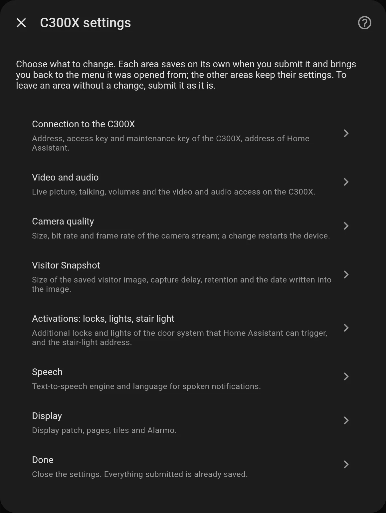

# Quick Start

This page takes a rooted or SSH-enabled C300X to a working doorbell card. No
YAML or manual card setup is needed.

```text
Install integration -> add the station -> install the device agent -> choose options
-> check Media readiness -> add the card -> test live video, Home Call and Ring Call
```

## Requirements

- Home Assistant `2026.10.0` or newer.
- A BTicino Classe 300X / C300X on firmware `1.7.x` or `2.0.2`. Firmware
  `3.0.6` is supported experimentally: without the Home Assistant pages on the
  display and with the low-resolution camera stream.
- Root or SSH access on the station for the first agent installation.
- A trusted local network between Home Assistant and the station.

The integration cannot root a stock station. This project provides no firmware
images, firmware extraction output, APKs, exploits, rooting instructions or
vendor files. Rooting is described by the community project
[fquinto/bticinoClasse300x](https://github.com/fquinto/bticinoClasse300x), a
third-party project that is not part of this project and is used at your own
risk; flashing a station can brick it. If a separate rooting or SSH-enablement
workflow asks for a firmware target, use `1.7.19`. A station on `2.0.2` or
`3.0.6` needs a workflow made for that firmware. Everything is used at your own
risk and without warranty.

## Install the Integration

### Marketplace: Home Assistant 2026.11 or Newer

[](https://my.home-assistant.io/redirect/marketplace_repository/?owner=memphi2&repository=ha-bticino-c300x&category=integration)

1. Open the button above, or go to **Settings > Marketplace**.
2. Find **BTicino C300X**, install it and confirm the community-integration
   notice.
3. Follow any restart request.

### HACS: Home Assistant 2026.10

1. Open **HACS** and search for **BTicino C300X**. No custom repository is
   needed; if the search finds nothing, refresh the HACS catalog.
2. Download it and restart Home Assistant.

Both ways install the same release archive. Moving from HACS to Marketplace
keeps existing entries and cards.

### Add the Station

Go to **Settings > Devices & services > Add integration > BTicino C300X** and
fill in:

| Field | Value |
| --- | --- |
| **Address of the C300X** | IP address or host name of the station. With an IPv4 address, Home Assistant follows the station to a new address on its own ([Station Changed Its Address](media-troubleshooting.md#station-changed-its-address)). |
| **Port** | `8091`, unless you changed it during installation. |
| **Address of Home Assistant for the C300X** | Leave empty. The station then reports rings and events to the address Home Assistant knows for itself. See [Callback URL](advanced-maintenance.md#callback-url) if events do not arrive. |

## Install the Device Agent

The device agent is a small program on the station that Home Assistant talks
to. What happens next depends on what Home Assistant finds:

- **No agent:** setup offers **Install native agent on the C300X**. Use it only
  on a rooted or SSH-enabled station. Home Assistant logs in over SSH with the
  station's factory root login and asks for an SSH user and password only if
  the station refuses it. It installs the agent, a configuration with generated
  keys, the startup script and the display support files, then keeps the keys
  itself. SSH credentials are used for this step only and are not stored in the
  entry, diagnostics or logs.
- **Agent already installed:** setup asks for its **Access key** and
  **Maintenance key**. See [Tokens and Access](advanced-maintenance.md#tokens-and-access).
- **Older agent:** run the **C300X device agent update required** Repair before
  testing camera or calls.

After installation, apply the **core media hook** when Repairs asks for it,
then reload the station display with the **Reload device display** button. The
hook lets Home Assistant see when the station display closes a media session
and keeps ringer mute in sync. It is separate from the optional display pages.

## Choose Options

Setup then walks through the settings areas one after the other. Later,
**Configure** opens the same areas from a menu. Good choices for a first test:

<table>
  <tr>
    <td align="center" valign="top"><strong>Settings menu</strong><br></td>
    <td align="center" valign="top"><strong>Video and audio</strong><br></td>
  </tr>
</table>

| Setting | First-test choice |
| --- | --- |
| **Door station video and audio** | On, for camera, Ring Call, Home Call and talkback. |
| **Set up video and audio access on the C300X** | On. Video and audio need their own access on the station. |
| **Live audio level (dB)** | `0 dB` (unchanged sound). |
| **Volume of ring recordings (dB)** | The default `6 dB`, unless you already use Ring capture. |
| **Connection paths for the live picture** | **IPv4 and local IPv6 (ULA) - recommended** (the default). |
| **Talk through the Home Assistant camera view** | Off. Talkback in the card does not need it. |
| **Visitor Snapshot** (only with video on) | The defaults: 800x480, 3 seconds, 14 days, date and time in the image. |
| **Additional device activations** | Empty, unless you already know the activation addresses you want as buttons. |
| **Alarm (Alarmo)** | Empty, unless you want the Alarmo page on the station display. |
| **Home Assistant pages on the display** | Off for now. Set them up later with [Station Display Pages](display.md). |

Change **Connection paths for the live picture** only when the live picture
does not connect. [All four choices and their exceptions](media-troubleshooting.md#connection-paths-for-the-live-picture)
are explained there. This field does not configure station callbacks or a
firewall.

Every choice can be changed later under **Configure** on the integration.
Leave the maintenance controls on the device page (SSH, noAuth, firewall
patches, reboot, agent removal) alone until you need them.

## Add the Card

### Check Media Readiness First

Open the **Media readiness** sensor on the device page:

| State | Next step |
| --- | --- |
| `ready` | Add the card. |
| `warning` | Basic media can work. With **Forwarding** on **Smartphone** it warns that Ring Calls cannot be answered in Home Assistant; live video and Home Call are not affected. |
| `blocked` or `unavailable` | Open the Repair issue and run the suggested fix. |

Do not debug the card while readiness shows a failure you do not understand.
Details: [Media Readiness](media-troubleshooting.md#media-readiness).

### Add It to a Dashboard

1. Open the dashboard where the card should go and add a card.
2. Select **C300X Doorbell Call Card**.
3. Choose the C300X camera entity.

Keep the mode **Doorstation + Home Call** (`mode: auto`): one card handles
rings, live video and Home Call. Separate Doorbell or Home Call modes are only
for hand-built special dashboards. The card shows the readiness line by
default; turn it off in the card editor if you want a cleaner dashboard.

## First Media Tests

Test in this order:

1. **Live video:** press **Stream** in the card.
2. **Home Call:** start and stop a Home Call from the card.
3. **Ring Call:** set **Forwarding** to **Home Assistant**, ring the doorbell,
   then press **Answer** in the card.

Talkback needs a secure Home Assistant frontend: HTTPS, Home Assistant Cloud or
another secure browser context with microphone permission. If a test fails, see
[Troubleshooting](media-troubleshooting.md).

### Visitor Images

With video on, **Save images** on the device page is on by default. Every ring
or video session saves one image after 3 seconds, even with every dashboard
closed. Browse the images under **Media > BTicino C300X Media** or with the
arrows in the card. They are stored in Home Assistant's media directory and
follow its media permissions. Turn **Save images** off to stop new images;
existing ones stay until they expire. See
[Visitor images](user-guide.md#visitor-images-and-media-history).

## Update

1. Install the update offered by Marketplace or HACS and follow any restart
   request.
2. Run the device-agent update Repair when it is offered. It uses the saved
   maintenance key; SSH is only needed for the first installation or recovery.
   It also refreshes an active Display patch or firewall patch when their
   packaged files changed.
3. Apply the core media hook when Repairs asks for it, then reload the station
   display. Updating only the integration does not change the station.
4. Run the C300X Lovelace card Repair if it is offered. It refreshes the
   generated C300X view. Hard-reload the browser or clear the frontend cache if
   the card still looks old.
5. Check **Media readiness** before testing video and calls.

Keep the existing integration entry. The release archive contains the agent,
its display files and the card; no separate card repository is needed.

## Next Steps

- [Using the Integration](user-guide.md): camera quality and picture size,
  clearer sound with **Audio codec** on **PCMU** (the station restarts once;
  firmware 3.0.6 already uses it), clips, announcements, notifications and
  [blueprints](user-guide.md#blueprints).
- [Station Display Pages](display.md): Home Assistant pages, tiles and
  notifications on the station display.
- [Reference](feature-reference.md): every option, entity, service and event.
- [Troubleshooting](media-troubleshooting.md): when something fails.
- [Maintenance and Removal](advanced-maintenance.md): agent, tokens, callback
  URL and recovery. To remove the integration, follow
  [Remove Home Assistant Integration](advanced-maintenance.md#remove-home-assistant-integration);
  removing the device agent is a separate, explicit step.
