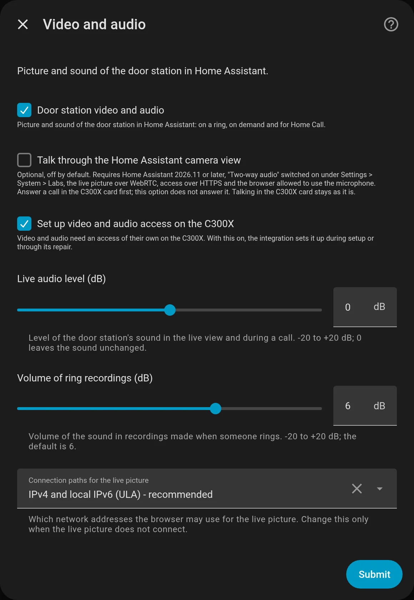

# Quick Start

This page takes a rooted or SSH-enabled Classe 300X (C300X) or Classe 100X
(C100X) to a working doorbell card. No YAML or manual card setup is needed.
Where the two models differ, the step says so; the full list is in
[Models and Features](feature-reference.md#models-and-features).

```text
Install integration -> add the station -> install the device agent -> choose options
-> check Media readiness -> add the card -> test live video, Home Call and Ring Call
```

## Requirements

- Home Assistant `2026.10.0` or newer.
- A BTicino Classe 300X / C300X on firmware `1.7.x`, `2.0.2` or `3.0.6`
  ([Firmware 3.0.6](#firmware-306)).
- Or a BTicino Classe 100X / C100X on firmware `1.5.8`, **in test** in
  [issue #51](https://github.com/memphi2/ha-bticino-c300x/issues/51): stock
  firmware with only the changes needed for root or SSH access, set up in the
  BTicino Door Entry app, not running alongside BTicino Companion.
- Root or SSH access on the station for the first agent installation.
- A trusted local network between Home Assistant and the station.

The integration cannot root a stock station. This project provides no firmware
images, firmware extraction output, APKs, exploits, rooting instructions or
vendor files. SSH can be enabled with the third-party projects
[fquinto/bticinoClasse300x](https://github.com/fquinto/bticinoClasse300x)
(C300X `1.7.x`), [davemajor/c300x-root](https://github.com/davemajor/c300x-root)
(C300X `2.0.2` and `3.0.6`) and
[daniel-sc/bticino-c100x-firmware-tools](https://github.com/daniel-sc/bticino-c100x-firmware-tools)
(C100X `1.5.8`), at your own risk and without warranty; flashing can brick the
station. The integration assumes a clean firmware: enable only SSH, no camera,
MQTT or other extras.

### Firmware 3.0.6

Everything works as on `1.7.x` and `2.0.2`, with these differences:

- **Camera:** the station sends only its low-resolution stream, with other
  sizes, bit rates and frame rates; there is no **Camera resolution** select
  and no 960x576 ([Stream Settings](user-guide.md#stream-settings)).
- **Picture controls:** until the station has written the contrast once after
  a start, they may only work during a Ring Call
  ([Picture Controls](user-guide.md#picture-controls)).
- **Sound:** the station already uses PCMU from the factory, so **Audio codec**
  needs no change.
- **Display pages:** the same pages and buttons, loaded into the station's
  display program at its start; the fix for lost taps is not available
  ([Display Patch on Firmware 3.0.6](display.md#display-patch-on-firmware-306)).
- **IPv6 firewall:** the station has no IPv6 firewall, so the switch is not
  offered.

Every release is tested on a station with `1.7.19`. On a `3.0.6` station,
Ring Call, the camera at its factory size, the door and activations were
tested with earlier releases, and the display pages loaded at start with the
Alarm and Home Assistant buttons in place. The other display pages, the other camera sizes,
picture controls, visitor images, Speex and announcements are checked offline
only.

## Install the Integration

### Marketplace: Home Assistant 2026.11 or Newer

[](https://my.home-assistant.io/redirect/marketplace_repository/?owner=memphi2&repository=ha-bticino-c300x&category=integration)

1. Open the button above, or go to **Settings > Marketplace**.
2. Find **BTicino C300X**, install it and confirm the community-integration
   notice.
3. Follow any restart request.

### HACS: Home Assistant 2026.10

1. Open **HACS** and search for **BTicino C300X**. No custom repository is
   needed; if the search finds nothing, refresh the HACS catalog.
2. Download it and restart Home Assistant.

Both ways install the same release archive. Moving from HACS to Marketplace
keeps existing entries and cards.

### Classe 100X: Experimental

The same package serves the C100X as an experiment. Make the private backup the
[Classe 100X notes](c100x-experimental.md#private-backup-before-the-first-installation) describes first.
Setup recognises the station and shows **Classe 100X: experimental support**;
nothing is installed on the station until you tick the box there. A C300X is
never asked. The integration keeps its name **BTicino C300X**.

### Add the Station

Go to **Settings > Devices & services > Add integration > BTicino C300X** and
fill in:

| Field | Value |
| --- | --- |
| **Address of the C300X/C100X** | IP address or host name of the station. With an IPv4 address, Home Assistant follows the station to a new address on its own ([Station Changed Its Address](media-troubleshooting.md#station-changed-its-address)). |
| **Port** | `8091`, unless you changed it during installation. |
| **Address of Home Assistant for the C300X/C100X** | Leave empty. The station then reports rings and events to the address Home Assistant knows for itself. See [Callback URL](advanced-maintenance.md#callback-url) if events do not arrive. |

## Install the Device Agent

The device agent is a small program on the station that Home Assistant talks
to. What happens next depends on what Home Assistant finds:

- **No agent:** setup offers **Install native agent on the C300X/C100X**; the
  model is not known yet. Use it only on a rooted or SSH-enabled station. Home
  Assistant logs in over SSH with the station's factory root login first. While
  the model is still unknown it tries the C300X factory login and the C100X one
  only after the station refused the first; a connection failure is not
  retried. If the station refuses the login, setup asks for an SSH user with
  root rights (`root` or `root2`, never `bticino2`) and its password, an
  optional private key, or both. The key is pasted as text (OpenSSH or PEM,
  with its passphrase if it has one): RSA or ECDSA on `1.7.x`, `2.0.2` and the
  C100X `1.5.8`, Ed25519 as well on `3.0.6`. A login you enter always takes
  priority. Before it writes anything it checks for the folder `/home/bticino`
  that every station has; any other host that accepts the login, such as a NAS
  or a Raspberry Pi, is refused and left unchanged. It installs the agent, a
  configuration with generated keys, the startup script and the display support
  files, then keeps the keys itself. SSH credentials and the key are used for
  this installation only and are not stored in the entry, diagnostics or logs.
- **Agent already installed:** setup asks for its **Access key** and
  **Maintenance key**. See [Tokens and Access](advanced-maintenance.md#tokens-and-access).
- **Agent already installed, keys lost** (for example the integration was
  removed and only its entry had the keys): tick **I do not have the keys:
  reinstall the agent** in the same dialog. Setup then runs the SSH install
  step above: it stops the installed agent, writes the bundled agent with newly
  generated keys and starts it again. The old keys stop working. If this
  station already has an entry in Home Assistant, that entry gets the new keys
  and no second entry is created. Display pages, the core media hook and the
  other settings on the station stay; the station is not restarted.
- **Older agent:** run the **C300X device agent update required** Repair before
  testing camera or calls.

After installation, apply the **core media hook** when Repairs asks for it,
then reload the station display with the **Reload device display** button. The
hook lets Home Assistant see when the station display closes a media session
and keeps ringer mute in sync. It is separate from the optional display pages.
A C100X has neither: skip this step. Its ringer mute arrives with the
[display activation](display.md#classe-100x-activation-by-reboot).

## Choose Options

Setup then walks through the settings areas one after the other. Later,
**Configure** opens the same areas from a menu. Good choices for a first test:

<table>
  <tr>
    <td align="center" valign="top"><strong>Settings menu</strong><br></td>
    <td align="center" valign="top"><strong>Video and audio</strong><br></td>
  </tr>
</table>

| Setting | First-test choice |
| --- | --- |
| **Door station video and audio** | On, for camera, Ring Call, Home Call and talkback. |
| **Set up video and audio access on the C300X** | On. Video and audio need their own access on the station. |
| **Door level** | The default `+6 dB`. |
| **Fine adjustment (dB)** | The default `0 dB`. |
| **Connection paths for the live picture** | **IPv4 and local IPv6 (ULA) - recommended** (the default). |
| **Talk through the Home Assistant camera view** | Off. Talkback in the card does not need it. |
| **Visitor Snapshot** (only with video on) | The defaults: 800x480, 3 seconds, 14 days, date and time in the image. |
| **Additional device activations** | Empty, unless you already know the activation addresses you want as buttons. |
| **Alarm (Alarmo)** | Empty, unless you want the Alarmo page on the station display. |
| **Home Assistant pages on the display** | Off for now. Set them up later with [Station Display Pages](display.md). A C100X shows this field only after the [display activation](display.md#classe-100x-activation-by-reboot). |

Change **Connection paths for the live picture** only when the live picture
does not connect. [All four choices and their exceptions](media-troubleshooting.md#connection-paths-for-the-live-picture)
are explained there. This field does not configure station callbacks or a
firewall.

Every choice can be changed later under **Configure** on the integration.
Leave the maintenance controls on the device page (SSH, noAuth, firewall
patches, reboot, agent removal) alone until you need them.

## Add the Card

### Check Media Readiness First

Open the **Media readiness** sensor on the device page:

| State | Next step |
| --- | --- |
| `ready` | Add the card. |
| `warning` | Basic media can work. With **Forwarding** on **Smartphone** it warns that Ring Calls cannot be answered in Home Assistant; live video and Home Call are not affected. |
| `blocked` or `unavailable` | Open the Repair issue and run the suggested fix. |

Do not debug the card while readiness shows a failure you do not understand.
Details: [Media Readiness](media-troubleshooting.md#media-readiness).

### Add It to a Dashboard

1. Open the dashboard where the card should go and add a card.
2. Select **BTicino Doorbell Call Card**.
3. Choose the C300X camera entity.

Keep the mode **Doorstation + Home Call** (`mode: auto`): one card handles
rings, live video and Home Call. Separate Doorbell or Home Call modes are only
for hand-built special dashboards. The card shows the readiness line by
default; turn it off in the card editor if you want a cleaner dashboard.

## First Media Tests

Test in this order. On a C100X, first press **Stair light** and **Door unlock**
once each on the device page and follow the
[test plan](c100x-experimental.md#test-plan); report the results
in issue #51.

1. **Live video:** press **Stream** in the card.
2. **Home Call:** start and stop a Home Call from the card.
3. **Ring Call:** set **Forwarding** to **Home Assistant**, ring the doorbell,
   then press **Answer** in the card.

Talkback needs a secure Home Assistant frontend: HTTPS, Home Assistant Cloud or
another secure browser context with microphone permission. If a test fails, see
[Troubleshooting](media-troubleshooting.md).

### Visitor Images

With video on, **Save images** on the device page is on by default. Every ring
or video session saves one image after 3 seconds, even with every dashboard
closed. Browse the images under **Media > BTicino C300X Media** or with the
arrows in the card. They are stored in Home Assistant's media directory and
follow its media permissions. Turn **Save images** off to stop new images;
existing ones stay until they expire. See
[Visitor images](user-guide.md#visitor-images-and-media-history).

## Update

1. Install the update offered by Marketplace or HACS and follow any restart
   request.
2. Run the device-agent update Repair when it is offered. It uses the saved
   maintenance key; SSH is only needed for the first installation or recovery.
   It also refreshes an active Display patch or firewall patch when their
   packaged files changed.
3. Apply the core media hook when Repairs asks for it, then reload the station
   display. Updating only the integration does not change the station.
4. Run the C300X Lovelace card Repair if it is offered. It refreshes the
   generated C300X view. Hard-reload the browser or clear the frontend cache if
   the card still looks old.
5. Check **Media readiness** before testing video and calls.

Keep the existing integration entry. The release archive contains the agent,
its display files and the card; no separate card repository is needed.

A C100X is updated the same way. Do not go back to a release from before the
joint package on a C100X: the C100X agent's own updater refuses such a package,
and a refused upload can leave staging files, but the SSH installer of an older
release does not check the model and must not be used on a C100X.

### Beta Versions

Betas use versions such as `2.9.0b1`; release candidates use `2.9.0rc1`. A
beta uses the same integration, card and packaged agent as a stable release,
with no separate repository or second integration entry.

To install a published beta:

1. Back up Home Assistant and read the beta's release notes.
2. In Marketplace, enable this repository's **Pre-release** switch. In HACS,
   open **Redownload**, enable beta versions and select the beta.
3. Follow the normal [update steps](#update), including the agent update
   Repair. Installing the integration alone does not update the agent.

Stable installations do not receive betas automatically. To leave the beta,
disable pre-releases and select the stable release, or wait for the next one,
then run the agent update Repair again. A Home Assistant backup does not
restore the agent on the device.

On firmware `3.0.6`, before going back to a release older than 2.10.0,
remove the display pages completely as described in
[Display Patch on Firmware 3.0.6](display.md#display-patch-on-firmware-306);
older releases cannot remove them.

`3.0.0b2` is the beta of the joint package for the Classe 300X and the Classe
100X. On a Classe 300X it works like stable 2.10.0. The Classe 100X support is
experimental and checked offline only; no stable release supports a Classe
100X, see [Classe 100X](c100x-experimental.md).

## Next Steps

- [Using the Integration](user-guide.md): camera quality and picture size,
  clearer sound with **Audio codec** on **PCMU** (the station restarts once),
  clips, announcements, notifications and
  [blueprints](user-guide.md#blueprints).
- [Station Display Pages](display.md): Home Assistant pages, tiles and
  notifications on the station display.
- [Reference](feature-reference.md): every option, entity, service and event.
- [Troubleshooting](media-troubleshooting.md): when something fails.
- [Maintenance and Removal](advanced-maintenance.md): agent, tokens, callback
  URL and recovery. To remove the integration, follow
  [Remove Home Assistant Integration](advanced-maintenance.md#remove-home-assistant-integration);
  removing the device agent is a separate, explicit step.
