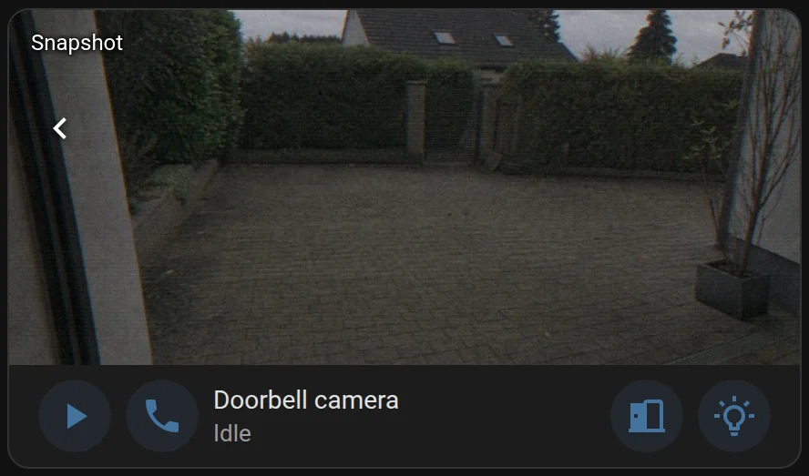
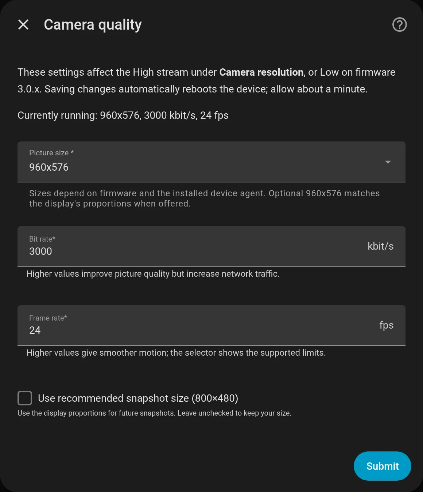
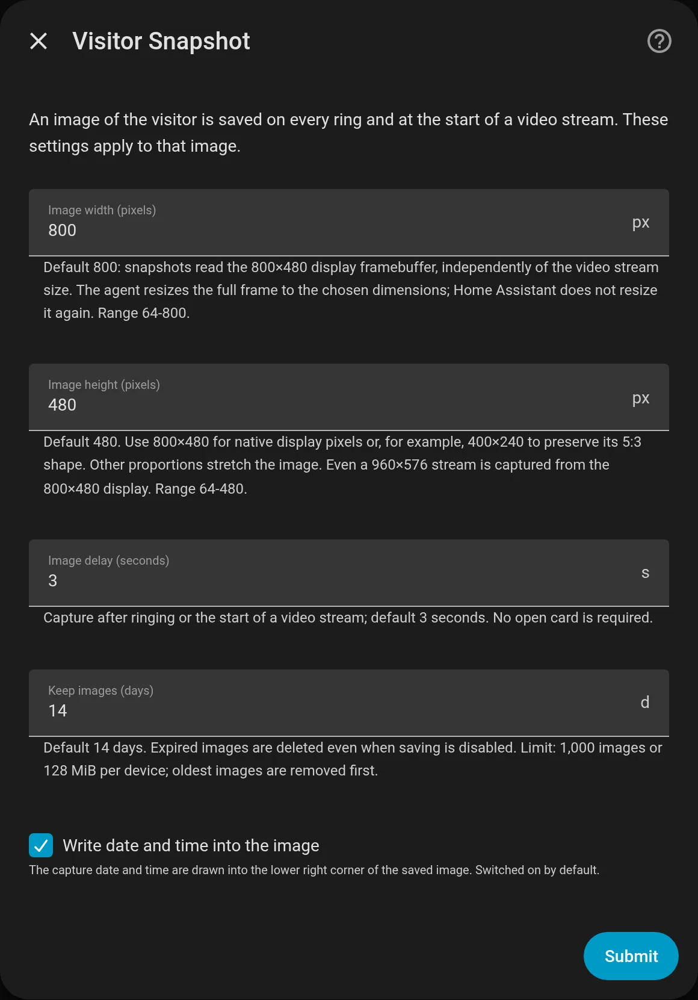

# Using the Integration

This page covers daily use once the integration and the device agent are set up
(see [Quick Start](quickstart.md)). Option, entity, service and event tables are
in the [Reference](feature-reference.md); the station display pages are in
[Station Display Pages](display.md). When something does not work, start with
[Media Readiness](media-troubleshooting.md#media-readiness).

## Doorbell Card

The **C300X Doorbell Call Card** shows live video, Ring Calls, Home Calls, saved
images and clips in one window. [Add the card](quickstart.md#add-the-card) and
select the C300X camera entity.



| Mode | YAML | Use |
| --- | --- | --- |
| Doorstation + Home Call (default) | `mode: auto` | One card for live view, Ring Calls and Home Calls. Use this normally. |
| Doorbell / On-demand | `mode: doorbell_call` | Hand-built dashboards that want a separate doorbell card. |
| Home Call | `mode: home_call` | A separate audio-only Home Call card. It shows no media history. |

Card options (editor or YAML) change only that card; entities, services and
stored files stay as they are:

| Option | Default | Effect |
| --- | --- | --- |
| Show media readiness line (`show_media_readiness`) | On | Media Readiness status line. |
| Show Open door button (`show_door_unlock`) | On | Door button at the bottom right. |
| Show staircase light button (`show_stair_light`) | On | Light button at the bottom right. |
| Browse saved images and videos (`show_media_history`) | On | Arrows on the picture for [saved media](#browsing-in-the-card). |
| Show picture controls for supported live video (`show_picture_controls`) | On | [Picture controls](#picture-controls). |
| Home Call ringback tone and volume (`ringback_tone`, `ringback_volume`) | On, 12 % | Local tone on the card that started a Home Call. Not in Doorbell / On-demand mode. |

The door and light buttons press the default door-unlock and staircase-light
entities of the same C300X without starting or stopping video; a missing or
unavailable entity disables its button. All entities come from the camera's
device. If that camera is removed, the card does not switch to another C300X
but reports the unresolved assignment.

Click the picture to open a large window with the same controls and full
screen; close it with the close button, Escape or a click beside it, and a
running stream or call continues. In HA's Sections layout the doorstation card
needs at least six rows, the Home Call card two.

## Live Picture and Talkback

| Path | Start | Needs |
| --- | --- | --- |
| On-demand video | **Stream** in the card, or `bticino_c300x.activate_doorbell_video` | Video enabled. Forwarding does not matter. |
| Ring Call | Someone rings; **Answer** in the card | **Forwarding** set to **Home Assistant**. |
| Home Call | **Call Home** in the card, or `bticino_c300x.start_home_call` | Audio only, rings the station display. |

Stop with the card, the **Stop doorbell video** button,
`bticino_c300x.stop_doorbell_video` or `bticino_c300x.stop_home_call`. Media
runs locally through Home Assistant's WebRTC provider (go2rtc).

### Ring Calls and Forwarding

The **Forwarding** select decides where a Ring Call goes:

| Choice | Option value | Result |
| --- | --- | --- |
| Smartphone | `enabled` | Ring Calls take the phone route; HA cannot answer them. |
| Home Assistant | `homeassistant` | The card shows the preview with **Answer** and **Hang Up**. |
| Blocked | `blocked` | HA still receives the ring event but cannot answer. |

Automations use the option values and can answer with
`bticino_c300x.answer_doorbell_call` or end the call with
`bticino_c300x.hangup_doorbell_call`. Several browsers can show the ring
preview; after the call is answered, only the answering browser shows the call
controls. Media Readiness reports another forwarding choice as a warning; a
Repair never changes it.

**Ringer mute** and **Ringer volume** (C300X scale `0..10`, `0` is mute) set
the ringtone. Mute stays in step with the display's own audio setting through
the agent's core GUI hook (see [Device Agent](advanced-maintenance.md#device-agent)),
without the optional display pages.

### Talkback

The card opens the browser microphone when you answer a Ring Call, start a
stream or start a Home Call; its microphone button mutes and unmutes it. The
browser must allow the microphone, which needs a secure Home Assistant
frontend: HTTPS, Home Assistant Cloud or another secure URL. Plain HTTP is not a
reliable microphone path; without a microphone the card only listens. A phone
notification action cannot grant microphone access, so talk from the opened
card. The secure frontend does not affect the station's
[Callback URL](advanced-maintenance.md#callback-url).

Talking through the **native HA camera view** is separate and off by default:
turn on **Talk through the Home Assistant camera view** under **Configure >
Video and audio**. It needs Home Assistant 2026.11 or newer, **Settings >
System > Labs > Two-way audio**, WebRTC, HTTPS and microphone permission. It
works for on-demand video and already answered Ring Calls; it never answers a
call, so answer in the card first. Card talkback is not affected.

If the picture does not connect on a network with several VLANs or IPv6,
see [Connection Paths for the Live Picture](media-troubleshooting.md#connection-paths-for-the-live-picture).

## Camera Quality and Picture Size

### Picture Controls

The card's sliders icon reads and changes **brightness**, **contrast** and
**colour saturation** of the live picture in 10 % steps; releasing a slider
changes that one setting. These are station settings, not browser filters, so
saved recordings and snapshots are never recoloured.

While the sliders panel is open, the card hides the play, mute and volume
controls under it; they return when the panel closes.

- **Ring Call:** uses the stock controls of the video call. Opening the sliders
  does not answer.
- **On-demand video:** start live video first; the sliders icon appears about
  two seconds later. On firmware 1.7.19, 2.0.2 (either video decoder) and
  3.0.6 (TVP5150 boards only) the agent checks during the session whether the
  video source offers all three settings. A slider move writes only that
  setting and succeeds only after reading the exact value back; otherwise the
  old value is put back. On a TVP5150 board contrast reads back from the
  driver's own copy, so a contrast write the decoder missed goes unnoticed.
  That copy reads 0 after a station start until the station itself writes
  the contrast once; until then the sliders icon does not appear for
  on-demand video, and the controls may only work during a Ring Call
  (through the display). Every 3.0.6 station has a TVP5150. Tested on
  1.7.19; 2.0.2 and 3.0.6 are checked offline only. Changes last until the
  video ends; the station starts each video with its own values.

Automations use `bticino_c300x.camera_picture` in an active session: omit
`control` and `value` to read, or send both (for example `control: contrast`,
`value: 60`). The response holds `brightness`, `contrast` and `saturation`.
Add `entry_id` with more than one station.

### Stream Settings

**Configure > Camera quality** sets picture size, bit rate and frame rate of the
station's video stream. The settings are stored on the station, not in Home
Assistant, and the form shows the saved values and the ones the device
currently runs with. **Saving reboots the station** (allow about a minute);
choose a time without a call or recording, then open a new stream.



| Firmware | Stream | Sizes | Bit rate | Frame rate |
| --- | --- | --- | --- | --- |
| 1.7.x, 2.0.2 | High | 688x480 (factory cut-out), 704x576 (full height), optional 960x576 | 300-3000 kbit/s (factory 800) | 5-24 fps (factory 15) |
| 3.0.6 | Low | 320x240 to 720x576, including the 5:3 sizes 480x288, 640x384 and 720x432 (factory 400x288) | 100-2000 kbit/s (factory 180) | 5-25 fps (factory 10) |

On 3.0.6 only the factory size is tested on a device. The beta adds the compact
**320x240 (4:3)** and **480x288 / 640x384 / 720x432 (5:3)** Low sizes. The 5:3
choices match the display's ratio, not its pixel count, and do not change its
picture. Only the station's Low configuration changes; no program is patched.
The original 3.0.6 code was checked offline, but other sizes than the factory
one, their framing and performance are **not tested on a device**; keep the
factory size unless you deliberately test another one
([offline evidence and limits](dev/firmware-3.0.6-camera.md)). High video stops at
**24 fps**: at 25 the older firmware turns its frame-rate control off and sends
only about 8 fps. A higher bit rate reduces compression artifacts; lower it
again if your network shows stalls or grey blocks.

The **Camera resolution** select picks the high (688x480 from the factory,
default) or low (400x288) stream from the next stream on. Firmware 3.0.x always
uses the low stream and has no such select.

### 960x576

The camera delivers 720x576; 704x576 keeps all 576 lines. The optional
**960x576** scales that picture before the station's encoder to the **5:3**
shape of the 800x480 display, without transcoding and without real 960-pixel
detail.

- Offered only for the exact, verified media program of firmware **1.7.19** or
  **2.0.2**; the version number alone is not enough. The live picture is tested
  on 1.7.19; 2.0.2 is checked offline only. Firmware 3.0.x is not changed.
- Applying it patches the media program after keeping a verified backup of the
  original on the station; choosing 688x480 or 704x576 restores the original.
  A missing or invalid backup blocks restoring: do not delete recovery backups
  or force the option onto an unrecognised program.
- Answering-machine recordings at 960x576 are not verified.

### Snapshot Size

Snapshots read the 800x480 display, not the stream, so 960x576 does not make
them larger. When you change the stream size, tick **Use recommended snapshot
size (800×480)** to keep the display proportions for future snapshots, or
leave it unticked to keep your size. See [Automatic Images](#automatic-images).

## Codec and Audio Levels

### Audio Codec

For clearer sound, set the **Audio codec** select to **PCMU**. The browser plays
PCMU as it is, so the agent no longer converts the sound between Speex and
PCMU; that gives clearer audio and leaves the device more room. Switching
restarts the C300X once. It writes the same codec settings that BTicino ships
on firmware 3.0.6, which already runs PCMU from the factory (1.7.19 and 2.0.2
ship with Speex).

### Audio Levels

Under **Configure > Video and audio**:

| Option | Default | Affects |
| --- | --- | --- |
| **Live audio level (dB)** | `0 dB` | Sound of the door station in on-demand video and Ring Calls. At `0 dB` the sound is left unchanged. |
| **Volume of ring recordings (dB)** | `6 dB` | Audio in Ring Capture MP4 files. At `0 dB` neither the gain nor its limiter is applied. The 16 kHz WAV for transcription is not affected. |

Both accept `-20` to `+20 dB`. Home Call has its own audio path; do not tune it
with these options. The station loudspeaker's volume for announcements is the
volume of the [Speaker](#speaker-announcements-and-tts) media player.

## Visitor Images and Media History

### Automatic Images

The device switch **Save images** (on by default) saves one image on every ring
and every video stream started through HA, also with every dashboard closed.
The agent reads the station's 800x480 display picture; HA encodes and stores
the JPEG, and no image files are written to the C300X.

**Configure > Visitor Snapshot** (offered while video is on):

| Setting | Default | Notes |
| --- | --- | --- |
| Image width and height | 800x480 | The display's own pixels and 5:3 shape. Width 64-800, height 64-480. For a smaller image with the same shape use 400x240; other shapes stretch the image. |
| Image delay | 3 seconds | Counted from the ring or stream start. A call or stream that ends earlier may give no image. |
| Keep images | 14 days | Expired images are deleted, also with **Save images** off. |
| Write date and time into the image | On | Drawn in the lower right corner. The card adds no second stamp. |



The agent resizes the full frame without cropping; HA does not resize it again.
A saved size such as 688x480 stays as it is; select 800x480 for the display
proportions in future images. Existing images are never resized.

Images are kept per device in `c300x/snapshots/<device-directory>/` under the HA
media root (not `www`) and appear in **Media > BTicino C300X Media**, at most
**1,000 images or 128 MiB per device**, oldest removed first. The latest image
is the preview of the camera entity and the card: a saved image, not live
video, and absent until the first capture.

Turning **Save images** off stops new images and hides snapshots in the card,
including the history. Clips and clip automations are not affected; existing
images stay until they expire.

When an image cannot be taken, the last one stays, HA logs a warning once per
cause, and the attribute `last_failure` of **Save images** names the cause
(for example `snapshot_unavailable` when the station's display picture cannot
be read) until the next image succeeds. On firmware 3.0.6 reading the display
picture is checked offline only and may fail.

### Browsing in the Card

With **Browse saved images and videos** on, the arrows on the picture (**Older
media** / **Newer media**) page through snapshots and clips, newest first. A
label shows **Snapshot**, **Recording** or **Live**; **Newer media** on the
newest item leaves the history without starting a stream.

Clips have play/pause, a timeline and volume/mute, with their recording time at
the lower right; playback starts with Play. On iPhone and iPad only mute is
shown, because the system leaves media volume to the hardware keys.

Live video and incoming rings take priority. Browsing never starts, answers or
stops a call, asks for the microphone, takes an image or records a clip.

### Storage and Retention

The history only links media that already exists in HA:

| Media | Default location |
| --- | --- |
| Snapshots | `<HA media root>/c300x/snapshots/<device-directory>/` |
| Capture MP4s | `<HA media root>/c300x/`, normally `/media/c300x/` |
| Capture WAV/JPEG/metadata | `/config/c300x/captures/<capture_id>/` |

New successful captures join the history of the C300X that made them when the
service's `output_path` is left unset, even while the history is hidden. Custom
output paths, older MP4s and clips over **64 MiB** are not included. The
history follows **Keep images** (14 days) and holds at most **1,000 items per
device**. An expired history entry leaves its MP4 in place: manage MP4 storage
yourself.

The card history needs camera read permission, but HA's media browser and clip
and message playback follow other rules; read
[Stored Media Access](../SECURITY.md#stored-media-access) before giving others
HA access.

### Answering Machine and Memos

The station's own answering-machine videos, voice memos and text memos stay on
the C300X and are not part of the card history. Use the **Answering machine**
switch, the message and memo sensors and the `play_latest_video_message`,
`play_latest_voice_memo`, `write_text_memo` and `delete_latest_*` actions;
deleting needs the Display patch. See [Services](feature-reference.md#services).

## Recording Clips and Capture Modes

The card does not record. Clips come from `bticino_c300x.capture_doorbell_call`,
usually through the **C300X Ring capture** blueprint.

### Record on Every Ring

1. Check Media Readiness and set **Forwarding** to **Home Assistant**.
2. Open **Settings > Automations & scenes > Blueprints**, choose **C300X Ring
   capture** (`bticino_c300x/ring_capture.yaml`) and create an automation.
3. Select the C300X device. The blueprint finds its readiness sensor, matches
   ring events to that device and runs only while readiness is `ready` or
   `warning`.
4. Choose the duration (**5 seconds** by default, **1-15** allowed) and whether
   to include audio. **Include audio is on by default and answers the Ring Call
   before recording.** Turn it off for video only without answering.
5. Leave the capture file directory at `/config/c300x` unless you need another
   place for the WAV/JPEG/metadata workspace; it is not the MP4 path.

### Capture Modes

| `capture_mode` | Starts from | Call handling |
| --- | --- | --- |
| `ring` (default) | An active Ring Call | With audio or `announcement_path`, the call is answered first and may be hung up during cleanup. |
| `on_demand` | Idle media, no ring | Starts a live view and records video with optional audio. Never answers or hangs up a call. |

```yaml
- action: bticino_c300x.capture_doorbell_call
  data:
    entry_id: YOUR_C300X_ENTRY_ID
    capture_mode: on_demand
    duration_seconds: 5
    include_audio: true
  response_variable: capture
```

Set `include_audio: false` for video only. Both modes record 1-15 seconds, and
a second capture on the same device is rejected while one runs.

- `ring` never takes over an answered call. Audio capture or an announcement is
  refused while a client watches the ring preview, so the call keeps ringing
  instead of being answered and dropped; video only can share the preview.
  Hang-up is skipped when the captured call cannot be identified reliably.
- `on_demand` needs idle media with no other camera client; close your live
  view first. A call that starts while the recording connects can make it fail
  or record ring video. `announcement_path` is rejected.
- Unloading the integration or a replacement call cancels a capture.

### Files and Response

MP4 files go to `/media/c300x/`; WAV audio, three JPEG frames and JSON metadata
go to a workspace per recording in `/config/c300x/captures/<capture_id>/`.
Output paths must stay below `/media/c300x/`, `/config/c300x/` or
`/config/www/c300x/`. The response holds `capture_id`, `entry_id`,
`metadata_path`, `output_path` and, with audio, `raw_wav_path`; use these exact
paths in later steps, for example `{{ capture.output_path }}`. The
`/config/c300x/latest.*` files only point to the newest capture of any device.

At most 64 workspaces are kept per capture folder; those older than one hour
are removed when the next recording starts, and a full limit rejects new
captures instead of deleting recent ones. MP4 files are never removed by this
cleanup.

## Speaker Announcements and TTS

The **Speaker** media player is the station's own loudspeaker. Use it like any
other speaker in Home Assistant:

```yaml
action: tts.speak
target:
  entity_id: tts.piper
data:
  media_player_entity_id: media_player.bticino_c300x_speaker
  message: The washing machine is done.
```

HA creates the speech with the engine you choose and converts it with `ffmpeg`
to the one format the station plays (8000 Hz mono, telephone quality); media
browser sounds play the same way. With a local engine such as Piper nothing
leaves your network.

- The player's **volume** applies to the next sound, on the station's ringing
  volume range.
- One sound plays at a time, up to about 110 seconds; others wait in order.
  **Stop** ends the current one.
- **A door call always wins.** A ring, a call or a camera request ends the sound
  at once.
- No sound starts during a door call, during a ring and up to a minute after
  its last bus message, for a minute after the agent restarted during a sound,
  or while the station plays a message itself; the action then fails and says
  so. It returns once the station has handed over its speaker.
- A touch tone on the display can cut a sound short.

The attribute `last_result` reports the outcome:

| Value | Meaning |
| --- | --- |
| `played`, `stopped` | Finished or stopped with **Stop**. |
| `preempted` | Ended by a door call. |
| `device_busy` | Not started: the station was using its speaker. |
| `not_played` | The agent did not take the sound. |
| `sound_path_failed`, `play_failed` | The station could not switch the speaker on or play. |
| `failed` | Broke off for another reason. |
| `unknown` | The agent could not be asked or restarted during the sound. |

Tested on firmware 1.7.19. On firmware 2.0.2 and 3.0.6 the agent uses each
station's own sound files, such as its speaker setup for playing messages; that
file differs between firmware versions. Playing is not yet tested on such a
device.

## Notifications

For phone alerts on a ring, use the [Blueprints](#blueprints). For notices on
the station, each entry registers a standard Notify action while **Home
Assistant pages on the display** is on (see
[Enable the Display Pages](display.md#enable-the-display-pages)). The first entry
uses `notify.bticino_c300x`; an entry named **Front door** gets
`notify.bticino_c300x_front_door`, and a name clash adds a short suffix. Use the
ID shown in HA's action editor; it survives restarts and renames. If HA cannot
read its saved name reservations, it registers no action under another
device's name; fix the HA storage or restore it from a working HA backup.

```yaml
action: notify.bticino_c300x
data:
  title: Front window
  message: The front window is still open.
  data:
    display: true
    notification_id: front_window
    severity: warning
    wake_duration: 30
    sound_duration: 30
    expires_in: 3600
```

The target is fixed to the entry, so do not set `target`; `title` defaults to
**Home Assistant**. Fields in the nested `data`:

| Field | Values |
| --- | --- |
| `display`, `tts`, `led` | Channel switches, `true` or `false`; see below. |
| `severity` | `info` (default), `warning`, `error`. A higher severity can replace a lower one, not the reverse. |
| `wake_duration`, `sound_duration` | 0-300 seconds, default 30; `0` turns the effect off. Only with `display`. |
| `expires_in` | 1 second to 7 days, default one hour. |
| `notification_id` | Optional; lowercase letters, digits, `_`, `-`, up to 64 characters. The same ID replaces a notice. |
| `tts_engine`, `language` | Engine and language for the speech. Only with `tts`. |
| `mode` | Legacy; see below. |

Title and message allow 80 and 500 characters; no URLs, audio files or
executable actions. This is supplementary information, **not a fire alarm or
other life-safety alerting system**.

Each switch turns on one channel; combine them freely, at least one on:

| Switch | Channel |
| --- | --- |
| `display` | Notice with popup, screen wake and tone, for `wake_duration` and `sound_duration`. |
| `tts` | The [Speaker](#speaker-announcements-and-tts) says the message, not the title. |
| `led` | The station's message LED, with an unread notice on the HA page. |

| Switches on | Result |
| --- | --- |
| `display` | Notice, popup, wake, tone. The LED stays off. |
| `tts` | Spoken only; nothing is stored. |
| `led` | Notice and LED; no popup, wake, tone or speech. |
| `display`, `tts` | Notice, popup and wake, spoken; no tone. |
| `display`, `led` | Notice, popup, wake, tone and LED. |
| `tts`, `led` | Notice and LED, spoken; no popup, wake or tone. |
| `display`, `tts`, `led` | Notice, popup and wake, spoken, LED; no tone. |

- **Speech wins over the tone.** With `display` and `tts` there is no tone,
  even when `sound_duration` is set; popup and wake still run. The station has
  one speaker, and the tone would hold it while the message should be spoken.
- A switch left out counts as `false`. All switches `false` is refused.
- Positive `wake_duration` or `sound_duration` without `display`, and
  `tts_engine` or `language` without `tts`, are refused. With only `tts`,
  `severity`, `expires_in` and `notification_id` are refused, because nothing
  is stored.
- `led` needs an agent that reports message LED support; otherwise HA refuses
  the call and nothing is shown or spoken. Success means HA stored the notice,
  not that the LED changed. The LED stays on while any unread HA notice that
  asked for it is live; a replacement without `led` releases it. An unread
  station memo keeps the LED on by itself.

To light the message LED as well, add `led: true`. This needs an agent that
reports message LED support, which depends on the station hardware:

```yaml
action: notify.bticino_c300x
data:
  title: Front window
  message: The front window is still open.
  data:
    display: true
    led: true
```

**Without switches** (and without `mode`) the call works as `mode: display`
always did: notice, popup, wake and tone, and the notice also lights the LED
where the agent supports it.

**Legacy `mode`.** Existing automations keep working; new ones should use the
switches. `mode` cannot be combined with any switch; HA refuses that.

| `mode` | Same as | Difference |
| --- | --- | --- |
| `display` | `display` | The notice also lights the LED where supported, without requiring it. `tts_engine` and `language` are ignored instead of refused. |
| `speech` | `tts` | Durations, `severity`, `expires_in` and `notification_id` are ignored instead of refused. |
| `both` | `display`, `tts` | Lights the LED like `display`. |
| `led` | `led` | None. |

Set engine and language for the speech once under **Configure > Speech** (for
example `tts.piper`); a language is saved the way the engine names it, such as
`de_DE` for `de`. A notification can name its own `tts_engine` and
`language`. Without any engine, HA uses its default, which is the cloud engine
where Home Assistant Cloud is set up. Engine, language and speaker are checked
before anything is shown or stored. Speech can still fail after the notice is
shown, for example when the engine is unreachable or a door call holds the
speaker; the action then fails and says why. `tts.speak` on the speaker works
without the display pages.

Popup, wake and beep run only on the stock Home or HA page while no call is
active or ringing. Alarmo, PIN entry, settings and other protected pages
suppress them: the action succeeds, keeps the notice and logs the suppression;
speech and the LED still follow their switches. Effects stop on a touch,
standby, a call or leaving the page and are never queued. HA keeps notices in
memory and sends each once; without a connected display a call with `display`
fails, with no retry. Success does not
prove the notice was seen or heard, so test on the device before relying on
it. Notices from `bticino_c300x.show_display_notification` are described in
[Display Notifications](display.md#display-notifications).

## Blueprints

The integration ships optional automation blueprints that use the public C300X
services and entities and change no device configuration. On startup, missing
ones are copied to `/config/blueprints/automation/bticino_c300x/` and appear
under **Settings > Automations & scenes > Blueprints**. Unchanged bundled files
are updated, changed ones kept; old bundled files are removed only while they
match a known original. If one is missing, restart Home Assistant once, or use
**Import Blueprint** with
`https://github.com/memphi2/ha-bticino-c300x/blob/main/blueprints/automation/bticino_c300x/<file>`.

| Blueprint | File | Purpose |
| --- | --- | --- |
| C300X Doorbell notification | `doorbell_notification.yaml` | Your own notification action on a ring; does not answer. |
| C300X Ring Call Android phone alert | `doorbell_call_android.yaml` | Rings an Android phone with **Answer**, **Hang Up**, **Open**. |
| C300X Ring Call iOS phone alert | `doorbell_call_ios.yaml` | Rings an iPhone (critical sound) with **Answer**, **Hang Up**, **Open**. |
| C300X Ring capture | `ring_capture.yaml` | [Records a clip on a ring](#record-on-every-ring). |
| C300X Ring capture and Wyoming transcription | `ring_capture_wyoming.yaml` | Records and transcribes with a local Wyoming Whisper service. |
| C300X strict phrase decision | `strict_phrase_decision.yaml` | Checks a transcription for an exact phrase; optional unlock. |
| C300X Calendar display reminder | `calendar_display_reminder.yaml` | Reminder on the station's HA page before a calendar event. |

The device-based blueprints find the camera, forwarding select and Media
Readiness sensor of the selected C300X and match its ring events, so no entry
ID is needed. Phone alerts and captures run only while readiness is `ready` or
`warning`.

### Phone Alerts

Both phone alerts need **Forwarding** set to **Home Assistant** and the Companion
App notify service of the phone, for example `notify.mobile_app_your_phone`.

- **Android:** a high-priority notification. **Answer** calls
  `bticino_c300x.answer_doorbell_call`, swaps the ringing notification for a
  quiet in-call one with **Hang Up**, and opens the dashboard with a temporary
  `c300x_ring_answer` URL marker so the card attaches to the answered call.
  **Open** alone does not answer. Set the ringtone in the Companion App for the
  blueprint's notification channel. Opening uses the `command_webview` command;
  the app may ask once to display over other apps.
- **iOS:** a critical notification. **Answer** opens the dashboard with the same
  marker and calls `bticino_c300x.answer_doorbell_call`.

### Doorbell Notification

This blueprint leaves the action to you (mobile app, persistent notification or
script). The action can use `camera_entity`, `dashboard_path` and `entry_id`:

```yaml
action: notify.mobile_app_your_phone
data:
  title: Doorbell
  message: Someone is at the door.
  data:
    url: "{{ dashboard_path }}"
    clickAction: "{{ dashboard_path }}"
    entity_id: "{{ camera_entity }}"
```

### Capture and Transcription

The Wyoming blueprint always records audio, so it answers the Ring Call. It
stores the capture response as `capture` and passes `capture.metadata_path` and
`capture.raw_wav_path` to `bticino_c300x.run_ring_wyoming_analysis`; that
response (`analysis`) holds `result_path`. With the result path left empty, the
result goes to `analysis/result.json` beside the recording's metadata; a custom
path must not be shared between automations or devices.
`/config/c300x/analysis/result.json` points to the latest result of any device.

### Strict Phrase Decision

Run it after transcription, for example from an `input_button`. It calls
`bticino_c300x.evaluate_ring_analysis`, which unlocks only if the result
belongs to a fresh capture not yet used for an unlock, the phrase matches
exactly and `unlock_on_match` is on (off by default). Set the entry ID for
unlock when more than one C300X is configured; a capture from another entry is
rejected. Each capture is reserved before the unlock is sent, also across HA
restarts within the freshness window, so it is never used twice. After a
failed or cancelled unlock, make a new capture. An unreadable reservation file
blocks unlocking; do not delete it to retry a still-fresh capture.

### Calendar Reminder

Select an HA calendar, the C300X, the lead time (15 minutes by default), the
text and the expiry. It uses a calendar event trigger and does not wake the
display or interrupt calls. For a test, create the event more than 15 minutes
ahead (see the
[Home Assistant calendar documentation](https://www.home-assistant.io/integrations/calendar/#automation)).

## Device Activations

Extra door locks and lights of the door system, for example a second door,
become activations: button entities that also run with
`bticino_c300x.run_device_activation`. Configure them in setup, options or
reconfigure under **Activations: locks, lights, stair light**. Changes are
collected and saved with **Finish and save**; the device is written only when
its activation list differs, never on a plain HA start.

| Field | Rule |
| --- | --- |
| ID | Letters, numbers, `_` and `-`, up to 32 characters, unique. |
| Name | Button name, up to 63 characters. |
| Type | Door lock, Light or Stair light. Activations reported by the agent can also be `scenario` or `generic`. |
| Address | OpenWebNet `where` value, up to 31 characters. |

**Stair light address:**

- **Automatic** uses the activations set up here or reported by the device and
  leaves the built-in stair-light action alone.
- **Manual (P and N)** builds one `stair_light` activation from the P and N
  parts (0-99 each) and reserves that ID, so up to 15 more activations fit.

At most 16 activations are sent to the agent.
